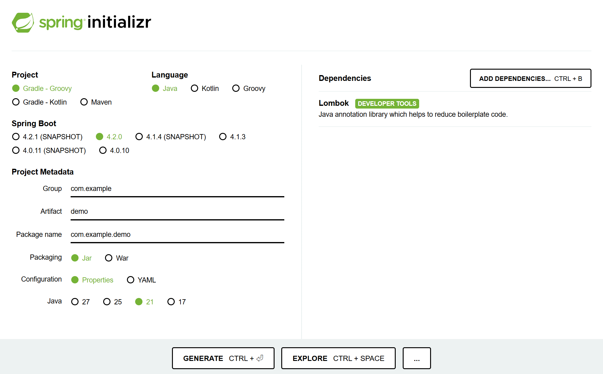

# 1장 스프링 코어

> **본 교재 참고**  
> 1장 「스프링 부트 이해하기」의 1.1 「스프링 부트란 무엇인가?」, 1.2 「스프링 부트의 핵심 개념」; 2장 「스프링 부트 시작하기」의 2.2 「프로젝트를 시작하기 전에 알아 두어야 할 사전 지식」

자바 프로그램은 객체들이 협력하며 동작합니다. 카페는 주문을 받고 커피 머신으로 커피를 만듭니다. 이때 카페가 사용할 머신을 누가 만들고 연결할지에 따라 코드의 구조가 달라집니다. 스프링은 이러한 객체 생성과 연결을 도와주는 프레임워크입니다.

이 장에서는 커피 예제로 스프링 컨테이너, 빈, 의존성 주입을 익힙니다. 이어서 반복되는 자바 코드를 줄이는 롬복과 실행 결과를 관찰하는 로그를 배웁니다.

**학습 목표**

- 스프링이 관리하는 객체와 직접 만든 객체를 구분한다.
- 인터페이스와 생성자 주입으로 객체를 연결한다.
- 롬복으로 객체를 만들고, 로그로 실행 결과를 확인한다.

**준비**: Java 21과 IntelliJ IDEA에서 [spring-core](../spring-core)를 엽니다. DB는 필요하지 않습니다. 이 장의 소스는 `com.example.demo` 패키지에 있습니다.

## 1.1 스프링 부트 프로젝트 이해하기

> **본 교재 참고**  
> 1.1 「스프링 부트란 무엇인가?」, 2.1.6 「스프링 이니셜라이저」

**프로젝트 생성과 의존성 선택**

Spring Initializr에서 다음과 같이 설정하고 Dependencies에 **Lombok**을 추가합니다. Lombok은 생성자·getter 같은 반복 코드를 줄여 줍니다.



프로젝트 생성의 공통 설정과 압축 해제 방법은 [실습 환경과 진행 방법](README.md#실습-환경과-진행-방법)을 참고합니다. 생성한 프로젝트 폴더는 `spring-core`로 준비합니다.

스프링은 애플리케이션을 구성하는 기능을 제공하고, 스프링 부트는 의존성 묶음과 자동 설정으로 프로젝트를 시작하기 쉽게 도와줍니다. 자동 설정은 추가한 라이브러리와 설정을 보고 필요한 객체를 준비하는 기능입니다. 모든 기능을 개발자가 직접 설정할 필요가 줄어듭니다.

`src/main/java`는 실행 코드, `src/main/resources`는 설정과 자원, `src/test/java`는 테스트 코드의 위치입니다. `build.gradle`은 사용할 라이브러리와 자바 버전 등을 정의합니다.

[build.gradle](../spring-core/build.gradle)

```groovy
plugins {
	id 'java'
	id 'org.springframework.boot' version '4.1.2'
	id 'io.spring.dependency-management' version '1.1.7'
}

group = 'com.example'
version = '0.0.1-SNAPSHOT'

java {
	toolchain {
		languageVersion = JavaLanguageVersion.of(21)
	}
}

repositories {
	mavenCentral()
}

dependencies {
	implementation 'org.springframework.boot:spring-boot-starter'
	compileOnly 'org.projectlombok:lombok'
	annotationProcessor 'org.projectlombok:lombok'
	testImplementation 'org.springframework.boot:spring-boot-starter-test'
	testCompileOnly 'org.projectlombok:lombok'
	testRuntimeOnly 'org.junit.platform:junit-platform-launcher'
	testAnnotationProcessor 'org.projectlombok:lombok'
}

tasks.named('test') {
	useJUnitPlatform()
}
```

`implementation`은 실행 코드가 사용하는 라이브러리입니다. 롬복의 `annotationProcessor`는 컴파일 시 애노테이션을 읽어 코드를 생성하도록 연결합니다. IntelliJ에서 Gradle 프로젝트를 불러와 의존성 동기화를 마친 뒤 실습합니다.

## 1.2 객체 생성과 의존성 주입

> **본 교재 참고**  
> 1.2.1 「의존성 주입」, 1.2.2 「제어의 역전」

카페가 머신의 기능을 사용하면 카페가 머신에 의존한다고 말합니다. 의존성 주입은 필요한 객체를 외부에서 전달받는 방식입니다. 스프링 컨테이너는 등록된 객체를 만들고 필요한 곳에 연결합니다. 컨테이너가 관리하는 객체를 빈이라고 합니다.

### 1.2.1 커피 머신의 공통 기능과 구현체

인터페이스에는 무엇을 할 수 있는지 선언합니다. 구현 클래스에는 실제 동작을 작성합니다. 카페는 구체적인 머신 종류보다 커피를 만드는 공통 기능에 의존하도록 구성합니다.

**실습 코드**

[CoffeeMachine.java](../spring-core/src/main/java/com/example/demo/CoffeeMachine.java)

```java
package com.example.demo;

public interface CoffeeMachine {
    String brew();
}
```

[DripCoffeeMachine.java](../spring-core/src/main/java/com/example/demo/DripCoffeeMachine.java)

```java
package com.example.demo;

import org.springframework.context.annotation.Primary;
import org.springframework.stereotype.Component;

@Component
@Primary
public class DripCoffeeMachine implements CoffeeMachine {
    @Override
    public String brew() {
        return "드립 커피";
    }
}
```

[EspressoMachine.java](../spring-core/src/main/java/com/example/demo/EspressoMachine.java)

```java
package com.example.demo;

import org.springframework.stereotype.Component;

@Component
public class EspressoMachine implements CoffeeMachine {
    @Override
    public String brew() {
        return "에스프레소";
    }
}
```

**코드 설명**

- `CoffeeMachine.brew()`는 커피 이름을 문자열로 반환하는 공통 기능입니다.
- 두 구현 클래스의 `@Component`는 스프링이 객체를 찾아 빈으로 등록하게 합니다.
- 같은 인터페이스를 구현한 빈이 둘이므로 `@Primary`가 붙은 드립 머신을 우선 선택합니다. 구현 클래스가 둘이라는 이유만으로 순서에 따라 선택하지는 않습니다.

**실행과 예상 결과**

각 클래스가 같은 패키지에 있는지 확인합니다. 실제 호출은 다음 소절에서 애플리케이션을 실행해 확인합니다.

드립 머신은 `드립 커피`, 에스프레소 머신은 `에스프레소`를 반환하도록 작성되어 있습니다.

**직접 바꿔 보기**

실습을 마친 뒤 `@Primary`를 에스프레소 머신으로 옮기고 앱을 재시작해 선택 결과를 비교합니다. 두 클래스에 동시에 붙이지 않습니다.

### 1.2.2 생성자로 커피 머신 주입받기

클래스 안에서 필요한 객체를 직접 만들면 구현체를 바꾸기 위해 그 클래스를 수정해야 할 수 있습니다. 생성자로 필요한 객체를 받으면 객체를 연결하는 일을 외부에 맡길 수 있습니다. 스프링에서는 이 생성자를 이용해 빈을 주입합니다.

**실습 코드**

[SpringCafe.java](../spring-core/src/main/java/com/example/demo/SpringCafe.java)

```java
package com.example.demo;

import lombok.RequiredArgsConstructor;
import lombok.extern.slf4j.Slf4j;
import org.slf4j.Logger;
import org.slf4j.LoggerFactory;
import org.springframework.stereotype.Component;

@Component
@RequiredArgsConstructor
@Slf4j
public class SpringCafe {

    // private static final Logger log = LoggerFactory.getLogger(SpringCafe.class);

    private final CoffeeMachine coffeeMachine;

    public void makeCoffee() {
        log.debug("커피를 만들고 있습니다.");
        log.trace("사용하는 커피 머신: {}", coffeeMachine.getClass().getSimpleName());
        log.info("{}를 만들었습니다.", coffeeMachine.brew());
    }

    public void orderCoffee(CoffeeOrder order) {
        log.info("주문 정보: {}", order);
    }
}
```

**코드 설명**

`private final CoffeeMachine coffeeMachine`은 카페가 사용할 머신입니다. `@RequiredArgsConstructor`가 이 필드를 받는 생성자를 생성합니다. 생성자가 하나이므로 스프링은 그 생성자로 머신을 전달합니다. `makeCoffee()`는 인터페이스의 `brew()`를 호출합니다. `@Slf4j`가 제공하는 `log`는 1.4절에서 살펴봅니다.

**실행과 예상 결과**

다음 소절의 DemoApplication을 실행합니다. 현재 `@Primary`가 드립 머신에 있다면 카페가 드립 머신을 사용합니다.

핵심 로그는 `드립 커피를 만들었습니다.`입니다. 로그 앞의 시각·스레드·클래스 표시는 환경에 따라 달라집니다.

### 1.2.3 컨테이너에서 객체 가져오고 비교하기

제어의 역전은 객체 생성과 연결의 주도권을 프레임워크에 맡기는 관점입니다. 빈은 기본적으로 한 컨테이너 안에서 하나의 인스턴스로 공유됩니다. 같은 타입을 다시 요청하면 기존 객체를 받을 수 있습니다.

**실습 코드**

[DemoApplication.java](../spring-core/src/main/java/com/example/demo/DemoApplication.java)

```java
package com.example.demo;

import lombok.extern.slf4j.Slf4j;
import org.springframework.boot.SpringApplication;
import org.springframework.boot.autoconfigure.SpringBootApplication;
import org.springframework.context.ConfigurableApplicationContext;

@SpringBootApplication
@Slf4j
public class DemoApplication {

	public static void main(String[] args) {
		ConfigurableApplicationContext context = SpringApplication.run(DemoApplication.class, args);

		SpringCafe cafe = context.getBean(SpringCafe.class);
		cafe.makeCoffee();

		CoffeeOrder order = CoffeeOrder.builder().coffeeName("드립커피").quantity(3).build();
		cafe.orderCoffee(order);

		SpringCafe cafe2 = context.getBean(SpringCafe.class);
		SpringCafe cafe3 = new SpringCafe(new DripCoffeeMachine());

		log.info("cafe == cafe2 : {}", cafe.equals(cafe2)); // true
		log.info("cafe == cafe3 : {}", cafe.equals(cafe3)); // false
	}

}
```

**코드 설명**

1. `SpringApplication.run()`이 앱과 컨테이너를 시작합니다. `@SpringBootApplication`이 있는 패키지와 하위 패키지에서 컴포넌트를 탐색합니다.
2. `getBean(SpringCafe.class)`로 관리 중인 카페를 받습니다.
3. `cafe2`도 같은 컨테이너에서 가져옵니다. `cafe3`은 `new`로 별도로 만듭니다.
4. 코드의 로그 문구에는 `==`가 있지만 실제 비교 메서드는 `equals()`입니다. SpringCafe는 `equals()`를 재정의하지 않아 현재는 객체의 동일성을 비교합니다.

**실행과 예상 결과**

DemoApplication의 main 왼쪽 실행 버튼을 누릅니다. 프로젝트 폴더에서 `./gradlew.bat bootRun`으로 실행할 수도 있습니다.

로그에서 `cafe == cafe2 : true`, `cafe == cafe3 : false`를 확인합니다. 직접 만든 객체도 자바 객체로 동작하지만 컨테이너가 관리하는 빈과는 별개의 객체입니다.

## 1.3 롬복으로 반복 코드 줄이기

> **본 교재 참고**  
> 2.2.1 「롬복」

회원·주문처럼 값을 담는 객체에는 getter, setter, 생성자 등의 반복 코드가 생깁니다. 롬복은 애노테이션을 읽어 필요한 코드를 컴파일 과정에서 생성합니다. 자바 문법 자체가 사라지는 것은 아니므로, 어떤 메서드가 만들어지는지 알고 사용해야 합니다.

### 1.3.1 주문 객체 만들기와 출력하기

빌더는 필드 이름을 지정하며 객체를 만드는 방식입니다. 매개변수가 여러 개인 생성자보다 어떤 값을 넣는지 읽기 쉽습니다. `toString()`은 객체를 로그에 출력할 때 사람이 읽을 문자열을 제공합니다.

**실습 코드**

[CoffeeOrder.java](../spring-core/src/main/java/com/example/demo/CoffeeOrder.java)

```java
package com.example.demo;

import lombok.*;

@Getter
@Setter
@ToString
@Builder
@NoArgsConstructor
@AllArgsConstructor
public class CoffeeOrder {
    private String coffeeName;
    private int quantity;
}
```

[SpringCafe.java — orderCoffee()](../spring-core/src/main/java/com/example/demo/SpringCafe.java)

```java
public void orderCoffee(CoffeeOrder order) {
    log.info("주문 정보: {}", order);
}
```

**코드 설명**

| 애노테이션 | 생성되는 코드 |
|---|---|
| `@Getter`, `@Setter` | 필드를 읽고 바꾸는 메서드 |
| `@NoArgsConstructor` | 매개변수가 없는 생성자 |
| `@AllArgsConstructor` | 모든 필드를 받는 생성자 |
| `@Builder` | 필드를 지정해 객체를 만드는 빌더 |
| `@ToString` | 필드 내용을 포함한 문자열 반환 메서드 |

main의 `CoffeeOrder.builder().coffeeName(...).quantity(3).build()`가 주문을 만듭니다. 마지막 `build()`가 실제 주문 객체를 반환합니다.

**실행과 예상 결과**

main을 실행하고 주문 정보 로그를 확인합니다.

`주문 정보: CoffeeOrder(coffeeName=드립커피, quantity=3)` 형태로 출력됩니다.

**직접 바꿔 보기**

main의 주문 수량을 바꾸고 로그에서 변경된 값을 확인합니다.

## 1.4 설정 파일과 로그

> **본 교재 참고**  
> 2.2.2 「애플리케이션 설정」, 2.2.3 「로그 출력」

로그는 프로그램이 어느 지점까지 실행됐는지, 어떤 값을 처리했는지 기록하는 수단입니다. 실행 결과를 콘솔에 보여 주면서 파일에도 남길 수 있습니다. 로그 레벨을 이용하면 필요한 상세도만 선택할 수 있습니다.

### 1.4.1 로그 레벨과 파일 설정

대표적인 레벨을 상세한 순서로 나열하면 TRACE, DEBUG, INFO, WARN, ERROR입니다. INFO로 설정하면 INFO·WARN·ERROR가 보이며 DEBUG·TRACE는 보이지 않습니다. 특정 패키지에 더 자세한 레벨을 적용할 수 있습니다.

**실습 코드**

[application.properties](../spring-core/src/main/resources/application.properties)

```properties
spring.application.name=demo

# logging level
logging.level.root=info
logging.level.com.example.demo=trace

# logging file
logging.file.name=./log/app.log
logging.logback.rollingpolicy.file-name-pattern=./log/app.backup.%d{yyyy-MM-dd}.%i.gz
logging.logback.rollingpolicy.max-history=7
logging.logback.rollingpolicy.max-file-size=10KB
logging.logback.rollingpolicy.total-size-cap=1GB
```

[SpringCafe.java — makeCoffee()](../spring-core/src/main/java/com/example/demo/SpringCafe.java)

```java
public void makeCoffee() {
    log.debug("커피를 만들고 있습니다.");
    log.trace("사용하는 커피 머신: {}", coffeeMachine.getClass().getSimpleName());
    log.info("{}를 만들었습니다.", coffeeMachine.brew());
}
```

**코드 설명**

`logging.level.root=info`는 전체 기본 레벨입니다. `logging.level.com.example.demo=trace`가 실습 패키지에 적용되어 현재는 TRACE와 DEBUG도 보입니다. 따라서 root만 바꿔도 패키지 설정이 남아 있으면 기대한 대로 줄어들지 않을 수 있습니다.

`logging.file.name`은 현재 작업 디렉터리를 기준으로 로그 파일을 지정합니다. `max-file-size`는 파일 교체 기준, `max-history`는 날짜별 보관 기간, `total-size-cap`은 보관 파일의 총 크기 제한입니다. 파일 교체는 로그 이벤트가 쌓일 때 처리되므로 파일이 없다고 시간 경과만으로 즉시 백업되는 것은 아닙니다.

**실행과 예상 결과**

앱을 실행해 콘솔과 `log/app.log`를 확인합니다. IntelliJ 실행 설정의 작업 디렉터리가 프로젝트 폴더인지 확인합니다.

현재 설정에서는 사용하는 머신의 클래스 이름을 포함한 TRACE 로그도 보입니다. 패키지 레벨을 `info`로 바꾸고 재시작하면 `makeCoffee()`의 INFO만 보입니다.

**직접 바꿔 보기**

실습 후 패키지 레벨을 원래 `trace`로 복구합니다.

## 1.5 학습 확인

- 빈으로 등록한 객체는 누가 생성하는가?
- CoffeeMachine 구현체가 둘일 때 @Primary는 어떤 역할을 하는가?
- final 필드와 @RequiredArgsConstructor가 생성자 주입으로 이어지는 이유는 무엇인가?
- 지금 예제의 equals() 결과와 비교 대상 클래스가 바뀌면 같은 결론을 항상 적용할 수 있는가?
- INFO 설정에서 TRACE가 보일 때 어느 설정부터 확인할 것인가?

[목차](README.md) · [다음: 2장 데이터베이스 연동](02-database.md)
