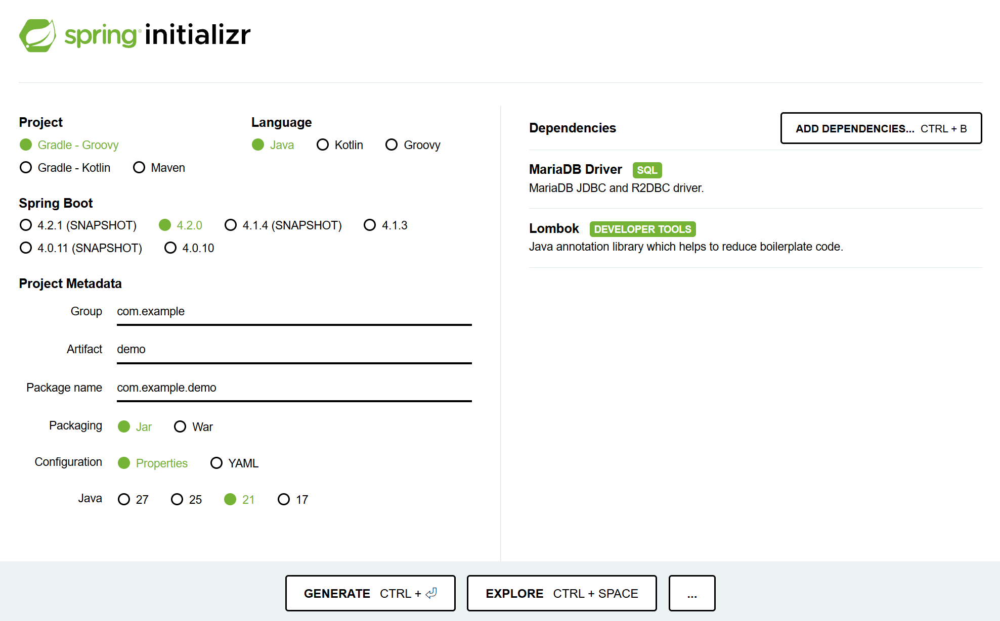

## 2.1 JDBC

> **본 교재 참고**  
> 3장 「데이터베이스 연동하기」의 3.1.1 「데이터베이스 준비」, 3.1.2 「데이터베이스 사용」

JDBC는 자바 프로그램이 DB에 SQL을 보내고 결과를 받기 위한 API입니다. DB마다 내부 통신 방식이 달라도 자바 코드는 Connection, Statement, ResultSet 같은 공통 인터페이스를 사용할 수 있습니다. MariaDB JDBC 드라이버가 실제 DB와 통신합니다.

이번 절에서는 회원 목록과 회원 한 명을 조회합니다. SQL을 실행해 얻은 결과는 처음부터 Member 객체가 아닙니다. JDBC의 조회 결과에서 컬럼 값을 읽고, 자바 객체를 만들어 담는 과정이 필요합니다. 이 과정을 직접 살펴보면 다음 절에서 MyBatis가 맡아 주는 작업을 이해할 수 있습니다.

| 단계 | 사용할 객체·메서드 | 역할 |
|---|---|---|
| DB 연결 | Connection | DB와 통신할 연결을 엽니다. |
| SQL 실행 | Statement, PreparedStatement | SQL을 전달하고 필요한 값을 바인딩합니다. |
| 결과 읽기 | ResultSet | 조회 결과를 한 행씩 읽습니다. |
| 객체로 변환 | Member, List | 읽은 값을 회원 객체와 목록에 담습니다. |

**데이터 상태**: 이 절에서는 조회만 수행하므로 회원 4명과 게시글 100개의 공통 샘플이 그대로 유지됩니다. 같은 DemoApplication을 여러 번 실행해도 데이터가 추가되지 않습니다.

**준비**: 2장 공통 준비를 완료한 뒤 spring-jdbc를 엽니다. 실습 코드는 MemberRepository(`spring-jdbc/src/main/java/com/example/demo/repository/MemberRepository.java`)에 있습니다. 현재 JDBC 프로젝트는 조회 두 가지를 구현합니다.

### 2.1.1 조회 결과를 담을 회원 객체

**프로젝트 생성과 의존성 선택**

Spring Initializr에서 다음 의존성을 선택하고, 생성한 프로젝트 폴더를 `spring-jdbc`로 준비합니다.

| 의존성 | 역할 |
|---|---|
| MariaDB Driver | 자바 프로그램에서 MariaDB에 연결합니다. |
| Lombok | 회원 객체의 getter·setter 등을 간단히 작성합니다. |



DB의 한 행을 자바에서 다루려면 값을 담는 객체가 필요합니다. 이름이 같아도 DB 컬럼과 자바 필드가 자동으로 연결되는 것은 아닙니다. 이 예제에서는 결과를 읽어 각 필드에 직접 넣습니다.

**실습 코드**

[Member.java](../spring-jdbc/src/main/java/com/example/demo/model/Member.java)

```java
package com.example.demo.model;

import lombok.AllArgsConstructor;
import lombok.Builder;
import lombok.Data;
import lombok.NoArgsConstructor;

@Data
@Builder
@AllArgsConstructor
@NoArgsConstructor
public class Member {
    private Long id;
    private String name;
    private String email;
    private Integer age;
}
```

**코드 설명**

`Long`과 `Integer`는 null을 표현할 수 있는 참조 타입입니다. `@Data`는 getter·setter·toString·equals·hashCode 등을 생성하고, `@Builder`는 조회한 값을 필드별로 넣어 객체를 만들게 합니다. ID는 DB에서 회원을 구별하는 값이며 이메일은 중복 불가 조건이 있는 회원 정보입니다.

**실행과 예상 결과**

이 클래스는 데이터 구조입니다. 단독 실행하지 않고 다음 조회 메서드에서 객체를 생성합니다.

조회한 회원을 로그에 출력하면 ID·이름·이메일·나이가 나타납니다.

### 2.1.2 전체 회원 조회

조회 흐름은 연결 열기 → SQL 실행 → 행을 읽으며 객체 생성 → 목록에 추가 → 연결 닫기입니다. ResultSet은 처음에는 첫 행 이전을 가리킵니다. next()가 다음 행으로 이동하며 읽을 행이 있으면 true를 반환합니다.

**실습 코드**

[MemberRepository.java — findAll()](../spring-jdbc/src/main/java/com/example/demo/repository/MemberRepository.java)

```java
public List<Member> findAll() throws SQLException {
    String url = System.getenv("DB_URL");
    String username = System.getenv("DB_USER");
    String password = System.getenv("DB_PASS");

    String sql = "SELECT * FROM member";

    List<Member> members = new ArrayList<>();
    Connection connection = DriverManager.getConnection(url, username, password);
    Statement statement = connection.createStatement();
    ResultSet resultSet = statement.executeQuery(sql);
    // next()는 다음 행으로 이동하며, 읽을 행이 없으면 false를 반환한다.
    while (resultSet.next()) {
        // 조회한 한 행의 값을 Member 객체에 담는다.
        Member member = Member.builder()
                .id(resultSet.getLong("id"))
                .name(resultSet.getString("name"))
                .email(resultSet.getString("email"))
                .age(resultSet.getInt("age"))
                .build();
        members.add(member);
    }
    connection.close();

    return members;
}
```

**코드 설명**

1. `System.getenv()`가 실행 프로세스의 환경변수를 읽습니다.
2. `DriverManager.getConnection()`이 연결을 엽니다.
3. `executeQuery()`는 SELECT 결과를 ResultSet으로 받습니다.
4. `while (resultSet.next())`에서 행마다 별도의 Member를 만들고 List에 추가합니다.
5. `getLong`, `getString`, `getInt`의 인자는 컬럼 이름입니다.
6. 현재 코드는 정상 흐름 끝에서 connection을 닫습니다. 예외 상황까지 자원을 닫는 방식은 이후 개선 주제이며, 이 코드는 조회 흐름을 관찰하는 예제입니다.

**실행과 예상 결과**

DemoApplication을 실행해 `모든 회원` 로그를 확인합니다.

샘플 준비 직후라면 List에 회원 4명이 들어 있습니다. ResultSet에서 회원 한 명을 읽을 때마다 새 Member를 만들고 목록에 추가하므로, DB의 행 네 개가 자바 객체 네 개로 변환됩니다. SQL에 ORDER BY가 없으므로 목록의 표시 순서는 비교 기준으로 삼지 않습니다.

**직접 바꿔 보기**

`SELECT *` 대신 사용할 컬럼을 나열해 보고 결과가 같은지 확인합니다.

### 2.1.3 ID로 회원 한 명 조회

앞 절에서는 입력값이 없는 전체 조회 SQL을 `Statement`로 실행했습니다. 이번에는 조회할 회원 ID를 전달하기 위해, SQL을 미리 지정하고 실행할 때 필요한 값을 전달할 수 있는 `PreparedStatement`를 사용합니다. `Connection`의 `prepareStatement(sql)`을 호출하면 `PreparedStatement` 객체를 얻습니다.

`PreparedStatement`는 같은 형태의 SQL을 값만 바꾸어 여러 번 실행할 때 유용합니다. 서버에서 준비한 SQL을 재사용하면 SQL 분석 등 반복적인 준비 비용을 줄여 성능을 높일 수 있으며, 실제 효과는 데이터베이스와 JDBC 드라이버의 설정 및 재사용 방식에 따라 달라집니다. 이번 예제는 호출할 때마다 연결을 열고 SQL을 한 번 실행한 뒤 연결을 닫으므로, 반복 실행에 따른 성능 향상을 확인하는 예제는 아닙니다.

값이 들어갈 자리는 `?`로 표시하고, `setLong(1, id)`처럼 값을 연결하는데 이를 **파라미터 바인딩**이라고 합니다. 바인딩은 `WHERE`의 비교값뿐 아니라 `INSERT`의 저장값이나 `UPDATE`의 변경값에도 사용할 수 있습니다. SQL과 입력값을 분리하면 문자열 조합 실수를 줄이고, 입력값이 SQL 명령으로 해석되는 SQL 인젝션을 방지하는 데 도움이 됩니다.

> **바인딩할 수 있는 대상**
>
> `?`에는 데이터 값을 바인딩할 수 있지만, 테이블 이름이나 컬럼 이름, `ASC`·`DESC` 같은 SQL 키워드는 바인딩할 수 없습니다. 예를 들어 `ORDER BY ?`에 `setString(1, "name")`으로 값을 전달해도 `name` 컬럼을 기준으로 정렬되지 않습니다. 정렬 기준을 동적으로 지정할 때는 미리 허용한 컬럼 이름과 정렬 방향 중에서 선택하여 SQL을 구성합니다.

**실습 코드**

[MemberRepository.java — findById()](../spring-jdbc/src/main/java/com/example/demo/repository/MemberRepository.java)

```java
public Member findById(Long id) throws SQLException {
    String url = System.getenv("DB_URL");
    String username = System.getenv("DB_USER");
    String password = System.getenv("DB_PASS");

    String sql = "SELECT * FROM member WHERE id = ?";

    Connection connection = DriverManager.getConnection(url, username, password);
    PreparedStatement statement = connection.prepareStatement(sql);
    // 첫 번째 ?에 회원 ID를 넣는다. 번호는 1부터 시작한다.
    statement.setLong(1, id);

    ResultSet resultSet = statement.executeQuery();

    Member member = null;
    if (resultSet.next()) {
        member = Member.builder()
                .id(resultSet.getLong("id"))
                .name(resultSet.getString("name"))
                .email(resultSet.getString("email"))
                .age(resultSet.getInt("age"))
                .build();
    }

    connection.close();
    return member;
}
```

**코드 설명**

`WHERE id = ?`의 첫 번째 ?에는 `setLong(1, id)`로 값을 넣습니다. 매개변수 위치는 1부터 시작합니다. 기본 키 검색은 최대 한 행이므로 while 대신 if로 결과를 읽습니다. 조회 결과가 없으면 이 메서드는 null을 반환합니다. 이후 배우는 JPA의 Optional과 반환 방식이 다릅니다.

**실행과 예상 결과**

main의 단건 조회를 실행합니다. 현재 코드는 ID 1을 사용하므로 실제 DB에서 그 ID가 어느 회원인지 먼저 확인합니다.

빈 테이블에서 샘플을 처음 넣었다면 보통 ID 1은 윤서준입니다. 기존 DB에서 다시 넣었다면 ID가 달라질 수 있으며, 없는 ID를 조회하면 `1번 회원: null`이 출력될 수 있습니다.

**직접 바꿔 보기**

실제 존재하는 다른 ID와 존재하지 않는 ID를 각각 넣어 결과를 비교합니다.

### 2.1.4 Repository를 호출하고 로그 확인

Repository는 데이터 접근 코드를 모으는 역할입니다. 호출하는 쪽은 연결과 ResultSet 처리 과정을 매번 작성하지 않고 메서드로 요청합니다.

**실습 코드**

[DemoApplication.java](../spring-jdbc/src/main/java/com/example/demo/DemoApplication.java)

```java
package com.example.demo;

import com.example.demo.repository.MemberRepository;
import lombok.extern.slf4j.Slf4j;
import org.springframework.boot.SpringApplication;
import org.springframework.boot.autoconfigure.SpringBootApplication;

import java.sql.SQLException;

@SpringBootApplication
@Slf4j
public class DemoApplication {

	public static void main(String[] args) throws SQLException {
		var context = SpringApplication.run(DemoApplication.class, args);
		var repository = context.getBean(MemberRepository.class);

		var members = repository.findAll();
		log.info("모든 회원: {}", members);

		var member = repository.findById(1L);
		log.info("1번 회원: {}", member);
	}

}
```

**코드 설명**

`@Component`로 등록한 MemberRepository를 컨테이너에서 가져와 두 조회 메서드를 호출합니다. Repository 안에서는 DB 연결과 SQL 실행을 처리하고, 호출한 쪽에는 Member나 List를 반환합니다. 이처럼 데이터에 접근하는 코드를 한곳에 모으면 사용하는 쪽에서 JDBC 처리 과정을 반복해서 작성하지 않아도 됩니다. `throws SQLException`은 DB 작업 중 발생한 예외를 호출한 쪽에 전달한다는 선언입니다.

**실행과 예상 결과**

환경변수를 설정하고 DemoApplication을 실행합니다. 연결 오류가 나면 URL·사용자·비밀번호·MariaDB 실행 상태를 먼저 확인합니다.

목록 로그에는 회원 4명이 출력됩니다. 이어지는 단건 로그는 조회한 ID가 실제로 존재할 때 회원 한 명을 출력합니다. ID 1이 윤서준인 DB에서의 예상 출력은 다음과 같습니다.

```text
1번 회원: Member(id=1, name=윤서준, email=SeojunYoon@campus.com, age=10)
```

기존 DB에서 ID 1이 없으면 단건 결과는 null입니다. 이 경우 전체 목록에서 실제 ID를 확인해 조회 조건을 바꾸면 됩니다. 다음 절에서는 SQL 실행과 결과 객체 변환을 MyBatis에 맡겨 같은 데이터를 조회합니다.

### 2.1.5 학습 확인

- Connection, PreparedStatement, ResultSet의 역할을 각각 설명해 봅니다.
- next()를 호출하기 전에 결과의 첫 행을 바로 읽지 않는 이유는 무엇인가요?
- 파라미터의 첫 위치가 0인지 1인지 확인해 봅니다.
- JDBC 조회에서 직접 작성했던 객체 변환을 다음 MyBatis 예제와 비교할 준비를 합니다.
