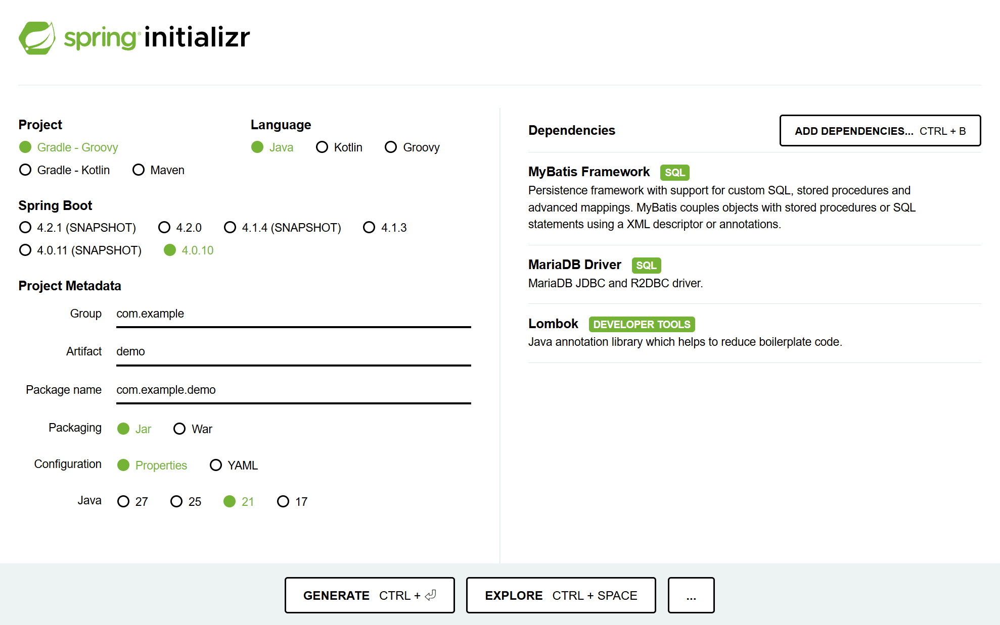

## 2.2 MyBatis

> **본 교재 참고**  
> 3장 「데이터베이스 연동하기」의 3.3 「MyBatis」

MyBatis는 자바 메서드와 SQL을 연결하는 SQL 매핑 프레임워크입니다. 개발자는 SQL을 직접 작성하지만 JDBC의 실행과 결과 변환 코드를 매번 반복하지 않을 수 있습니다. Mapper 인터페이스와 XML의 메서드 ID가 연결되는 구조를 이해하는 것이 핵심입니다.

이 절에서는 기존 회원 4명을 조회하고 정혁을 등록·수정·삭제합니다. 테스트 메서드는 기능을 하나씩 실행하는 실습 도구로 사용하며 결과는 한글 로그로 확인합니다.

**준비**: spring-mybatis를 열고 MariaDB 환경변수를 설정합니다. 공통 SQL로 준비한 DB를 그대로 사용합니다. 정혁이 DB에 남아 있다면 중복 등록이 되지 않도록 실습 전 상태를 확인합니다.

### 2.2.1 Mapper와 XML 연결

> **본 교재 참고**  
> 3.3.1 「XML 기반 SQL 매핑」

**프로젝트 생성과 의존성 선택**

Spring Initializr에서 다음 의존성을 선택하고, 생성한 프로젝트 폴더를 `spring-mybatis`로 준비합니다.

| 의존성 | 역할 |
|---|---|
| MyBatis Framework | Mapper 메서드와 SQL을 연결하고 결과를 객체로 변환합니다. |
| MariaDB Driver | MariaDB에 연결합니다. |
| Lombok | 회원 객체와 로그 코드를 간단히 작성합니다. |



Mapper는 데이터 접근 메서드를 선언한 인터페이스입니다. MyBatis는 이 인터페이스를 구현한 객체를 준비해 SQL을 실행합니다. XML의 namespace는 인터페이스의 패키지를 포함한 이름, 각 SQL의 id는 메서드 이름입니다.

**실습 코드**

[MemberMapper.java](../spring-mybatis/src/main/java/com/example/demo/mapper/MemberMapper.java)

```java
package com.example.demo.mapper;

import com.example.demo.model.Member;
import org.apache.ibatis.annotations.Mapper;
import org.apache.ibatis.annotations.Param;

import java.util.List;

@Mapper
public interface MemberMapper {
    List<Member> findAll();
    Member findById(Long id);
    Member findByEmail(String email);
    int insert(Member member);
    int update(Member member);
    int deleteById(Long id);
    List<Member> findAllOrderBy(@Param("order") String order, @Param("dir") String dir);
}
```

[application.properties](../spring-mybatis/src/main/resources/application.properties)

```properties
spring.application.name=spring-mybatis
spring.datasource.url=${DB_URL}
spring.datasource.username=${DB_USER}
spring.datasource.password=${DB_PASS}
mybatis.mapper-locations=classpath:mapper/*.xml
```

[MemberMapper.xml — memberResultMap](../spring-mybatis/src/main/resources/mapper/MemberMapper.xml)

```xml
<resultMap id="memberResultMap" type="com.example.demo.model.Member">
        <id column="id" property="id" />
        <result column="name" property="name" />
        <result column="email" property="email" />
        <result column="age" property="age" />
    </resultMap>
```

**코드 설명**

`@Mapper`는 MyBatis가 사용할 인터페이스를 표시합니다. `mybatis.mapper-locations`는 XML을 찾을 위치입니다. resultMap의 column은 DB 컬럼, property는 Member의 자바 속성입니다. 이름이 다를 때도 이 설정으로 연결할 수 있습니다.

[Member 모델](../spring-mybatis/src/main/java/com/example/demo/model/Member.java)은 JDBC처럼 id·name·email·age를 담습니다. 인터페이스와 XML에서 철자가 다르면 호출할 SQL을 찾지 못합니다.

**실행과 예상 결과**

설정과 namespace를 확인하고 테스트 클래스를 실행할 준비를 합니다. 클래스와 각 메서드는 이미 프로젝트에 작성되어 있으므로 해당 위치를 열어 함께 읽습니다.

정상적으로 연결되면 MemberMapper를 주입받아 SQL을 호출할 수 있습니다.

### 2.2.2 기능별 실습을 실행하는 테스트

> **본 교재 참고**  
> 3.3.3 「예제 애플리케이션」

[MemberMapperTests](../spring-mybatis/src/test/java/com/example/demo/mapper/MemberMapperTests.java)를 엽니다. `@SpringBootTest`는 앱의 객체들을 준비하고, `@Autowired`는 Mapper를 주입합니다. `@Test`가 붙은 메서드 왼쪽 실행 버튼을 누르면 해당 기능을 실행합니다.

클래스의 `@Transactional`은 테스트 실행 중 변경한 데이터를 테스트 종료 후 롤백하게 합니다. 이 테스트 환경의 동작이며, 모든 애플리케이션 트랜잭션이 항상 롤백되는 것은 아닙니다. ID 자동 증가 값은 롤백 후에도 건너뛸 수 있습니다. 메서드는 위에서 아래 순서로 실행된다고 가정하지 않으며 각각 필요한 회원을 준비합니다.

이 단계의 목표는 Mapper 호출과 결과를 이해하는 것입니다. 성공 표시만 보지 말고 로그에 출력된 행 수와 데이터를 직접 확인합니다. 자동 검증은 3장에서 배웁니다.

### 2.2.3 회원 목록·단건 조회

SELECT의 결과가 여러 행이면 List로, 한 행이면 Member로 받습니다. WHERE 조건의 값은 #{}로 전달합니다. ID는 데이터가 다시 입력될 때 달라질 수 있으므로 샘플 이메일로 찾은 실제 ID를 사용합니다.

**실습 코드**

[MemberMapper.xml — findAll](../spring-mybatis/src/main/resources/mapper/MemberMapper.xml)

```xml
<select id="findAll" resultMap="memberResultMap">
        SELECT id, name, email, age FROM member
    </select>
```

[MemberMapper.xml — findById](../spring-mybatis/src/main/resources/mapper/MemberMapper.xml)

```xml
<select id="findById" resultMap="memberResultMap">
        SELECT id, name, email, age FROM member WHERE id = #{id}
    </select>
```

[MemberMapper.xml — findByEmail](../spring-mybatis/src/main/resources/mapper/MemberMapper.xml)

```xml
<select id="findByEmail" resultMap="memberResultMap">
        SELECT id, name, email, age FROM member WHERE email = #{email}
    </select>
```

[MemberMapperTests.java — testFindById()](../spring-mybatis/src/test/java/com/example/demo/mapper/MemberMapperTests.java)

```java
@Test
void testFindById() {
    // 샘플 이메일로 찾은 회원의 실제 ID를 사용해 조회한다.
    Member member = memberMapper.findByEmail("SeojunYoon@campus.com");
    Member found = memberMapper.findById(member.getId());
    log.info("ID로 조회한 회원: {}", found);
}
```

[MemberMapperTests.java — testFindByEmail()](../spring-mybatis/src/test/java/com/example/demo/mapper/MemberMapperTests.java)

```java
@Test
void testFindByEmail() {
    // 기존 샘플 회원의 이메일로 조회한다.
    Member found = memberMapper.findByEmail("SeojunYoon@campus.com");
    log.info("이메일로 조회한 회원: {}", found);

    // 등록되지 않은 이메일이면 null을 반환한다.
    log.info("없는 이메일로 조회한 결과: {}", memberMapper.findByEmail("missing@example.com"));
}
```

**코드 설명**

XML의 `#{id}`, `#{email}`은 입력값을 안전하게 바인딩하는 자리입니다. `resultMap="memberResultMap"`으로 결과 행을 Member에 연결합니다. testFindById는 이메일 조회 결과의 getId()를 다시 조회 조건으로 사용합니다. findByEmail은 조회 결과가 없으면 null입니다. findAll()은 등록 실습에서 목록 크기를 비교할 때도 호출됩니다.

**실행과 예상 결과**

testFindById와 testFindByEmail을 각각 실행합니다.

윤서준의 이메일과 이름이 출력됩니다. `missing@example.com` 조회는 null입니다. 샘플 회원이 없다면 먼저 공통 데이터를 준비합니다.

### 2.2.4 회원 등록과 생성된 ID

등록 결과에는 실제 저장된 행 수와 DB가 부여한 ID가 있습니다. 등록에 성공했는지 관찰할 때 두 값을 함께 확인하면 좋습니다.

**실습 코드**

[MemberMapper.xml — insert](../spring-mybatis/src/main/resources/mapper/MemberMapper.xml)

```xml
<insert id="insert" useGeneratedKeys="true" keyProperty="id">
        INSERT INTO member (name, email, age) VALUES (#{name}, #{email}, #{age})
    </insert>
```

[MemberMapperTests.java — testInsertMember()](../spring-mybatis/src/test/java/com/example/demo/mapper/MemberMapperTests.java)

```java
@Test
void testInsertMember() {
    log.info("등록 전 회원 수: {}", memberMapper.findAll().size());

    // 새 회원을 등록하면 DB에서 생성한 ID가 member에 들어간다.
    Member member = Member.builder()
            .name("정혁")
            .email("JungHyuk@campus.com")
            .age(10)
            .build();
    int insertedRows = memberMapper.insert(member);
    log.info("등록한 행 수: {}, 생성된 회원 ID: {}", insertedRows, member.getId());
    log.info("등록한 회원: {}", member);
    log.info("등록 후 회원 수: {}", memberMapper.findAll().size());
}
```

**코드 설명**

`#{name}` 등은 전달한 Member의 속성을 읽습니다. `useGeneratedKeys="true"`는 DB가 만든 키를 받아오고 `keyProperty="id"`는 그 값을 같은 객체의 id에 넣습니다. insert()의 반환값 int는 ID가 아니라 영향받은 행 수입니다.

**실행과 예상 결과**

testInsertMember만 실행합니다. DB 도구에서 확인하려면 테스트 중 조회 시점과 트랜잭션 가시성도 다르므로, 우선 코드가 출력하는 로그로 확인합니다.

등록 전 4명 → 등록한 행 수 1 → 등록 후 5명이 출력됩니다. 테스트 종료 후에는 등록이 롤백되어 다시 4명입니다. 생성 ID가 반드시 5일 필요는 없습니다.

### 2.2.5 회원 정보 수정

수정은 어떤 행을 바꿀지 지정하는 WHERE와 바꿀 값을 지정하는 SET으로 구성됩니다. 객체의 값을 바꿨다고 DB가 자동으로 변경되는 것은 아니므로 이 Mapper의 update()를 호출합니다.

**실습 코드**

[MemberMapper.xml — update](../spring-mybatis/src/main/resources/mapper/MemberMapper.xml)

```xml
<update id="update">
        UPDATE member SET name = #{name}, email = #{email}, age = #{age} WHERE id = #{id}
    </update>
```

[MemberMapperTests.java — testUpdateMember()](../spring-mybatis/src/test/java/com/example/demo/mapper/MemberMapperTests.java)

```java
@Test
void testUpdateMember() {
    // 기존 샘플 회원을 조회해 나이를 변경한다. 테스트 후에는 롤백된다.
    Member member = memberMapper.findByEmail("SeojunYoon@campus.com");
    log.info("수정 전 회원: {}", member);

    member.setAge(11);
    int updatedRows = memberMapper.update(member);
    log.info("수정한 행 수: {}", updatedRows);
    log.info("수정 후 회원: {}", memberMapper.findById(member.getId()));
}
```

**코드 설명**

샘플 윤서준을 이메일로 조회하고 setAge(11)로 값을 바꿉니다. XML은 전달받은 객체의 ID로 행을 찾고 이름·이메일·나이를 저장합니다. 반환값 updatedRows로 수정된 행 수를 확인합니다.

**실행과 예상 결과**

testUpdateMember를 단독 실행합니다.

수정 전 나이는 10, 수정 후 나이는 11, 수정 행 수는 1입니다. 테스트가 끝나면 변경은 롤백됩니다.

### 2.2.6 회원 삭제

샘플 회원들은 게시글의 작성자입니다. 외래 키 관계가 있는 회원을 삭제하면 제약 위반이 발생할 수 있습니다. 삭제 연습에서는 게시글이 없는 회원을 새로 준비합니다.

**실습 코드**

[MemberMapper.xml — deleteById](../spring-mybatis/src/main/resources/mapper/MemberMapper.xml)

```xml
<delete id="deleteById">
        DELETE FROM member WHERE id = #{id}
    </delete>
```

[MemberMapperTests.java — testDeleteMember()](../spring-mybatis/src/test/java/com/example/demo/mapper/MemberMapperTests.java)

```java
@Test
void testDeleteMember() {
    // 기존 회원은 게시글이 있을 수 있으므로, 삭제할 회원을 따로 등록한다.
    Member member = Member.builder()
            .name("정혁")
            .email("JungHyuk@campus.com")
            .age(10)
            .build();
    memberMapper.insert(member);
    log.info("삭제 전 회원: {}", memberMapper.findById(member.getId()));

    // 삭제 후 같은 ID로 조회하면 null이 나온다.
    int deletedRows = memberMapper.deleteById(member.getId());
    log.info("삭제한 행 수: {}", deletedRows);
    log.info("삭제 후 조회 결과: {}", memberMapper.findById(member.getId()));
    log.info("삭제 후 회원 수: {}", memberMapper.findAll().size());
}
```

**코드 설명**

테스트 안에서 정혁을 등록하고 생성된 ID로 삭제합니다. deleteById()의 반환값은 삭제 행 수입니다. 같은 ID를 다시 조회해 null인지 로그로 확인합니다. 등록 테스트를 먼저 실행해 놓아야 하는 구조가 아닙니다.

**실행과 예상 결과**

testDeleteMember를 단독 실행합니다.

삭제 행 수 1, 삭제 후 조회 결과 null, 초기 샘플 상태 기준 회원 수 4가 출력됩니다.

### 2.2.7 정렬 조건과 파라미터 방식

데이터 값과 SQL의 컬럼 이름은 성격이 다릅니다. ORDER BY의 컬럼 이름을 문자열 치환으로 넣는 예제를 통해 두 방식을 구분합니다.

**실습 코드**

[MemberMapper.xml — findAllOrderBy](../spring-mybatis/src/main/resources/mapper/MemberMapper.xml)

```xml
<select id="findAllOrderBy" resultMap="memberResultMap">
        SELECT id, name, email, age FROM member ORDER BY ${order} ${dir}
    </select>
```

[MemberMapperTests.java — testFindAllOrderBy()](../spring-mybatis/src/test/java/com/example/demo/mapper/MemberMapperTests.java)

```java
@Test
void testFindAllOrderBy() {
    // id, desc를 전달해 기존 회원을 ID가 큰 순서로 조회한다.
    List<Member> members = memberMapper.findAllOrderBy("id", "desc");
    log.info("ID 내림차순으로 조회한 회원 수: {}", members.size());
    for (Member member : members) {
        log.info("회원 ID: {}, 이름: {}, 나이: {}", member.getId(), member.getName(), member.getAge());
    }
}
```

**코드 설명**

`@Param("order")`, `@Param("dir")`로 두 인자의 이름을 지정합니다. `#{}`는 값 바인딩이지만 `${}`는 문자열을 SQL에 그대로 넣습니다. 현재 코드는 정해진 `id`, `desc`를 전달하는 학습 예제입니다. 사용자 입력을 그대로 전달하면 SQL 구조까지 바뀔 수 있으므로 실제 입력을 받는 경우 허용한 컬럼·정렬 방향만 선택하도록 해야 합니다.

**실행과 예상 결과**

testFindAllOrderBy를 실행하고 ID 순서를 확인합니다. XML의 교육용 주석은 읽기만 하며, 테이블을 지우는 입력을 실행할 필요가 없습니다.

회원 4명이 ID 내림차순으로 출력됩니다. 처음 순서대로 등록한 DB라면 김도윤 → 공미영 → 윤광철 → 윤서준입니다.

### 2.2.8 학습 확인

- Mapper 인터페이스와 XML의 namespace·id가 어떻게 연결되는지 설명합니다.
- insert()의 반환값과 member.getId()의 차이를 설명합니다.
- 현재 테스트 하나를 실행한 뒤 DB 값이 원래대로 돌아오는 이유를 설명합니다.
- JDBC에서 직접 작성했던 while·ResultSet 변환 코드가 어디로 이동했는지 정리합니다.

[목차](README.md) · [이전: 2.1 JDBC](02-1-jdbc.md) · [다음: 2.3 JPA](02-3-jpa.md)
