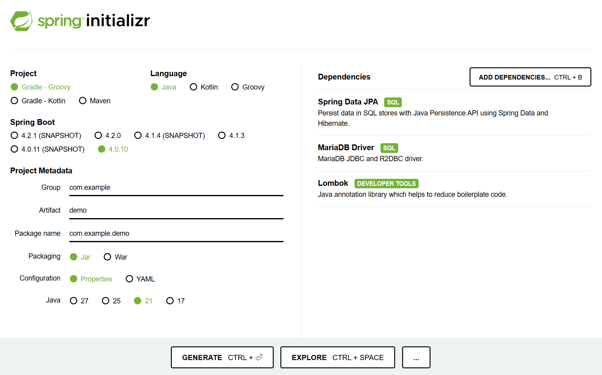

## 2.3 JPA

> **본 교재 참고**  
> 3장 「데이터베이스 연동하기」의 3.4 「JPA」

JDBC와 MyBatis에서는 개발자가 SQL을 작성하고 조회 결과를 자바 객체로 받았습니다. JPA에서는 엔티티와 테이블의 대응 관계를 선언한 뒤 객체를 저장하거나 조회하도록 요청합니다. JPA를 구현한 Hibernate가 이 매핑 정보를 바탕으로 필요한 SQL을 만들고 실행합니다.

이처럼 객체와 관계형 DB의 데이터를 연결하는 기술을 ORM이라고 합니다. JPA는 자바 ORM의 표준 API이며, Spring Data JPA는 그 위에서 기본 CRUD와 조건 검색을 편리하게 사용할 수 있는 Repository를 제공합니다.

이 절에서는 이미 준비된 MariaDB 테이블을 사용합니다. 엔티티의 필드가 어느 컬럼과 연결되는지 확인한 뒤, 객체를 다루는 코드가 어떤 SQL로 이어지는지 관찰합니다.

**학습 목표**

- 엔티티·ID·Repository의 관계를 이해한다.
- 회원 CRUD와 메서드 이름 쿼리를 실행한다.
- 같은 영속성 컨텍스트의 객체 동일성을 관찰한다.
- 게시글 작성자 관계와 페이징을 사용한다.

**준비**: spring-jpa를 열고 2장 공통 SQL과 MariaDB 환경변수를 준비합니다. 테스트는 MemberRepositoryTests와 ArticleRepositoryTests에서 한 개씩 실행합니다. 클래스의 @Transactional에 의해 테스트 종료 후 변경은 롤백됩니다.

### 2.3.1 엔티티와 테이블 매핑

> **본 교재 참고**  
> 3.4.1 「엔티티 객체 매핑」

**프로젝트 생성과 의존성 선택**

Spring Initializr에서 다음 의존성을 선택하고, 생성한 프로젝트 폴더를 `spring-jpa`로 준비합니다.

| 의존성 | 역할 |
|---|---|
| Spring Data JPA | 엔티티와 Repository로 데이터를 저장하고 조회합니다. |
| MariaDB Driver | 실습용 MariaDB에 연결합니다. |
| Lombok | 엔티티와 로그 코드를 간단히 작성합니다. |



엔티티는 DB의 행과 연결해 JPA가 관리하는 객체입니다. 예를 들어 회원 테이블에서 윤서준의 한 행을 조회하면, 그 행의 컬럼 값을 담은 Member 객체를 얻습니다. 조회한 객체의 id는 DB에서 그 회원을 식별하는 기본 키와 연결됩니다.

| DB 테이블·컬럼 | 자바 클래스·속성 | 담는 정보 |
|---|---|---|
| member | Member | 회원 한 명 |
| id | id | 회원을 식별하는 값 |
| name | name | 회원 이름 |
| email | email | 회원 이메일 |
| age | age | 회원 나이 |

JPA는 @Entity가 붙은 클래스를 엔티티로 인식합니다. @Id는 여러 회원 중 어느 회원의 객체인지 구별하는 필드이며, 나머지 필드는 테이블의 컬럼과 매핑합니다.

**실습 코드**

[Member.java](../spring-jpa/src/main/java/com/example/demo/entity/Member.java)

```java
package com.example.demo.entity;

import jakarta.persistence.*;
import lombok.*;

// 클래스명과 테이블명이 다르면 @Table(name), 필드명과 컬럼명이 다르면 @Column(name)으로 매핑한다.
@Entity
@Table(name = "member")
@Data
@Builder
@AllArgsConstructor
@NoArgsConstructor
public class Member {
    @Id
    @GeneratedValue(strategy = GenerationType.IDENTITY)
    @Column(name = "id")
    private Long id;
    @Column(name = "name")
    private String name;
    // 이메일의 NOT NULL, UNIQUE 제약은 sql/schema.sql에서 정의한다.
    @Column(name = "email")
    private String email;
    @Column(name = "age")
    private Integer age;
}
```

**코드 설명**

클래스 이름과 테이블 이름, 자바 속성과 DB 컬럼 이름이 다르더라도 애노테이션으로 대응 관계를 지정할 수 있습니다. 이 예제에서는 다음과 같이 매핑합니다.

| 애노테이션 | 이 예제에서의 역할 |
|---|---|
| @Entity | Member를 JPA가 관리하는 엔티티로 지정합니다. |
| @Table(name = "member") | Member를 member 테이블에 연결합니다. |
| @Id | id를 엔티티의 식별자로 지정합니다. |
| @GeneratedValue(strategy = GenerationType.IDENTITY) | 새 회원의 ID를 DB의 자동 증가 기능으로 부여합니다. |
| @Column(name = "email") | email 속성을 email 컬럼에 연결합니다. |

JPA가 조회 결과로 엔티티를 만들 때는 기본 생성자가 필요하며, 이 예제에서는 Lombok의 @NoArgsConstructor로 준비합니다. 이메일의 NOT NULL·UNIQUE 제약은 공통 schema.sql에 정의되어 있습니다. 매핑 선언은 자바 객체와 기존 테이블을 연결하는 역할을 하며, 이 실습의 테이블 생성과 제약 설정은 SQL이 담당합니다.

**실행과 예상 결과**

Member 엔티티와 DB 도구의 member 테이블을 나란히 열어 이름과 자료형을 비교합니다.

자바의 id는 Long, DB에서는 BIGINT이며 이름·이메일은 문자열로 연결됩니다. 엔티티를 실행하는 별도의 main은 필요하지 않습니다.

### 2.3.2 Repository와 반환값 이해하기

> **본 교재 참고**  
> 3.4.2 「리포지터리 작성」

JpaRepository를 상속하면 기본 CRUD를 구현하지 않고 사용할 수 있으며, 제네릭의 첫 타입은 엔티티, 두 번째는 ID 타입입니다. 이 절에서는 조건 검색 메서드의 이름을 작성하는 규칙을 익히고, 이후 소절에서 해당 메서드를 실행해 조회 결과를 확인합니다.

**실습 코드**

[MemberRepository.java](../spring-jpa/src/main/java/com/example/demo/repository/MemberRepository.java)

```java
package com.example.demo.repository;

import com.example.demo.entity.Member;
import org.springframework.data.jpa.repository.JpaRepository;

import java.util.List;
import java.util.Optional;

/**
 * Member는 다룰 엔티티, Long은 회원 ID의 타입이다.
 * 아래 기본 메서드는 JpaRepository에서 상속받으므로 따로 선언하지 않아도 된다.
 * - save(member): 새 회원을 저장하거나, 조회한 회원의 정보를 수정해 저장한다.
 * - findById(id): ID로 한 명을 조회한다. 없으면 빈 Optional을 반환한다.
 * - findAll(): 모든 회원을 List로 반환한다.
 * - deleteById(id): 해당 ID의 회원을 삭제한다.
 * - existsById(id): 해당 ID의 회원이 있으면 true, 없으면 false를 반환한다.
 * - count(): 전체 회원 수를 반환한다.
 */
public interface MemberRepository extends JpaRepository<Member, Long> {

    // 아래 메서드는 이름을 보고 Spring Data JPA가 조회 쿼리를 만든다.
    // By 뒤에는 DB 컬럼명이 아닌 Member의 자바 속성명을 쓴다.

    // 이메일이 같은 회원 한 명을 조회한다. 없으면 빈 Optional, 여러 명이면 오류가 발생한다.
    Optional<Member> findByEmail(String email);

    // 이름이 정확히 같은 회원들을 조회한다. 동명이인이 있을 수 있으므로 List로 받는다.
    List<Member> findByName(String name);

    // 이름에 keyword가 포함된 회원들을 조회한다. 예: "윤"이면 "윤서준", "윤광철" 등.
    List<Member> findByNameContaining(String keyword);

    // 나이가 전달한 값 이상인 회원들을 조회한다. 예: 19이면 19세 이상.
    List<Member> findByAgeGreaterThanEqual(Integer age);

    // 이름이 같고(And), 나이가 전달한 값 이상인 회원들을 조회한다.
    List<Member> findByNameAndAgeGreaterThanEqual(String name, Integer age);

    // 같은 이메일의 회원이 있으면 true, 없으면 false를 반환한다.
    boolean existsByEmail(String email);
}
```

**코드 설명**

**메서드 이름으로 조회 조건 작성하기**

Spring Data JPA는 정해진 규칙으로 작성한 메서드 이름을 해석하여 조회 쿼리를 만듭니다. `findBy` 뒤에 검색할 엔티티 속성과 비교 조건을 작성하고, 조건이 여러 개라면 `And` 또는 `Or`로 연결합니다.

```text
findBy + 속성명 + 비교 조건
       + And 또는 Or + 속성명 + 비교 조건
       + OrderBy + 정렬할 속성명 + Asc 또는 Desc
```

위 구조의 모든 부분을 반드시 작성하는 것은 아니며, 필요한 조건과 정렬만 붙입니다. 비교 조건을 따로 쓰지 않으면 같은 값인지 비교하고, 속성 이름은 `Name`, `Email`, `Age`처럼 첫 글자를 대문자로 시작하여 연결합니다.

메서드 이름에는 DB 컬럼 이름이 아니라 엔티티의 자바 속성 이름을 사용합니다. 예를 들어 엔티티의 `email` 속성이 DB의 `contact` 컬럼에 연결되어 있더라도 메서드 이름은 `findByEmail`로 작성합니다.

| 구성 요소 | 의미 | 예 |
|---|---|---|
| `findBy` | 조건에 맞는 데이터를 조회합니다. | `findByEmail` |
| 속성명 | 조건에 사용할 엔티티의 속성입니다. | `Name`, `Email`, `Age` |
| `Containing` | 전달한 문자열을 포함하는지 비교합니다. | `findByNameContaining` |
| `GreaterThanEqual` | 전달한 값 이상인지 비교합니다. | `findByAgeGreaterThanEqual` |
| `And` | 두 조건을 모두 만족해야 합니다. | `findByNameAndAgeGreaterThanEqual` |
| `Or` | 두 조건 중 하나 이상을 만족하면 됩니다. | `findByNameOrEmail` |
| `OrderBy` | 조회 결과의 정렬 기준을 지정합니다. | `findByNameOrderByAgeDesc` |
| `Asc` / `Desc` | 오름차순 / 내림차순으로 정렬합니다. | `AgeAsc`, `AgeDesc` |

실습 코드의 다음 메서드를 나누어 읽어 보면 규칙을 이해하기 쉽습니다. 아래는 앞의 `MemberRepository`에서 발췌한 선언이므로 인터페이스에 중복해서 추가하지 않습니다.

```java
List<Member> findByNameAndAgeGreaterThanEqual(String name, Integer age);
```

`findBy`는 조회, `Name`은 이름 비교, `And`는 조건 연결, `AgeGreaterThanEqual`은 나이가 전달한 값 이상이라는 뜻입니다. 따라서 첫 번째 인자는 이름 조건에, 두 번째 인자는 나이 조건에 사용되며, 두 조건을 모두 만족하는 회원을 목록으로 반환합니다.

**독립 예제: 조건 검색에 정렬 추가하기**

검색 조건 뒤에 `OrderBy`를 붙이면 조회 결과의 정렬 기준도 메서드 이름으로 지정할 수 있습니다. 다음은 작성 규칙을 설명하기 위한 독립 예제이므로 실습 인터페이스에 추가하지 않습니다.

```java
List<Member> findByNameContainingOrderByAgeDescIdAsc(String keyword);
```

이 메서드는 이름에 `keyword`가 포함된 회원을 나이 내림차순으로 조회하고, 나이가 같으면 ID 오름차순으로 정렬합니다. `OrderBy` 뒤의 속성과 방향은 메서드 이름에 정해져 있으므로 정렬용 매개변수는 추가하지 않습니다.

**Optional과 목록으로 조회 결과 받기**

Optional은 조회 결과가 없을 가능성을 표현하는 타입입니다. 한 명을 찾는 findById()는 회원이 있으면 그 객체를 Optional에 담아 반환하고, 없으면 빈 Optional을 반환합니다. 실습의 `orElseThrow()`는 값이 있으면 객체를 꺼내고, 없으면 예외를 던집니다. 여러 명을 찾는 List 조회는 결과가 없을 때 빈 목록으로 표현합니다.

**실행과 예상 결과**

MemberRepositoryTests를 엽니다. 클래스의 선언부와 주입 필드를 먼저 확인합니다. 아래는 메서드를 제외한 발췌이며, 뒤의 테스트 메서드는 이 클래스 안에 들어갑니다.

```java
@Slf4j
@SpringBootTest
@Transactional
class MemberRepositoryTests {
    @Autowired
    private MemberRepository memberRepository;
}
```

MyBatis 실습처럼 @SpringBootTest로 애플리케이션의 객체를 준비하고, @Autowired로 Repository를 주입받습니다. @Test 메서드를 실행하면 한글 로그로 결과를 관찰할 수 있고, 테스트에서 수행한 DB 변경은 종료 후 롤백됩니다.

인터페이스 선언만으로 주입받아 기본 메서드와 조건 검색 메서드를 호출할 수 있습니다.

### 2.3.3 회원 전체·단건 조회

목록 조회와 단건 조회를 구분합니다. 단건 실습에서는 고정 ID를 쓰지 않고 샘플 이메일로 회원을 찾은 후 실제 ID를 사용합니다.

**실습 코드**

[MemberRepositoryTests.java — findAllMembers()](../spring-jpa/src/test/java/com/example/demo/repository/MemberRepositoryTests.java)

```java
@Test
void findAllMembers() {
    List<Member> members = memberRepository.findAll();
    log.info("전체 회원 수: {}", members.size());
    for (Member member : members) {
        log.info("회원: {}", member);
    }
}
```

[MemberRepositoryTests.java — findMemberById()](../spring-jpa/src/test/java/com/example/demo/repository/MemberRepositoryTests.java)

```java
@Test
void findMemberById() {
    // 이메일로 찾은 회원의 실제 ID를 사용해 조회한다.
    Member member = memberRepository.findByEmail("SeojunYoon@campus.com").orElseThrow();
    Member found = memberRepository.findById(member.getId()).orElseThrow();
    log.info("ID로 조회한 회원: {}", found);
}
```

[MemberRepositoryTests.java — findMemberByEmail()](../spring-jpa/src/test/java/com/example/demo/repository/MemberRepositoryTests.java)

```java
@Test
void findMemberByEmail() {
    Member member = memberRepository.findByEmail("KwangcheolYoon@campus.com").orElseThrow();
    log.info("이메일로 조회한 회원: {}", member);
}
```

**코드 설명**

findAll()의 List를 for문으로 읽습니다. ID 검색과 이메일 검색은 같은 회원을 서로 다른 조건으로 찾는 예제입니다. 이메일 조회 메서드의 구현은 이름 규칙을 보고 Spring Data JPA가 준비합니다. 윤광철 이메일 조회와 윤서준 ID 조회는 서로 다른 테스트이므로 각 출력 대상을 구분합니다.

**실행과 예상 결과**

세 메서드를 각각 실행합니다.

전체 회원 수는 4입니다. ID 조회는 윤서준, 이메일 조회 테스트는 윤광철을 출력합니다. 출력 순서는 ORDER BY를 지정하지 않았으므로 가정하지 않습니다.

### 2.3.4 회원 등록

새 회원은 ID를 직접 지정하지 않고 저장합니다. DB가 ID를 만들고, 저장된 객체를 통해 생성 결과를 확인합니다.

**실습 코드**

[MemberRepositoryTests.java — saveMember()](../spring-jpa/src/test/java/com/example/demo/repository/MemberRepositoryTests.java)

```java
@Test
void saveMember() {
    log.info("등록 전 회원 수: {}", memberRepository.count());

    Member member = Member.builder().name("정혁")
            .email("JungHyuk@campus.com").age(10).build();
    memberRepository.save(member);

    log.info("등록한 회원: {}", member);
    log.info("등록 후 회원 수: {}", memberRepository.count());
}
```

**코드 설명**

빌더로 정혁을 만들고 save()에 전달합니다. 새 회원의 ID는 지정하지 않으며, DB가 생성한 값은 저장한 객체의 id에 들어갑니다. count()로 등록 전후의 회원 수도 비교합니다. 이 예제의 IDENTITY 전략에서는 생성된 ID를 받아오기 위해 저장 과정에서 INSERT가 실행됩니다. 저장 요청과 SQL 실행 시점의 관계는 작업 종류와 ID 생성 방식에 따라 달라질 수 있습니다.

**실행과 예상 결과**

saveMember를 실행합니다.

초기 샘플 상태에서는 등록 전 4명, 등록 후 5명입니다. 객체의 toString()으로 출력한 ID는 실행한 DB에서 생성된 값입니다. 주요 예상 로그는 다음과 같습니다.

```text
등록 전 회원 수: 4
등록 후 회원 수: 5
```

테스트 종료 후 등록은 롤백되어 회원 4명이 유지됩니다. 따라서 다른 테스트는 이 테스트가 만든 정혁의 존재에 의존하지 않습니다.

### 2.3.5 이메일 중복과 DB 제약

중복 이메일 허용 여부는 DB의 UNIQUE 제약으로 결정됩니다. JPA를 사용해도 이 제약을 어길 수 없습니다. 예외 발생 시점을 코드와 SQL 로그로 함께 관찰합니다.

**실습 코드**

[MemberRepositoryTests.java — rejectDuplicateEmail()](../spring-jpa/src/test/java/com/example/demo/repository/MemberRepositoryTests.java)

```java
@Test
void rejectDuplicateEmail() {
    // 윤서준의 이메일을 다시 사용하면 DB의 UNIQUE 제약으로 예외가 발생한다.
    Member duplicate = Member.builder().name("정혁")
            .email("SeojunYoon@campus.com").age(10).build();

    try {
        memberRepository.save(duplicate);
        log.warn("중복 이메일이 저장되었습니다. DB의 UNIQUE 제약을 확인하세요.");
    } catch (DataIntegrityViolationException e) {
        log.info("이메일 중복으로 저장할 수 없습니다: {}", e.getMessage());
    }
    // 예외가 발생한 뒤에는 추가 DB 작업 없이 테스트를 끝내고 롤백한다.
}
```

**코드 설명**

기존 윤서준의 이메일로 새 회원을 저장하려고 합니다. 현재 IDENTITY 저장 흐름에서는 save() 중 DB 예외가 DataIntegrityViolationException으로 전달되는 것을 관찰할 수 있습니다. 이 시점을 모든 키 전략·모든 save()에 일반화하면 안 됩니다. 예외 뒤에는 같은 테스트 안에서 추가 DB 작업을 하지 않고 롤백으로 끝냅니다.

**실행과 예상 결과**

rejectDuplicateEmail을 단독 실행합니다.

`이메일 중복으로 저장할 수 없습니다`가 출력됩니다. DB 드라이버·제약 이름·SQL 오류 전문은 환경에 따라 달라집니다. 새 회원은 추가되지 않습니다.

### 2.3.6 회원 수정·삭제

수정은 조회한 객체의 값을 바꾸고 저장하는 흐름입니다. 삭제는 게시글을 작성하지 않은 회원을 직접 준비해 연습합니다.

**실습 코드**

[MemberRepositoryTests.java — updateMember()](../spring-jpa/src/test/java/com/example/demo/repository/MemberRepositoryTests.java)

```java
@Test
void updateMember() {
    // 수정할 회원은 ID를 가정하지 않고 이메일로 찾는다.
    Member member = memberRepository.findByEmail("SeojunYoon@campus.com").orElseThrow();
    log.info("수정 전 회원: {}", member);

    member.setName("수정된 윤서준");
    memberRepository.save(member);

    // 관리 중인 객체의 변경 결과다. 테스트가 끝나면 롤백된다.
    log.info("수정 후 회원: {}", memberRepository.findById(member.getId()).orElseThrow());
}
```

[MemberRepositoryTests.java — deleteMember()](../spring-jpa/src/test/java/com/example/demo/repository/MemberRepositoryTests.java)

```java
@Test
void deleteMember() {
    // 샘플 회원은 모두 게시글이 있으므로, 삭제할 회원을 따로 등록한다.
    Member member = Member.builder().name("정혁")
            .email("JungHyuk@campus.com").age(10).build();
    memberRepository.save(member);
    memberRepository.delete(member);

    log.info("삭제 후에도 회원이 조회되는가? {}",
            memberRepository.findById(member.getId()).isPresent());
    log.info("삭제 후 회원 수: {}", memberRepository.count());
}
```

**코드 설명**

updateMember는 조회한 윤서준의 이름을 `수정된 윤서준`으로 바꾸고 저장합니다. 같은 테스트 안에서 다시 조회한 결과에는 관리 중인 객체의 변경된 이름이 나타납니다. 이 로그는 객체 상태를 보여 주며, 반드시 새 SELECT나 UPDATE가 실행되었다는 의미는 아닙니다. 변경을 DB에 반영하는 시점은 객체의 값을 바꾸는 시점과 구분합니다.

deleteMember는 새 정혁을 등록한 뒤 삭제합니다. 샘플 회원은 게시글의 작성자이므로, 작성한 게시글이 없는 회원을 따로 준비한 것입니다. 삭제 후 조회 결과에 isPresent()를 호출하면 값이 있는지 알 수 있으며, 빈 Optional이면 false를 반환합니다.

**실행과 예상 결과**

updateMember와 deleteMember를 각각 실행합니다.

수정 후 이름은 `수정된 윤서준`입니다. 삭제 후 조회 여부는 false, 샘플 기준 회원 수는 4입니다. 두 테스트가 끝나면 변경은 롤백됩니다.

### 2.3.7 영속성 컨텍스트와 동일성

> **본 교재 참고**  
> 3.4.3 「영속성 컨텍스트」

영속성 컨텍스트는 JPA가 조회하거나 저장한 엔티티를 관리하는 공간입니다. 같은 회원을 여러 번 조회할 때마다 서로 다른 객체를 만들면 어느 객체의 값을 사용해야 하는지 혼란스러울 수 있습니다. JPA는 같은 컨텍스트 안에서 엔티티 타입과 ID가 같은 대상을 하나의 객체로 관리합니다.

관리 중인 엔티티를 기본 키로 찾아 재사용하는 기능을 1차 캐시라고 합니다. 이 절에서는 조회한 객체를 다시 사용할 수 있다는 점과, 같은 객체인지 ==로 확인하는 방법에 집중합니다. 영속성 컨텍스트는 DB 자체가 아니며, 객체를 관리하는 범위와 DB에 데이터를 보관하는 범위도 다릅니다.

1장에서 배운 스프링 컨테이너와도 역할을 구분합니다. 스프링 컨테이너는 서비스·리포지토리처럼 애플리케이션을 구성하는 빈을 관리합니다. 영속성 컨텍스트는 DB의 회원·게시글 데이터와 연결된 엔티티를 관리합니다. 이 예제의 Member에는 @Component가 아니라 @Entity를 붙이는 이유입니다.

**실습 코드**

[MemberRepositoryTests.java — sameMemberInPersistenceContext()](../spring-jpa/src/test/java/com/example/demo/repository/MemberRepositoryTests.java)

```java
@Test
void sameMemberInPersistenceContext() {
    // 이메일로 찾은 회원을 실제 ID와 이메일로 다시 조회한다.
    Member member = memberRepository.findByEmail("SeojunYoon@campus.com").orElseThrow();
    Member foundById = memberRepository.findById(member.getId()).orElseThrow();
    Member foundByEmail = memberRepository.findByEmail("SeojunYoon@campus.com").orElseThrow();

    // 같은 영속성 컨텍스트에서 같은 회원은 같은 객체로 관리된다. ==로 비교한다.
    log.info("ID로 다시 조회한 회원과 같은 객체인가? {}", member == foundById);
    log.info("이메일로 조회한 회원과 같은 객체인가? {}", member == foundByEmail);
}
```

**코드 설명**

이메일로 찾은 회원을 실제 ID로 다시 조회하고, 이메일로도 다시 조회합니다. `==`는 필드 내용이 같은지가 아니라 두 변수가 같은 객체를 가리키는지 비교합니다. 현재 테스트의 트랜잭션 안에서 동일한 영속성 컨텍스트를 사용하므로 두 비교는 true입니다.

기본 키 findById()는 관리 중인 엔티티를 활용할 수 있습니다. 이메일 같은 조건 조회는 SQL을 실행할 수 있지만, 그 결과의 ID가 이미 관리 중이면 같은 엔티티 객체로 연결됩니다. 객체가 같다는 사실과 SELECT가 실행되지 않았다는 주장은 구분해야 합니다.

**실행과 예상 결과**

이 테스트를 실행하고 두 로그와 SQL 로그를 함께 읽습니다.

`ID로 다시 조회한 회원과 같은 객체인가? true`, `이메일로 조회한 회원과 같은 객체인가? true`가 출력됩니다. 다른 트랜잭션이나 다른 컨텍스트의 객체까지 항상 같다고 가정하지 않습니다.

### 2.3.8 메서드 이름으로 조건 검색

> **본 교재 참고**  
> 3.4.2 「리포지터리 작성」의 ‘메서드 이름으로 쿼리하기’

메서드 이름의 By 뒤에는 테이블 컬럼명이 아닌 자바 속성명을 씁니다. Containing은 포함 검색, GreaterThanEqual은 이상 조건, And는 두 조건을 모두 만족함을 뜻합니다.

**실습 코드**

[MemberRepositoryTests.java — findMembersByName()](../spring-jpa/src/test/java/com/example/demo/repository/MemberRepositoryTests.java)

```java
@Test
void findMembersByName() {
    List<Member> members = memberRepository.findByName("윤서준");
    for (Member member : members) {
        log.info("이름이 윤서준인 회원: {}", member);
    }
    log.info("없는 이름으로 조회한 결과: {}", memberRepository.findByName("없는회원"));
}
```

[MemberRepositoryTests.java — findMembersByNameContaining()](../spring-jpa/src/test/java/com/example/demo/repository/MemberRepositoryTests.java)

```java
@Test
void findMembersByNameContaining() {
    // 윤서준, 윤광철, 김도윤의 이름에는 모두 '윤'이 들어간다.
    List<Member> members = memberRepository.findByNameContaining("윤");
    log.info("이름에 '윤'이 포함된 회원 수: {}", members.size());
    for (Member member : members) {
        log.info("검색된 회원: {}", member);
    }
}
```

[MemberRepositoryTests.java — findMembersByAgeGreaterThanEqual()](../spring-jpa/src/test/java/com/example/demo/repository/MemberRepositoryTests.java)

```java
@Test
void findMembersByAgeGreaterThanEqual() {
    // 23세인 공미영과 43세인 윤광철이 조회된다.
    List<Member> members = memberRepository.findByAgeGreaterThanEqual(23);
    for (Member member : members) {
        log.info("23세 이상인 회원: {}", member);
    }
}
```

[MemberRepositoryTests.java — findMembersByNameAndAgeGreaterThanEqual()](../spring-jpa/src/test/java/com/example/demo/repository/MemberRepositoryTests.java)

```java
@Test
void findMembersByNameAndAgeGreaterThanEqual() {
    List<Member> members = memberRepository.findByNameAndAgeGreaterThanEqual("윤광철", 43);
    for (Member member : members) {
        log.info("이름이 윤광철이고 43세 이상인 회원: {}", member);
    }
    log.info("윤광철이면서 44세 이상인 회원: {}",
            memberRepository.findByNameAndAgeGreaterThanEqual("윤광철", 44));
    log.info("없는 이름이면서 10세 이상인 회원: {}",
            memberRepository.findByNameAndAgeGreaterThanEqual("없는회원", 10));
}
```

[MemberRepositoryTests.java — existsMemberByEmail()](../spring-jpa/src/test/java/com/example/demo/repository/MemberRepositoryTests.java)

```java
@Test
void existsMemberByEmail() {
    log.info("윤서준의 이메일이 존재하는가? {}",
            memberRepository.existsByEmail("SeojunYoon@campus.com"));
    log.info("미등록 이메일이 존재하는가? {}",
            memberRepository.existsByEmail("missing@example.com"));
}
```

**코드 설명**

Repository 선언을 먼저 읽고 어떤 SQL 조건이 필요할지 말해 봅니다. 이어서 테스트에서 전달한 인자를 확인합니다. existsByEmail()은 Member 객체 대신 true/false가 필요할 때 사용합니다.

**실행과 예상 결과**

각 메서드를 하나씩 실행합니다. 결과 목록은 순서보다 포함된 이름과 개수를 확인합니다.

| 조건 | 샘플 기준 예상 결과 |
|---|---|
| 이름이 윤서준 | 윤서준 |
| 이름에 윤 포함 | 윤서준·윤광철·김도윤, 3명 |
| 23세 이상 | 공미영·윤광철, 2명 |
| 윤광철이고 43세 이상 | 윤광철 |
| 윤광철이고 44세 이상 | 빈 목록 |
| 등록 이메일 존재 여부 | true |
| 미등록 이메일 존재 여부 | false |

### 2.3.9 게시글과 작성자 관계·날짜 설정

> **본 교재 참고**  
> 3.4.4 「관계 매핑」

회원 한 명은 여러 게시글을 작성할 수 있지만, 이 예제에서 게시글 하나의 작성자는 한 명입니다. 게시글을 기준으로 보면 여러 게시글이 같은 회원을 참조하므로 다대일 관계입니다. 자바에서는 Article의 member 필드가 Member 객체를 참조하고, DB에서는 article.member_id가 member.id를 참조합니다.

| 자바에서 사용하는 연결 | DB에 저장되는 연결 |
|---|---|
| article.getMember() | article 행의 member_id가 가리키는 회원 |
| article.getMember().getName() | 연결된 member 행의 name 값 |

객체의 member 필드에 Member를 넣는다고 회원 전체가 게시글 테이블에 복사되는 것은 아닙니다. 게시글에는 그 회원을 가리키는 ID가 저장됩니다.

**실습 코드**

[Article.java](../spring-jpa/src/main/java/com/example/demo/entity/Article.java)

```java
package com.example.demo.entity;

import jakarta.persistence.*;
import lombok.*;
import java.time.LocalDateTime;

// 클래스명과 테이블명이 다르면 @Table(name), 필드명과 컬럼명이 다르면 @Column(name)으로 매핑한다.
// 회원을 참조하는 외래 키 컬럼명은 @JoinColumn(name)으로 매핑한다.
@Entity
@Table(name = "article")
@Data
@Builder
@AllArgsConstructor
@NoArgsConstructor
public class Article {
    @Id
    @GeneratedValue(strategy = GenerationType.IDENTITY)
    @Column(name = "id")
    private Long id;
    @Column(name = "title")
    private String title;
    @Column(name = "description")
    private String description;
    @Column(name = "created")
    private LocalDateTime created;
    @Column(name = "updated")
    private LocalDateTime updated;

    @ManyToOne
    @JoinColumn(name = "member_id")
    private Member member;

    // 처음 저장하기 전에 생성일과 수정일을 현재 시간으로 설정한다.
    @PrePersist
    protected void onCreate() {
        LocalDateTime now = LocalDateTime.now();
        created = now;
        updated = now;
    }

    // 변경 내용을 DB에 반영하기 전에 수정일만 현재 시간으로 갱신한다.
    @PreUpdate
    protected void onUpdate() {
        updated = LocalDateTime.now();
    }
}
```

[ArticleRepository.java](../spring-jpa/src/main/java/com/example/demo/repository/ArticleRepository.java)

```java
package com.example.demo.repository;

import com.example.demo.entity.Article;
import com.example.demo.entity.Member;
import org.springframework.data.jpa.repository.JpaRepository;

import java.util.List;

// 기본 CRUD는 JpaRepository에서 상속받는다.
// findAll(pageable)은 게시글 목록과 전체 개수 등의 페이지 정보를 반환한다.
public interface ArticleRepository extends JpaRepository<Article, Long> {

    // 제목에 keyword가 포함된 게시글 목록을 조회한다.
    List<Article> findByTitleContaining(String keyword);

    // 해당 회원이 작성한 게시글 목록을 조회한다. 회원의 ID를 기준으로 검색한다.
    List<Article> findByMember(Member member);
}
```

**코드 설명**

`@ManyToOne`은 여러 게시글 대 한 회원의 관계입니다. `@JoinColumn(name="member_id")`는 연결 컬럼을 정합니다. 회원 필드에 회원 ID 숫자 대신 Member 객체를 넣습니다.

@PrePersist는 처음 저장하기 전에 생성일·수정일을 준비합니다. @PreUpdate는 변경이 DB에 반영되기 전에 수정일을 준비합니다. 단순 조회 시에는 호출되지 않습니다. SQL로 직접 등록하는 data.sql은 엔티티 콜백을 실행하지 않으므로 날짜도 SQL에 지정되어 있습니다.

**실행과 예상 결과**

ArticleRepositoryTests의 각 테스트 전에 실행되는 setUp을 확인합니다.

샘플 게시글은 100개이고 각 회원에게 25개씩 연결되어 있습니다. 다음 저장 테스트의 새 글은 콜백에 의해 실행 시각이 들어갑니다.

### 2.3.10 작성자를 지정해 게시글 저장

BeforeEach는 테스트마다 필요한 준비를 반복합니다. 각 테스트가 다른 테스트에서 준비한 객체에 의존하지 않게 합니다.

**실습 코드**

[ArticleRepositoryTests.java — setUp()](../spring-jpa/src/test/java/com/example/demo/repository/ArticleRepositoryTests.java)

```java
@BeforeEach
void setUp() {
    // 각 테스트 전에 샘플 게시글의 작성자인 윤서준을 조회한다.
    member = memberRepository.findByEmail("SeojunYoon@campus.com").orElseThrow();
}
```

[ArticleRepositoryTests.java — saveArticle()](../spring-jpa/src/test/java/com/example/demo/repository/ArticleRepositoryTests.java)

```java
@Test
void saveArticle() {
    // member에 작성자 객체를 넣으면 DB에는 그 회원의 ID가 member_id로 저장된다.
    Article article = Article.builder()
            .title("주말에 한강에서 자전거를 탔어요")
            .description("친구와 여의도에서 반포까지 달렸어요. 강바람이 시원해서 기분이 좋았습니다.").member(member).build();

    articleRepository.save(article);

    log.info("저장한 게시글 ID: {}, 제목: {}", article.getId(), article.getTitle());
    log.info("작성자 ID: {}, 이름: {}", article.getMember().getId(), article.getMember().getName());
    log.info("생성일: {}, 수정일: {}", article.getCreated(), article.getUpdated());
}
```

**코드 설명**

setUp()은 윤서준을 이메일로 조회해 필드 member에 보관합니다. saveArticle()은 이 객체를 새 Article의 작성자로 지정합니다. JPA가 연결된 회원의 실제 ID를 member_id로 저장합니다. member를 연결한다고 회원을 다시 새로 만드는 코드는 아닙니다.

**실행과 예상 결과**

saveArticle을 실행합니다.

새 게시글 제목과 작성자 윤서준이 출력됩니다. 생성일과 수정일은 최초 저장 시 같은 시각입니다. 새 글 등록은 테스트 후 롤백됩니다.

### 2.3.11 기존 게시글에서 작성자 조회

관계 매핑을 사용하면 게시글을 조회한 뒤 getMember()로 작성자 객체에 접근할 수 있습니다. 자바 객체 사이의 연결을 통해 값을 읽는 방식에 집중합니다.

**실습 코드**

[ArticleRepositoryTests.java — findArticleAuthor()](../spring-jpa/src/test/java/com/example/demo/repository/ArticleRepositoryTests.java)

```java
@Test
void findArticleAuthor() {
    // 기존 게시글 목록에서 하나를 선택한다. 특정 ID나 조회 순서를 가정하지 않는다.
    Article found = articleRepository.findAll().getFirst();

    log.info("게시글 제목: {}", found.getTitle());
    log.info("작성자 이름: {}, 이메일: {}", found.getMember().getName(), found.getMember().getEmail());
}
```

**코드 설명**

findAll().getFirst()는 기존 목록에서 첫 객체를 선택합니다. 샘플 데이터가 있다는 전제로 실행하는 실습입니다. 정렬 조건이 없으므로 첫 글의 작성자를 윤서준이라고 단정하지 않습니다. getMember().getName()으로 실제 작성자를 확인합니다. 관련 정보 접근이 SQL 한 문장이나 JOIN 한 번만 사용한다는 뜻은 아닙니다.

**실행과 예상 결과**

findArticleAuthor를 실행합니다.

선택된 글의 제목과 연결된 작성자의 이름·이메일이 출력됩니다. 실제 DB의 해당 글과 비교해 일치하는지 확인합니다.

### 2.3.12 제목과 작성자로 게시글 검색

검색 조건이 문자열인 경우와 다른 엔티티 객체인 경우를 비교합니다. 이 두 검색은 페이징 없이 결과 전체를 List로 받습니다.

**실습 코드**

[ArticleRepositoryTests.java — findArticlesByTitleContaining()](../spring-jpa/src/test/java/com/example/demo/repository/ArticleRepositoryTests.java)

```java
@Test
void findArticlesByTitleContaining() {
    List<Article> articles = articleRepository.findByTitleContaining("동네");

    log.info("'동네' 검색 결과: {}개", articles.size());
    for (Article article : articles) {
        log.info("제목: {}", article.getTitle());
    }
}
```

[ArticleRepositoryTests.java — findArticlesByMember()](../spring-jpa/src/test/java/com/example/demo/repository/ArticleRepositoryTests.java)

```java
@Test
void findArticlesByMember() {
    // 회원 객체를 전달해 윤서준이 작성한 기존 게시글을 조회한다.
    List<Article> articles = articleRepository.findByMember(member);

    log.info("윤서준의 게시글: {}개", articles.size());
    for (Article article : articles) {
        log.info("제목: {}, 작성자: {}", article.getTitle(), article.getMember().getName());
    }
}
```

**코드 설명**

Containing은 제목 일부가 일치하는 글을 찾습니다. findByMember(member)는 전달한 회원의 ID에 연결된 글을 찾습니다. 준비된 객체의 이름을 비교해 검색하는 메서드는 아닙니다.

**실행과 예상 결과**

두 테스트를 각각 실행합니다.

공통 data.sql 그대로라면 제목에 `동네`가 들어간 글은 7개, 윤서준의 글은 25개입니다. 게시글을 추가·수정한 DB에서는 결과 개수가 바뀔 수 있습니다.

### 2.3.13 전체 게시글 페이징

> **본 교재 참고**  
> 3.4.2 「리포지터리 작성」

페이징은 전체 결과를 일정한 크기로 나누어 필요한 구간만 조회하는 방식입니다. 게시글 100개를 한 번에 표시하는 대신 10개씩 보여 주면 한 화면의 목록을 짧게 유지할 수 있습니다. Pageable은 몇 번째 페이지를 어떤 크기와 순서로 요청할지 담고, Page는 그 요청으로 얻은 목록과 전체 개수 등의 결과를 담습니다.

**실습 코드**

[ArticleRepositoryTests.java — findArticlesByPage()](../spring-jpa/src/test/java/com/example/demo/repository/ArticleRepositoryTests.java)

```java
@Test
void findArticlesByPage() {
    // 0은 첫 페이지, 10은 페이지 크기, descending()은 ID 내림차순이다.
    PageRequest pageable = PageRequest.of(0, 10, Sort.by("id").descending());
    Page<Article> page = articleRepository.findAll(pageable);

    // getContent()는 현재 페이지의 목록, getTotalElements()는 모든 페이지를 합친 게시글 수다.
    log.info("전체 게시글 수: {}", page.getTotalElements());
    log.info("전체 페이지 수: {}", page.getTotalPages());
    log.info("현재 페이지의 게시글 수: {}", page.getContent().size());
    for (Article article : page.getContent()) {
        log.info("제목: {}, 작성자: {}", article.getTitle(), article.getMember().getName());
    }
}
```

**코드 설명**

| 코드 | 뜻 |
|---|---|
| PageRequest.of(0, 10, ...) | 첫 페이지, 한 페이지 최대 10개 |
| Sort.by("id").descending() | ID가 큰 글부터 |
| getContent() | 현재 페이지의 글 목록 |
| getTotalElements() | 모든 페이지를 합친 글 수 |
| getTotalPages() | 현재 페이지 크기로 나눈 전체 페이지 수 |

100개를 10개씩 조회하면 10페이지입니다. 페이지 번호는 0부터 시작합니다. findAll(Pageable)은 JpaRepository에서 상속받으므로 별도 SQL이나 메서드 선언이 필요하지 않습니다.

**실행과 예상 결과**

findArticlesByPage를 실행합니다.

샘플 데이터 100개를 그대로 사용했을 때의 주요 예상 로그는 다음과 같습니다.

```text
전체 게시글 수: 100
전체 페이지 수: 10
현재 페이지의 게시글 수: 10
```

이어지는 제목·작성자 로그는 현재 페이지의 10개 게시글을 보여 줍니다. 페이지 번호를 1로 바꾸면 다음 10개를 조회하지만, 전체 게시글 수와 전체 페이지 수는 그대로 유지됩니다.

### 2.3.14 SQL과 바인딩 값 관찰

객체를 저장·조회할 때 JPA가 실제로 어떤 SQL을 실행하는지 살펴봅니다. 물음표 자리에 들어갈 값은 SQL 출력과 별도의 바인딩 로그에 표시될 수 있습니다.

**실습 코드**

[application.properties](../spring-jpa/src/main/resources/application.properties)

```properties
spring.application.name=demo

# 실행과 테스트 모두 DB_URL에 지정한 MariaDB를 사용한다.
# sql/schema.sql과 sql/data.sql을 먼저 직접 실행해 테이블과 샘플 데이터를 준비한다.
spring.datasource.url=${DB_URL}
spring.datasource.username=${DB_USER}
spring.datasource.password=${DB_PASS}

# JPA가 실행하는 SQL을 콘솔에 출력한다.
spring.jpa.show-sql=true
# SQL에 줄바꿈과 들여쓰기를 적용해 읽기 쉽게 출력한다.
spring.jpa.properties.hibernate.format_sql=true
# SQL의 ?에 들어가는 실제 값을 별도 로그로 출력한다. SQL 안의 ? 자체가 바뀌지는 않는다.
logging.level.org.hibernate.orm.jdbc.bind=TRACE
```

**코드 설명**

show-sql은 실행 SQL, format_sql은 읽기 좋은 줄바꿈을 지정합니다. org.hibernate.orm.jdbc.bind의 TRACE는 Hibernate 바인딩 로그를 켭니다. 전체 애플리케이션 로그 레벨을 모두 TRACE로 바꿀 필요는 없습니다. TRACE는 DEBUG보다 상세한 레벨이며, SQL 안의 ? 문자열 자체를 값으로 바꾸는 옵션은 아닙니다.

**실행과 예상 결과**

이메일 조회 테스트를 실행하고 WHERE 조건의 ?와 바인딩 로그의 이메일을 함께 찾습니다. 생성일·수정일 변경은 다음 REST 장의 게시글 등록·수정 요청에서도 확인합니다.

SQL의 ?에 어떤 문자열이 전달됐는지 별도 로그에서 확인할 수 있습니다. 로그의 타입 표기와 SQL 모양은 Hibernate 버전에 따라 달라집니다.

### 2.3.15 학습 확인

- 엔티티의 자바 객체 참조가 DB에서 어느 컬럼으로 저장되는지 설명합니다.
- 단건 결과가 없는 Optional과 빈 List의 차이를 설명합니다.
- 같은 객체가 반환되면 이메일 조회 SQL도 항상 생략되는지 생각해 봅니다.
- 페이지 크기를 20으로 바꾸면 총 100개 게시글의 페이지 수가 어떻게 되는지 예상합니다.
