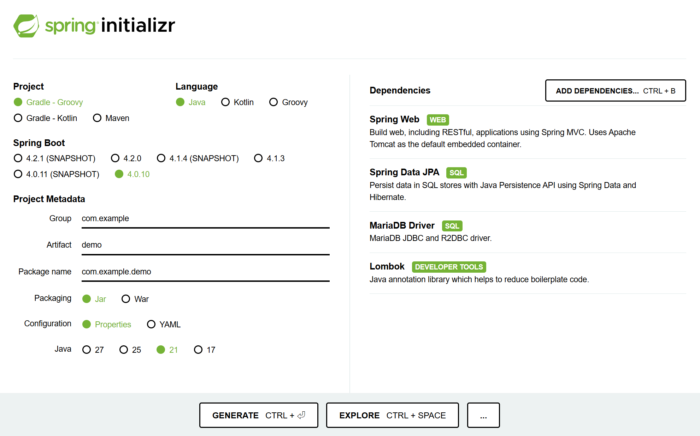
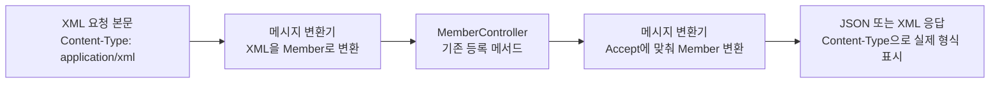

# 3장 RESTful API

> **본 교재 참고**  
> 4장 「RESTful API 작성하기」의 4.1 「RESTful API란 무엇인가?」, 4.2 「JPA로 RESTful API 서버 만들기」, 4.3 「테스트」

RESTful API는 클라이언트가 HTTP 요청으로 서버의 데이터를 조회하고 변경할 수 있도록 제공하는 인터페이스입니다. 이 예제에서는 회원을 /members, 게시글을 /articles라는 주소로 표현합니다. 클라이언트가 주소와 HTTP 메서드, 필요한 데이터를 보내면 서버는 요청한 작업을 수행하고 처리 결과를 응답합니다.

이 장은 Member로 기본 API와 요청 객체 검증을 익힌 뒤 Article에서 Service와 DTO를 배웁니다. 여러 회원 가입을 묶는 트랜잭션을 실습하고, 마지막에 결과를 자동으로 검증하는 테스트를 작성합니다.

**준비**: spring-rest를 열고 MariaDB 환경변수를 설정합니다. 공통 schema.sql·data.sql로 회원 4명과 게시글 100개를 준비합니다. DemoApplication을 실행하고 members.http(`spring-rest/http/members.http`), articles.http(`spring-rest/http/articles.http`)를 IDE에서 엽니다. 웹 앱을 동시에 같은 8080 포트로 실행하지 않습니다.

## 3.1 HTTP와 API의 기본 개념

> **본 교재 참고**  
> 4.1.1 「웹 애플리케이션의 진화」, 4.1.2 「RESTful API 설계 원칙」; 프로젝트 생성은 4.2.1 「프로젝트 생성 및 JPA 리포지터리 작성」

**프로젝트 생성과 의존성 선택**

Spring Initializr에서 Spring Web, Spring Data JPA, Validation, MariaDB Driver, Lombok을 선택하고, 생성한 프로젝트 폴더를 `spring-rest`로 준비합니다. Validation은 뒤에서 회원 등록 요청의 이름과 이메일을 검사할 때 사용합니다.

| 의존성 | 역할 |
|---|---|
| Spring Web | Controller에서 HTTP 요청을 받고 JSON을 응답합니다. |
| Spring Data JPA | Repository로 회원과 게시글을 저장하고 조회합니다. |
| Validation | 요청 객체의 필드에 선언한 입력 조건을 검사합니다. |
| MariaDB Driver | 기존 실습용 MariaDB에 연결합니다. |
| Lombok | 생성자와 getter 같은 반복 코드를 줄여 줍니다. |



**HTTP 요청과 응답의 구성**

HTTP 통신은 클라이언트의 요청과 서버의 응답으로 이루어집니다. 요청에서는 HTTP 메서드로 수행할 작업(Operation)을, URI로 대상 리소스를 지정합니다. 예를 들어 `GET /members/47`은 ID가 47인 회원을 조회하라는 뜻입니다. 이 예제에서 GET은 조회, POST는 등록, PUT은 전체 수정, PATCH는 부분 수정, DELETE는 삭제에 사용합니다.

| 요청의 구성 | 역할 | 예 |
|---|---|---|
| 메서드 | 대상에 수행할 작업을 지정합니다. | `POST` |
| URI | 작업의 대상 리소스를 지정합니다. | `/members` |
| 요청 헤더 | 본문의 형식, 원하는 응답 형식 등의 부가 정보를 전달합니다. | `Content-Type: application/json` |
| 요청 본문 | 서버에 보낼 실제 데이터를 담습니다. | 등록할 회원의 이름·이메일·나이 |

| 응답의 구성 | 역할 | 예 |
|---|---|---|
| 상태 코드 | 요청 처리 결과를 알립니다. | `201 Created` |
| 응답 헤더 | 응답 본문의 형식 등의 부가 정보를 전달합니다. | `Content-Type: application/json` |
| 응답 본문 | 처리 결과 데이터를 담습니다. | 저장된 회원의 ID·이름·이메일·나이 |

모든 요청과 응답에 본문이 필요한 것은 아닙니다. 회원 단건 조회의 GET 요청에는 본문을 보내지 않으며, 삭제에 성공한 204 응답에도 본문이 없습니다.

상태 코드는 첫 번째 숫자로 의미를 크게 구분합니다. 본문의 안내 문구를 읽기 전에 상태 코드를 확인하면 요청이 성공했는지, 어디에서 문제가 생겼는지 파악할 수 있습니다.

| 범위 | 의미 | 대표적인 예 |
|---|---|---|
| 2xx | 요청을 성공적으로 처리했습니다. | 200 조회·수정 성공, 201 등록 성공, 204 본문 없이 처리 성공 |
| 3xx | 요청을 마치기 위해 추가 동작이 필요합니다. | 302 다른 URI로 이동해 다시 요청. 304는 캐시된 내용을 재사용하라는 뜻입니다. |
| 4xx | 요청 내용이나 접근 조건에 문제가 있습니다. | 400 잘못된 요청, 403 접근 금지, 404 대상 없음 |
| 5xx | 서버가 요청 처리 중 오류를 만났습니다. | 500 서버 내부 오류 |

**Content-Type과 Accept**

헤더는 본문 자체가 아니라 본문을 어떻게 해석하고 처리할지 알려 주는 정보입니다. 이 장에서는 다음 두 헤더에 집중합니다.

| 헤더 | 요청에서의 의미 | 응답에서의 의미 |
|---|---|---|
| `Content-Type` | 지금 보내는 본문이 어떤 형식인지 알립니다. | 서버가 실제로 보낸 본문의 형식을 알립니다. |
| `Accept` | 클라이언트가 받을 수 있는 응답 형식을 알립니다. | 이 실습에서는 요청에만 지정합니다. |

`application/json`은 JSON, `application/xml`은 XML 형식을 뜻합니다. 예를 들어 요청의 Content-Type이 application/xml이고 Accept가 application/json이면, XML로 데이터를 보내고 JSON으로 결과를 받겠다는 의미입니다. 두 헤더의 값이 같아야 하는 것은 아닙니다. 서버가 요청한 응답 형식을 지원하지 않으면 406, 보낸 본문의 형식을 지원하지 않으면 415로 거절할 수 있습니다.

다음은 회원 등록 요청과 성공 응답의 구성을 읽기 위한 HTTP/1.1 예입니다. 서버 주소 등의 다른 헤더는 생략했습니다. 실제 등록은 3.2.1에서 수행하며, ID 47은 설명을 위한 값입니다.

```http
POST /members HTTP/1.1
Content-Type: application/json
Accept: application/json

{"name":"정혁","email":"JungHyuk@campus.com","age":10}
```

```http
HTTP/1.1 201 Created
Content-Type: application/json

{"id":47,"name":"정혁","email":"JungHyuk@campus.com","age":10}
```

헤더와 본문은 빈 줄로 구분합니다. Content-Type을 바꾸었다면 실제 본문도 그 형식에 맞게 작성해야 합니다. 헤더만 XML로 바꾼다고 JSON 본문이 XML로 바뀌지는 않습니다. 이러한 헤더와 상태 코드의 의미는 HTTP 표준(https://www.rfc-editor.org/rfc/rfc9110.html)에 정의되어 있습니다.

이 장의 응답 본문은 주로 JSON입니다. JSON은 객체를 `{ }`, 배열을 `[ ]`로 표현하며, 필드 이름과 값을 짝지어 데이터를 전달합니다. 서버는 Member 객체를 그대로 메모리 밖으로 보내는 대신 그 속성을 JSON으로 변환합니다. 클라이언트가 보낸 JSON을 자바 객체로 바꾸어 받는 것도 가능합니다.

### 3.1.1 HTTP Client와 응답 ID 재사용

회원이 등록될 때 DB가 생성하는 ID는 실행마다 달라질 수 있습니다. 등록 응답에서 받은 ID를 저장해 두면 다음 조회·수정·삭제 요청에 그대로 사용할 수 있으므로, 실제 값을 매번 확인해 입력할 필요가 없습니다.

IntelliJ의 HTTP Client는 .http 파일에 작성한 요청을 실행하는 도구입니다. 파일의 `@baseUrl`은 서버 주소를 반복 작성하지 않기 위한 변수입니다. 다음 등록 요청으로 구조를 먼저 읽어 보고, 실제 등록은 3.2.1절에서 한 번 수행합니다.

[members.http — 요청 2](../spring-rest/http/members.http)

```http
### 2. 회원 등록 (201 Created)
POST {{baseUrl}}/members
Content-Type: application/json
Accept: application/json

{
  "name": "정혁",
  "email": "JungHyuk@campus.com",
  "age": 10
}

> 
```

Content-Type은 보내는 본문의 형식, Accept는 받고 싶은 응답 형식입니다. 응답 처리의 `client.global.set()`은 실제 생성 ID를 다음 요청에서 재사용하도록 합니다. 이 작은 스크립트는 HTTP Client의 기능이며 서버 Controller 코드가 아닙니다. 아래 요청은 파일의 기존 위치에서 순서대로 실행합니다.

등록에 성공하면 201 응답과 회원 JSON을 받습니다. 응답의 ID를 memberId 변수에 저장해 다음 조회·수정·삭제 요청에서 재사용합니다. ID를 직접 예상해 입력할 필요가 없습니다.

## 3.2 Member로 기본 CRUD API

> **본 교재 참고**  
> 4.2.2 「회원 관리 RESTful API 작성」

컨트롤러(Controller)는 웹 요청을 받는 진입점입니다. @RestController가 붙은 클래스에서 객체를 반환하면 그 값은 응답 본문으로 변환됩니다. Member 예제에서는 Repository를 직접 호출해 HTTP 요청과 CRUD 메서드가 어떻게 연결되는지 익힙니다.

**클래스와 메서드의 요청 매핑**

클래스의 `@RequestMapping("/members")`는 공통 경로를 지정하고, 각 메서드의 매핑은 그 뒤에 붙을 경로와 HTTP 메서드를 지정합니다. 같은 주소라도 HTTP 메서드가 다르면 서로 다른 처리 메서드로 연결할 수 있습니다.

| 클래스의 공통 경로 | 메서드의 매핑 | 처리할 요청 |
|---|---|---|
| `/members` | `@GetMapping` | `GET /members` |
| `/members` | `@GetMapping("/{id}")` | `GET /members/47` 등 |
| `/members` | `@PostMapping` | `POST /members` |
| `/members` | `@DeleteMapping("/{id}")` | `DELETE /members/47` 등 |

`{id}`는 경로의 일부를 값으로 받는 자리이며, `@PathVariable`로 메서드 매개변수에 연결합니다. 여기서 47은 경로 구성을 설명하기 위한 값으로, 실제 요청에는 등록 응답에서 받은 ID를 사용합니다.

**시작 상태와 실행 순서**

회원 4명이 있고 정혁이 등록되지 않은 상태에서 시작합니다. 먼저 members.http의 요청 1로 전체 회원을 조회해 준비 상태를 확인합니다. 이어서 아래 순서대로 각 요청을 실행합니다. 등록 요청을 반복하면 같은 이메일의 중복 가입이 되므로, 절마다 정혁을 새로 만들지 않고 같은 회원을 이어서 사용합니다.

| 실습 | members.http 요청 | 실행 후 회원 상태 |
|---|---|---|
| 준비 상태 확인 | 1: 전체 조회 | 기존 회원 4명 |
| 등록 | 2: 정혁 등록 | 회원 5명, memberId 저장 |
| 조회 | 1·3: 목록·단건 조회 | 회원 5명 유지 |
| 전체 수정 | 4·5: 수정·재조회 | 정혁의 나이가 11로 변경 |
| 부분 수정 | 6·7: 수정·재조회 | 이름이 정현으로 변경, 이메일 유지 |
| 삭제 | 8·9: 삭제·재조회 | 기존 회원 4명, 삭제한 ID 조회는 404 |
| 이름 검색 | 10~12: 이름 검색·결과 없음·빈 조건 조회 | 일치하는 회원 배열·빈 배열·전체 회원 4명 |

MemberController(`spring-rest/src/main/java/com/example/demo/controller/MemberController.java`)의 @RequestMapping("/members")가 모든 메서드의 공통 주소입니다. @RequiredArgsConstructor가 final 필드를 받는 생성자를 만들고 스프링이 Repository와 MemberService를 주입합니다. Member 엔티티의 기본 매핑은 JPA 절과 같으며, 이름과 이메일에 추가한 검증 규칙은 3.2.8절에서 살펴봅니다. 현재 Repository는 REST에 필요한 이름 검색만 추가합니다.

MemberController의 선언부와 주입 필드는 다음과 같습니다. 메서드를 제외한 발췌이며, 뒤의 API 메서드는 이 클래스 안에 들어갑니다. MemberService는 일괄 가입 실습에서 사용합니다.

```java
@RestController
@RequestMapping("/members")
@RequiredArgsConstructor
public class MemberController {
    private final MemberRepository memberRepository;
    private final MemberService memberService;
}
```

[MemberRepository.java](../spring-rest/src/main/java/com/example/demo/repository/MemberRepository.java)

```java
package com.example.demo.repository;

import com.example.demo.entity.Member;
import org.springframework.data.jpa.repository.JpaRepository;

import java.util.List;

// 기본 CRUD는 JpaRepository의 findAll, findById, save, delete를 그대로 사용한다.
public interface MemberRepository extends JpaRepository<Member, Long> {
    // 이름이 일치하는 회원을 조회한다. 동명이인이 있을 수 있으므로 목록으로 반환한다.
    List<Member> findByName(String name);
}
```

### 3.2.1 회원 등록

요청 JSON을 자바 객체로 받으려면 @RequestBody를 사용합니다. DB가 생성할 ID는 클라이언트가 정하지 않습니다.

**실습 코드**

[MemberController.java — create()](../spring-rest/src/main/java/com/example/demo/controller/MemberController.java)

```java
// POST /members: 요청 JSON을 Member로 받아 등록하고, 201로 응답한다.
@PostMapping
@ResponseStatus(HttpStatus.CREATED)
public Member create(@RequestBody Member member) {
    // 신규 등록의 ID는 DB가 생성한다. 요청에 ID가 있어도 사용하지 않는다.
    member.setId(null);
    return memberRepository.save(member);
}
```

**코드 설명**

JSON의 name·email·age가 Member의 속성으로 들어갑니다. setId(null)은 요청에 ID가 들어 있어도 신규 등록의 식별자로 사용하지 않도록 합니다. @ResponseStatus(CREATED)는 실제 201 응답을 지정합니다. 반환한 저장 결과가 응답 JSON입니다.

**실행과 예상 결과**

정혁이 아직 없는 상태에서 members.http의 회원 등록 요청 2를 한 번 실행하고, 응답 본문과 memberId 변수 저장을 확인합니다. 3.1.1절에서는 요청의 구조만 읽었으므로 여기에서 처음 등록합니다.

등록에 성공하면 상태 코드 201과 다음 형태의 회원 JSON을 받습니다. ID 47은 설명용 예시이며 실제 실행에서는 응답으로 받은 ID를 사용합니다.

```json
{
  "id": 47,
  "name": "정혁",
  "email": "JungHyuk@campus.com",
  "age": 10
}
```

DB에는 정혁의 행이 추가되어 회원이 5명이 됩니다. HTTP 요청은 앞 장의 롤백 테스트와 달리 저장 결과가 남습니다. 다음 조회 실습에서는 이 회원을 그대로 사용합니다.

### 3.2.2 회원 목록·단건 조회

URL 안의 ID는 @PathVariable로 받습니다. Repository의 결과가 없으면 HTTP 404 예외를 발생시킵니다.

**실습 코드**

[MemberController.java — findAll()](../spring-rest/src/main/java/com/example/demo/controller/MemberController.java)

```java
// GET /members: 전체 회원을 조회한다.
@GetMapping
public List<Member> findAll() {
    return memberRepository.findAll();
}
```

[MemberController.java — findById()](../spring-rest/src/main/java/com/example/demo/controller/MemberController.java)

```java
// GET /members/회원ID: URL의 ID로 회원을 조회한다. 없으면 404로 응답한다.
@GetMapping("/{id}")
public Member findById(@PathVariable("id") Long id) {
    return memberRepository.findById(id)
            .orElseThrow(() -> new ResponseStatusException(HttpStatus.NOT_FOUND, "회원을 찾을 수 없습니다."));
}
```

[members.http — 요청 1](../spring-rest/http/members.http)

```http
### 1. 전체 회원 조회 (200 OK)
GET {{baseUrl}}/members
Accept: application/json
```

[members.http — 요청 3](../spring-rest/http/members.http)

```http
### 3. 등록한 회원 조회 (200 OK)
GET {{baseUrl}}/members/{{memberId}}
Accept: application/json
```

**코드 설명**

orElseThrow()는 Optional에 회원이 있으면 꺼내고, 없으면 예외를 발생시킵니다. `() -> new ResponseStatusException(...)`은 회원을 찾지 못했을 때 만들 예외를 지정하는 람다 표현식입니다. 람다는 실행할 동작을 값처럼 전달하는 자바 문법이며, 여기서는 예외를 만드는 동작을 orElseThrow()에 전달합니다.

@GetMapping에 주소가 없으면 공통 주소 /members를 사용합니다. `/{id}`가 있으면 /members/실제ID입니다. 전체 조회는 List를 JSON 배열로, 단건 조회는 Member를 JSON 객체로 변환합니다.

ResponseStatusException은 HTTP 응답 상태와 오류 사유를 지정하는 예외이며, HttpStatus.NOT_FOUND는 404 상태를 나타냅니다.

이 절에서는 검색 조건 없이 전체 회원을 조회하는 findAll()을 작성합니다. 3.2.6절에서는 이 메서드에 선택적인 이름 검색 조건을 추가하며, 예제 모듈의 실제 코드는 해당 기능까지 반영한 최종 형태입니다.

**실행과 예상 결과**

앞 절에서 정혁을 한 번 등록한 상태로 members.http의 목록 요청 1과 단건 요청 3을 실행합니다. 단건 요청은 등록 응답에서 저장한 memberId를 사용합니다.

목록 요청은 상태 코드 200과 회원 5명의 JSON 배열을 반환합니다. 단건 요청은 같은 상태 코드와 정혁 한 명의 JSON 객체를 반환합니다. 배열과 객체의 모양을 비교하고, 단건 응답의 ID가 등록 응답의 ID와 같은지 확인합니다.

### 3.2.3 회원 전체 수정

PUT 예제는 이름·이메일·나이를 모두 받아 기존 회원 정보를 교체합니다. 먼저 URL의 ID로 존재하는 회원을 찾습니다.

**실습 코드**

[MemberController.java — update()](../spring-rest/src/main/java/com/example/demo/controller/MemberController.java)

```java
// PUT /members/회원ID: 기존 회원의 이름, 이메일, 나이를 요청 내용으로 변경한다.
@PutMapping("/{id}")
public Member update(@PathVariable("id") Long id, @RequestBody Member member) {
    Member found = memberRepository.findById(id)
            .orElseThrow(() -> new ResponseStatusException(HttpStatus.NOT_FOUND, "회원을 찾을 수 없습니다."));

    found.setName(member.getName());
    found.setEmail(member.getEmail());
    found.setAge(member.getAge());
    return memberRepository.save(found);
}
```

[members.http — 요청 4](../spring-rest/http/members.http)

```http
### 4. 회원 수정 (200 OK)
# PUT은 이름, 이메일, 나이를 모두 보낸다. 나이를 11살로 변경한다.
PUT {{baseUrl}}/members/{{memberId}}
Content-Type: application/json
Accept: application/json

{
  "name": "정혁",
  "email": "JungHyuk@campus.com",
  "age": 11
}
```

**코드 설명**

URL ID가 수정 대상을 결정합니다. 조회한 객체에 요청 값을 복사하고 save()합니다. JSON의 ID로 수정 대상을 바꾸는 구조가 아닙니다. 여기서는 별도 DTO 검증 없이 세 필드를 모두 전달하는 실습 규칙을 따릅니다.

**실행과 예상 결과**

등록한 정혁에 대해 수정 요청과 다음 조회 요청을 실행합니다.

200 응답에서 나이가 11로 바뀝니다. 이름과 이메일은 요청한 값으로 유지됩니다.

### 3.2.4 회원 부분 수정

회원 이름만 바꾸는데 이메일과 나이까지 다시 보낼 필요는 없습니다. 변경할 항목만 전달할 수 있도록 PATCH 요청으로 부분 수정 API를 작성합니다. 여기서는 요청에 포함된 값이 null이 아닌 필드만 변경하도록 처리합니다.

**실습 코드**

[MemberController.java — patch()](../spring-rest/src/main/java/com/example/demo/controller/MemberController.java)

```java
// PATCH /members/회원ID: 이름, 이메일, 나이 중 전달한 값만 수정한다.
@PatchMapping("/{id}")
public Member patch(@PathVariable("id") Long id, @RequestBody Member member) {
    Member found = memberRepository.findById(id)
            .orElseThrow(() -> new ResponseStatusException(HttpStatus.NOT_FOUND, "회원을 찾을 수 없습니다."));

    // 이 예제에서는 생략하거나 null로 보낸 필드는 기존 값을 유지한다.
    if (member.getName() != null) {
        found.setName(member.getName());
    }
    if (member.getEmail() != null) {
        found.setEmail(member.getEmail());
    }
    if (member.getAge() != null) {
        found.setAge(member.getAge());
    }
    return memberRepository.save(found);
}
```

[members.http — 요청 6](../spring-rest/http/members.http)

```http
### 6. 회원 일부 수정 (200 OK)
# PATCH는 바꿀 필드만 보낸다. 이름을 정현으로 바꾸고 이메일과 나이는 유지한다.
PATCH {{baseUrl}}/members/{{memberId}}
Content-Type: application/json
Accept: application/json

{
  "name": "정현"
}
```

**코드 설명**

각 값이 null이 아닐 때만 기존 객체에 적용합니다. JSON에서 생략한 값과 명시적으로 null로 보낸 값을 이 예제는 구별하지 않습니다. 따라서 이 메서드로 값을 null로 지우는 기능은 제공하지 않습니다.

**실행과 예상 결과**

부분 수정과 그 다음 조회를 실행합니다.

이름은 정현으로 바뀌고 이메일과 앞에서 수정한 나이 11은 유지됩니다.

### 3.2.5 회원 삭제

삭제할 회원을 조회해 확인한 뒤 삭제합니다. 성공 응답에 데이터가 필요하지 않으면 204를 사용합니다.

**실습 코드**

[MemberController.java — delete()](../spring-rest/src/main/java/com/example/demo/controller/MemberController.java)

```java
// DELETE /members/회원ID: 회원을 삭제하고, 본문 없이 204로 응답한다.
@DeleteMapping("/{id}")
@ResponseStatus(HttpStatus.NO_CONTENT)
public void delete(@PathVariable("id") Long id) {
    Member member = memberRepository.findById(id)
            .orElseThrow(() -> new ResponseStatusException(HttpStatus.NOT_FOUND, "회원을 찾을 수 없습니다."));
    memberRepository.delete(member);
}
```

[members.http — 요청 8](../spring-rest/http/members.http)

```http
### 8. 회원 삭제 (204 No Content)
# 이 파일에서 등록한 회원만 삭제한다. 응답 본문은 없다.
DELETE {{baseUrl}}/members/{{memberId}}
```

[members.http — 요청 9](../spring-rest/http/members.http)

```http
### 9. 삭제한 회원 조회 (404 Not Found)
# 삭제 후에는 같은 ID로 조회할 수 없으므로 404가 정상적인 결과다.
GET {{baseUrl}}/members/{{memberId}}
Accept: application/json
```

**코드 설명**

@DeleteMapping은 DELETE 요청을 처리하고, NO_CONTENT는 204를 지정합니다. 이 실습에서는 작성한 게시글이 없는 새 회원을 삭제합니다. 기존 작성자 삭제는 외래 키 제약으로 실패할 수 있습니다.

**실행과 예상 결과**

members.http의 삭제와 삭제 후 조회를 순서대로 실행합니다.

삭제 응답은 본문 없는 204입니다. 삭제한 ID를 다시 조회하면 404입니다. 404는 이 실습에서 의도한 확인 결과입니다.

### 3.2.6 선택적인 이름 검색과 오류 사유

3.2.2절에서 작성한 전체 회원 목록 조회 API를 확장하여 이름으로 검색하는 기능을 추가하겠습니다. 검색할 이름은 `/members?name=윤서준`과 같이 요청 파라미터로 전달합니다.

컨트롤러는 전달받은 이름과 일치하는 회원을 조회합니다. 동명이인이 있을 수 있으므로 결과는 목록으로 반환하며, 이름을 전달하지 않으면 기존과 같이 전체 회원을 조회합니다. MemberController.java의 기존 findAll()을 다음 코드로 변경합니다.

**실습 코드**

[MemberController.java — findAll()](../spring-rest/src/main/java/com/example/demo/controller/MemberController.java)

```java
// GET /members?name=이름: 이름이 없으면 전체 회원을, 있으면 이름이 일치하는 회원을 조회한다.
@GetMapping
public List<Member> findAll(
        @RequestParam(name = "name", required = false) String name) {
    // 생략한 값은 null이며, 빈 문자열이나 공백도 검색 조건이 없는 것으로 처리한다.
    if (name == null || name.isBlank()) {
        return memberRepository.findAll();
    }
    return memberRepository.findByName(name);
}
```

[members.http — 요청 10~12](../spring-rest/http/members.http)

```http
### 10. 이름으로 샘플 회원 검색 (200 OK)
# name은 선택 조건이다. 이름이 정확히 일치하는 회원을 배열로 반환한다.
GET {{baseUrl}}/members?name=윤서준
Accept: application/json

### 11. 검색 결과가 없는 이름 조회 (200 OK, 빈 배열)
GET {{baseUrl}}/members?name=없는이름
Accept: application/json

### 12. 빈 이름으로 전체 회원 조회 (200 OK)
# name을 생략하거나 빈 값·공백으로 보내면 전체 회원을 반환한다.
GET {{baseUrl}}/members?name=
Accept: application/json
```

[application.properties — 오류 메시지 설정 발췌](../spring-rest/src/main/resources/application.properties)

```properties
spring.application.name=demo

# 앱 실행에는 DB_URL에 지정한 MariaDB를, 테스트에는 src/test/resources의 H2 설정을 사용한다.
# sql/schema.sql과 sql/data.sql을 먼저 직접 실행해 테이블과 샘플 데이터를 준비한다.
spring.datasource.url=${DB_URL}
spring.datasource.username=${DB_USER}
spring.datasource.password=${DB_PASS}

# 컨트롤러의 요청 처리 과정에서 예외가 발생하면 오류 응답의 message 항목에 예외 메시지를 포함한다.
# 기본값은 never이며, 내부 정보나 민감한 정보의 노출을 방지하기 위한 것이다.
spring.web.error.include-message=always
```

**코드 설명**

`@RequestParam(name = "name", required = false)`는 쿼리 매개변수 name의 값을 받습니다. required = false이므로 name을 생략할 수 있으며, 생략하면 null이 들어옵니다.

조건문에서는 name이 null이면 전체 회원을 조회합니다. 추가로 isBlank()를 사용하여 빈 문자열이나 공백도 검색 조건이 없는 것으로 처리합니다. 이름이 있으면 findByName()으로 정확히 일치하는 회원을 조회하며, 동명이인이 있을 수 있으므로 결과를 항상 목록으로 반환합니다.

목록 검색은 조건에 맞는 회원이 없어도 정상적으로 처리한 것이므로 200과 빈 배열을 반환합니다. 반면 /members/ID로 특정 회원을 조회할 때 해당 ID가 없으면 404로 응답합니다. spring.web.error.include-message=always는 이때 예외 사유를 오류 응답의 message에 포함하도록 합니다. 기본적으로 메시지 노출이 제한되는 이유는 내부 정보가 섞일 수 있기 때문입니다.

**실행과 예상 결과**

members.http의 요청 10~12를 순서대로 실행합니다. 요청 1처럼 name을 생략한 전체 조회와도 비교합니다.

이름이 윤서준인 회원을 검색하면 200과 해당 회원이 담긴 배열을, 없는 이름을 검색하면 200과 빈 배열 []을 받습니다. 빈 이름으로 조회하면 기존 회원 4명이 반환됩니다. 이어서 요청 9로 이미 삭제한 회원의 ID를 다시 조회하여, 404와 `회원을 찾을 수 없습니다.`라는 오류 사유를 확인합니다.

### 3.2.7 헤더로 JSON·XML 형식 선택하기

연동할 시스템에 따라 JSON 대신 XML 형식으로 데이터를 주고받아야 할 수 있습니다. 같은 회원 API에서 요청과 응답의 형식을 선택할 수 있도록 XML 변환 기능을 추가합니다.

이 프로젝트의 웹 스타터에는 객체를 JSON으로 변환하는 Jackson이 포함되어 있습니다. XML로 객체를 주고받으려면 XML 변환 라이브러리를 추가합니다.

**실습 코드**

[build.gradle — dependencies에 추가](../spring-rest/build.gradle)

```groovy
// JSON과 함께 XML 형식의 요청·응답도 자바 객체로 변환한다.
implementation 'tools.jackson.dataformat:jackson-dataformat-xml'
```

현재 프로젝트는 Spring Boot 4와 Jackson 3을 사용하므로 `tools.jackson.dataformat` 그룹을 사용합니다. `com.fasterxml.jackson.dataformat:jackson-dataformat-xml`은 Jackson 2용 좌표입니다. 이 프로젝트에서는 위 의존성을 추가한 뒤 Gradle을 다시 불러오고 앱을 재시작합니다. XML 지원은 Spring Boot 공식 문서(https://docs.spring.io/spring-boot/how-to/spring-mvc.html#howto.spring-mvc.write-xml-rest-service)에서도 확인할 수 있습니다.

스프링 MVC의 메시지 변환기가 요청 본문을 자바 객체로, 반환된 객체를 응답 본문으로 바꿉니다. Content-Type으로 요청 본문을 읽을 형식을 판단하고 Accept를 참고해 응답 형식을 선택합니다. 따라서 MemberController의 등록·조회 메서드를 XML용으로 따로 만들 필요가 없습니다.



**시작 상태와 실행 순서**

members.http의 삭제까지 마쳐 기존 회원 4명만 있는 상태에서 시작합니다. members-xml.http(`spring-rest/http/members-xml.http`)를 열고 요청 1~3을 순서대로 실행합니다. 정혁의 이메일이 이미 있으면 중복 등록이 되므로, 등록 요청을 반복하지 않고 조회와 삭제를 이어서 실행합니다.

```http
@baseUrl = http://localhost:8080

### 1. XML로 회원 등록, JSON으로 응답 받기 (201 Created)
# Content-Type은 보내는 본문 형식, Accept는 받고 싶은 응답 형식이다.
POST {{baseUrl}}/members
Content-Type: application/xml
Accept: application/json

<Member>
  <name>정혁</name>
  <email>JungHyuk@campus.com</email>
  <age>10</age>
</Member>

> 

### 2. 등록한 회원을 XML로 조회 (200 OK)
# GET에는 본문이 없으므로 Content-Type 없이 Accept만 지정한다.
GET {{baseUrl}}/members/{{xmlMemberId}}
Accept: application/xml

### 3. 실습 회원 삭제 (204 No Content)
DELETE {{baseUrl}}/members/{{xmlMemberId}}
Accept: application/json
```

**코드 설명과 예상 결과**

첫 요청은 XML의 name·email·age를 Member의 필드에 담아 저장합니다. 응답은 Accept에 지정한 JSON으로 받으며 상태 코드는 201입니다. 응답의 ID를 xmlMemberId에 저장하므로 실제 DB에서 부여한 값을 그대로 사용할 수 있습니다.

두 번째 요청은 본문이 없는 GET입니다. Accept만 application/xml로 지정하면, 같은 단건 조회 메서드의 Member 반환값을 XML로 받습니다. 응답 상태는 200이고 응답의 Content-Type은 application/xml입니다. 다음은 ID가 48인 경우의 응답 본문을 읽기 좋게 줄을 나눈 예입니다. 실제 ID와 XML의 줄바꿈은 달라질 수 있습니다.

```xml
<Member>
  <id>48</id>
  <name>정혁</name>
  <email>JungHyuk@campus.com</email>
  <age>10</age>
</Member>
```

조회 요청의 Accept를 application/json으로 바꾸어 다시 실행하면 같은 회원을 JSON으로 받습니다. 마지막 삭제 요청은 204를 반환하며 본문이 없습니다. 삭제까지 마치면 기존 회원 4명만 남고 이후 일괄 가입 실습도 같은 시작 상태에서 진행할 수 있습니다.

### 3.2.8 Validation으로 요청 객체 검증하기

앞에서는 요청으로 받은 회원 정보를 저장하고 조회했습니다. 이번에는 이름에 공백만 입력하거나 이메일 형식에 맞지 않는 값을 보냈을 때, 저장하기 전에 요청을 거절하도록 검증을 적용합니다. 프로젝트를 생성할 때 선택한 Validation을 사용하면 입력 조건을 필드의 애너테이션으로 선언할 수 있습니다.

DB의 NOT NULL 제약은 null을 막지만 공백만 있는 이름이나 이메일 형식까지 검사하지는 않습니다. 요청 객체에 검증 규칙을 선언하면 이러한 입력 조건을 요청 처리 단계에서 확인할 수 있습니다.

**Member의 검증 규칙**

다음은 spring-rest의 Member 클래스입니다. JPA의 매핑 애너테이션과 함께 선언된 이름·이메일의 검증 규칙을 확인합니다.

[Member.java](../spring-rest/src/main/java/com/example/demo/entity/Member.java)

```java
package com.example.demo.entity;

import jakarta.persistence.*;
import jakarta.validation.constraints.Email;
import jakarta.validation.constraints.NotBlank;
import jakarta.validation.constraints.NotNull;
import lombok.*;

// 클래스명과 테이블명이 다르면 @Table(name), 필드명과 컬럼명이 다르면 @Column(name)으로 매핑한다.
@Entity
@Table(name = "member")
@Data
@Builder
@AllArgsConstructor
@NoArgsConstructor
public class Member {
    @Id
    @GeneratedValue(strategy = GenerationType.IDENTITY)
    @Column(name = "id")
    private Long id;
    @Column(name = "name")
    @NotBlank(message = "이름을 입력하세요")
    private String name;
    // 이메일의 NOT NULL, UNIQUE 제약은 sql/schema.sql에서 정의한다.
    @NotBlank(message = "이메일을 입력하세요")
    @Email(message = "이메일 형식이 아닙니다")
    @Column(name = "email")
    private String email;
    @Column(name = "age")
    private Integer age;
}
```

이름과 이메일의 @NotBlank는 값이 null이거나 빈 문자열이거나 공백만 있는 경우 검증에 실패하도록 합니다. 이메일에는 @Email도 함께 선언하여 입력 여부와 이메일 형식을 모두 확인합니다. 각 애너테이션의 message에는 검증에 실패했을 때 사용할 안내 문구를 지정합니다.

현재 age에는 검증 규칙이 없으므로 나이의 필수 입력이나 범위를 검사하지 않습니다. @Email은 이메일 형식을 검사하며, 실제 주소의 존재 여부나 중복 여부는 확인하지 않습니다. 이 프로젝트의 이메일 중복은 DB의 UNIQUE 제약으로 제한합니다.

**@Valid로 요청 객체 검증하기**

다음 메서드는 기존 create()와 함께 MemberController 안에 있습니다. 클래스의 공통 경로 /members와 메서드의 /valid가 합쳐져 POST /members/valid 요청을 처리하며, @Valid의 import는 jakarta.validation.Valid입니다.

[MemberController.java — createValid()](../spring-rest/src/main/java/com/example/demo/controller/MemberController.java)

```java
@PostMapping("/valid")
@ResponseStatus(HttpStatus.CREATED)
public Member createValid(@Valid @RequestBody Member member) {
    // 신규 등록의 ID는 DB가 생성한다. 요청에 ID가 있어도 사용하지 않는다.
    member.setId(null);
    return memberRepository.save(member);
}
```

@RequestBody는 요청 JSON을 Member 객체로 변환하고, @Valid는 해당 객체의 필드에 선언된 검증 규칙을 적용하도록 합니다. 검증을 통과하면 createValid()의 본문에서 회원을 저장하고 201 Created로 응답합니다.

검증에 실패하면 스프링은 메서드 본문을 실행하기 전에 요청을 거절하고, 기본적으로 400 Bad Request로 응답합니다. 따라서 회원 저장 코드는 실행되지 않으며, @ResponseStatus(HttpStatus.CREATED)를 선언했더라도 검증에 실패한 요청에는 201을 반환하지 않습니다.

**오류 응답에 필드별 정보 표시하기**

[application.properties — 오류 응답 설정 발췌](../spring-rest/src/main/resources/application.properties)

```properties
# 컨트롤러의 요청 처리 과정에서 예외가 발생하면 오류 응답의 message 항목에 예외 메시지를 포함한다.
# 기본값은 never이며, 내부 정보나 민감한 정보의 노출을 방지하기 위한 것이다.
spring.web.error.include-message=always
# @Valid를 사용한 데이터 검증에 실패하면 오류 응답의 errors 항목에 필드명, 오류 메시지 등의 상세 검증 정보를 포함한다.
# 기본값은 never이며, 검증에 실패한 입력값이나 내부 검증 정보의 노출을 방지하기 위한 것이다.
spring.web.error.include-binding-errors=always
```

include-message는 오류 응답의 message에 예외 메시지를 포함하고, include-binding-errors는 errors에 필드별 오류 정보를 포함하도록 합니다. 검증 자체는 @Valid가 적용하며, 이 설정은 검증 결과를 응답에서 확인하기 위한 것입니다. 기본값 never는 입력값이나 내부 정보의 노출을 제한하기 위한 값이며, 이 실습에서는 오류 내용을 관찰하기 위해 always를 사용합니다.

**실행과 예상 결과**

기본 CRUD와 XML 실습에서 등록한 정혁을 삭제하여 기존 회원 4명만 있는 상태에서 시작합니다. members.http의 요청 13~17을 순서대로 실행하며, 정상 등록 요청은 한 번만 실행합니다.

[members.http — 요청 13~17](../spring-rest/http/members.http)

```http
### 13. 빈 이름과 잘못된 이메일 검증 (400 Bad Request)
POST {{baseUrl}}/members/valid
Content-Type: application/json
Accept: application/json

{
  "name": "   ",
  "email": "wrong",
  "age": 10
}

### 14. 이메일 필수 입력 검증 (400 Bad Request)
POST {{baseUrl}}/members/valid
Content-Type: application/json
Accept: application/json

{
  "name": "정혁",
  "age": 10
}

### 15. 검증을 통과한 회원 등록 (201 Created)
POST {{baseUrl}}/members/valid
Content-Type: application/json
Accept: application/json

{
  "name": "정혁",
  "email": "JungHyuk@campus.com",
  "age": 10
}

> 

### 16. 검증 실습 회원 삭제 (204 No Content)
DELETE {{baseUrl}}/members/{{validMemberId}}

### 17. 검증 실습 후 회원 목록 확인 (200 OK)
GET {{baseUrl}}/members
Accept: application/json
```

| 요청 | 확인할 결과 |
|---|---|
| 13: 공백 이름·잘못된 이메일 | 400, name과 email의 검증 오류 |
| 14: 이메일 생략 | 400, email의 필수 입력 오류 |
| 15: 정상 회원 등록 | 201, 생성된 회원 ID를 validMemberId에 저장 |
| 16: 실습 회원 삭제 | 204, 응답 본문 없음 |
| 17: 회원 목록 확인 | 200, 기존 회원 4명 |

요청 13의 응답에서 status가 400인지 확인하고, errors 배열의 field와 defaultMessage를 찾아봅니다. name에는 ‘이름을 입력하세요’, email에는 ‘이메일 형식이 아닙니다’가 표시됩니다. 오류 항목의 순서는 비교 기준으로 삼지 않습니다.

요청 14에서는 생략한 이메일이 null이 되어 @NotBlank 검증에 실패하고, ‘이메일을 입력하세요’가 표시됩니다. @Email만으로는 필수 입력을 검사하지 않으므로 두 애너테이션을 함께 사용합니다. 두 실패 요청은 회원을 저장하지 않으며, 정상 등록 후에는 응답으로 받은 실제 ID로 삭제해 다음 실습의 시작 상태를 유지합니다.

**참고: 자주 쓰는 Validation 애노테이션**

| 애노테이션 | 검증 규칙 |
|---|---|
| @NotNull | null을 허용하지 않습니다. 문자열의 내용은 검사하지 않습니다. |
| @NotEmpty | null과 빈 문자열·빈 컬렉션·빈 배열을 허용하지 않습니다. 공백 문자열은 허용합니다. |
| @NotBlank | 문자열이 null이거나 비어 있거나 공백만 있으면 오류입니다. |
| @Size(min = 2, max = 20) | 문자열 길이나 컬렉션·배열의 크기를 제한합니다. |
| @Email | 이메일 형식을 검사합니다. 실제 존재하는 주소인지는 확인하지 않습니다. |
| @Min(0), @Max(150) | 숫자의 최솟값·최댓값을 제한하며 경계값도 허용합니다. |
| @Positive | 0보다 큰 숫자만 허용합니다. |
| @PositiveOrZero | 0 이상의 숫자를 허용합니다. |
| @Pattern(regexp = "[0-9]+") | 정규식과 일치하는 문자열인지 검사합니다. 예시는 숫자로만 된 문자열입니다. |
| @Past, @Future | 날짜·시간이 현재보다 과거인지·미래인지 검사합니다. |

@Size, @Email, 숫자·날짜·정규식 검증은 null을 허용합니다. 필수값이라면 @NotNull이나 문자열용 @NotBlank를 함께 사용합니다. 위 목록을 모두 외우기보다 현재 실습의 이름·이메일 규칙부터 확인하고, 다른 종류는 필요한 조건이 생겼을 때 참고합니다.


## 3.3 Service와 DTO로 게시글 API 작성

> **본 교재 참고**  
> 4.2.3 「서비스 계층 분리」, 4.2.4 「게시글 RESTful API 구현」

게시글을 등록할 때는 작성자를 찾고, 게시글과 연결해 저장하고, 응답에 넣을 값을 준비해야 합니다. 이 처리를 컨트롤러에 모두 작성하면 HTTP 요청 처리와 데이터 처리 코드가 섞입니다. 서비스(Service)에 필요한 작업을 모으면 컨트롤러는 요청을 받아 전달하고 응답하는 역할에 집중할 수 있습니다.

DTO(Data Transfer Object)는 요청이나 응답에서 전달할 값을 담는 객체입니다. 엔티티는 DB에 연결된 데이터를 표현하고, DTO는 API가 주고받을 데이터를 표현합니다. 예를 들어 엔티티의 member 필드는 Member 객체를 참조하지만, 응답에서는 memberId와 writerName만 제공할 수 있습니다. 클라이언트가 DB의 객체 관계까지 알아야 할 필요가 줄어듭니다.

| 단계 | 사용하는 값·객체 | 처리 내용 |
|---|---|---|
| 요청 | memberId·title·description | 클라이언트가 작성자 ID와 게시글 내용을 보냅니다. |
| 요청 DTO | ArticleCreateRequest | 컨트롤러가 JSON을 자바 객체로 받습니다. |
| 엔티티 처리 | Member, Article | 서비스가 실제 회원을 찾고 게시글의 작성자로 연결해 저장합니다. |
| 응답 DTO | ArticleResponse | 저장 결과와 작성자 이름을 응답용 객체에 담습니다. |
| 응답 | JSON | 클라이언트가 게시글 ID·내용·작성자 이름·날짜를 받습니다. |

**데이터 상태와 실행 순서**: 회원 실습에서 정혁을 삭제한 뒤 시작합니다. articles.http의 요청 1로 작성자 ID를 준비하고, 요청 2로 게시글을 한 번 등록합니다. 같은 articleId로 조회·수정을 수행한 뒤 페이징을 확인하고 마지막에 삭제합니다.

| 단계 | articles.http 요청 | 게시글 수 |
|---|---|---|
| 작성자 조회 | 1 | 100개 |
| 등록 | 2 | 101개 |
| 단건 조회·수정 | 3·4·5 | 101개 유지 |
| 첫 페이지·다음 페이지 조회 | 6·7 | 101개 유지 |
| 삭제·삭제 후 조회 | 8·9 | 100개, 삭제한 글 조회는 404 |

### 3.3.1 요청·응답 DTO 준비

[ArticleCreateRequest.java](../spring-rest/src/main/java/com/example/demo/dto/ArticleCreateRequest.java)

```java
package com.example.demo.dto;

import lombok.Data;

// 등록 요청에는 작성자 ID와 제목, 본문만 받는다. 게시글 ID와 날짜는 서버에서 만든다.
@Data
public class ArticleCreateRequest {
    private Long memberId;
    private String title;
    private String description;
}
```

[ArticleUpdateRequest.java](../spring-rest/src/main/java/com/example/demo/dto/ArticleUpdateRequest.java)

```java
package com.example.demo.dto;

import lombok.Data;

// 수정할 때는 제목과 본문만 받는다. 기존 작성자는 바꾸지 않는다.
@Data
public class ArticleUpdateRequest {
    private String title;
    private String description;
}
```

[ArticleResponse.java](../spring-rest/src/main/java/com/example/demo/dto/ArticleResponse.java)

```java
package com.example.demo.dto;

import lombok.Builder;
import lombok.Getter;

import java.time.LocalDateTime;

// Entity를 그대로 반환하지 않고, 응답에 필요한 정보만 담는다.
@Getter
@Builder
public class ArticleResponse {
    private Long id;
    private String title;
    private String description;
    private Long memberId;
    // Member 객체 전체 대신 작성자 이름을 제공한다.
    private String writerName;
    private LocalDateTime created;
    private LocalDateTime updated;
}
```

등록 DTO는 memberId·title·description, 수정 DTO는 title·description을 받습니다. 응답 DTO에는 게시글 ID·날짜·작성자 이름도 포함합니다. 같은 게시글이라도 용도별로 모양이 다릅니다. API가 받지 않는 값을 DTO에 넣지 않으면 역할을 더 쉽게 구분할 수 있습니다.

### 3.3.2 게시글 등록과 응답 변환

요청은 Controller → Service → Repository 순서로 전달됩니다. 서비스는 작성자가 실제로 존재하는지 확인하고 게시글과 연결합니다. 먼저 두 클래스의 선언부와 필드를 확인합니다. 아래는 메서드를 제외한 발췌이며, 이어지는 메서드를 각각의 클래스 안에서 읽습니다.

`@Service`는 1장에서 사용한 `@Component`처럼 클래스를 탐색하여 빈으로 등록하는 애너테이션이며, 해당 클래스가 서비스 계층임을 나타냅니다. 따라서 컨트롤러는 서비스를 직접 생성하지 않고 생성자로 주입받을 수 있습니다. 애너테이션을 붙이는 것만으로 업무 처리가 완성되는 것은 아니며, 실제 처리 내용은 서비스의 메서드에 작성합니다.

```java
@RestController
@RequestMapping("/articles")
@RequiredArgsConstructor
public class ArticleController {
    private final ArticleService articleService;
}
```

```java
@Service
@RequiredArgsConstructor
public class ArticleService {
    private final ArticleRepository articleRepository;
    private final MemberRepository memberRepository;
}
```

**실습 코드**

[ArticleController.java — create()](../spring-rest/src/main/java/com/example/demo/controller/ArticleController.java)

```java
// POST /articles: 요청 DTO로 게시글을 등록하고 201로 응답한다.
@PostMapping
@ResponseStatus(HttpStatus.CREATED)
public ArticleResponse create(@RequestBody ArticleCreateRequest request) {
    return articleService.create(request);
}
```

[ArticleService.java — create()](../spring-rest/src/main/java/com/example/demo/service/ArticleService.java)

```java
public ArticleResponse create(ArticleCreateRequest request) {
    // 요청의 회원 ID로 실제 작성자를 찾아 게시글과 연결한다.
    Member member = memberRepository.findById(request.getMemberId())
            .orElseThrow(() -> new ResponseStatusException(HttpStatus.NOT_FOUND, "작성자를 찾을 수 없습니다."));

    Article article = Article.builder()
            .title(request.getTitle())
            .description(request.getDescription())
            .member(member)
            .build();
    Article saved = articleRepository.save(article);
    return toResponse(saved);
}
```

[ArticleService.java — toResponse()](../spring-rest/src/main/java/com/example/demo/service/ArticleService.java)

```java
private ArticleResponse toResponse(Article article) {
    // 관계 매핑된 회원에서 ID와 이름을 꺼내 응답에 담는다.
    return ArticleResponse.builder()
            .id(article.getId())
            .title(article.getTitle())
            .description(article.getDescription())
            .memberId(article.getMember().getId())
            .writerName(article.getMember().getName())
            .created(article.getCreated())
            .updated(article.getUpdated())
            .build();
}
```

[articles.http — 요청 1](../spring-rest/http/articles.http)

```http
### 1. 작성자로 사용할 기존 회원 조회 (200 OK)
GET {{baseUrl}}/members
Accept: application/json

> 
```

[articles.http — 요청 2](../spring-rest/http/articles.http)

```http
### 2. 게시글 등록 (201 Created)
# 회원 객체 전체 대신 작성자 ID와 제목, 본문을 보낸다.
POST {{baseUrl}}/articles
Content-Type: application/json
Accept: application/json

{
  "memberId": {{articleMemberId}},
  "title": "토요일 오전에 같이 산책하실 분",
  "description": "오전 열 시에 공원 입구에서 만나요. 한 바퀴 걷고 차도 마시면 좋겠습니다."
}

> 
```

**코드 설명**

서비스는 요청의 memberId로 실제 Member를 조회하고, Article의 작성자로 연결해 저장합니다. 이어서 toResponse()가 저장 결과를 응답 DTO로 바꿉니다. writerName에는 연결된 Member의 name을 넣습니다. 요청에는 작성자 ID만 있었지만, 응답에는 DB에서 확인한 작성자 이름도 포함되는 것입니다.

이 절의 저장은 기본 Repository 메서드인 save()를 사용합니다. Repository의 저장 메서드가 수행하는 트랜잭션과 여러 저장을 한꺼번에 묶는 서비스의 트랜잭션은 3.4절에서 연결해 설명합니다.

**실행과 예상 결과**

articles.http를 위에서부터 실행합니다. 첫 요청이 작성자 실제 ID를 저장하고 등록 응답이 articleId를 저장합니다.

상태 코드 201과 게시글 응답 JSON을 받습니다. 다음은 작성자로 윤서준이 선택되었을 때의 예상 응답입니다. ID와 시각은 설명용 예시이며, 실제 응답의 articleId를 다음 요청에서 재사용합니다.

```json
{
  "id": 137,
  "title": "토요일 오전에 같이 산책하실 분",
  "description": "오전 열 시에 공원 입구에서 만나요. 한 바퀴 걷고 차도 마시면 좋겠습니다.",
  "memberId": 12,
  "writerName": "윤서준",
  "created": "2026-11-22T10:00:00",
  "updated": "2026-11-22T10:00:00"
}
```

생성일과 수정일은 엔티티의 @PrePersist에서 설정하므로 처음에는 같습니다. 응답에는 요청에 없던 게시글 ID와 작성자 이름, 날짜가 추가되어 있습니다. 새 글은 DB에 남아 게시글 수가 101개가 됩니다.

### 3.3.3 게시글 단건 조회

조회할 때도 Entity를 그대로 응답하지 않고 같은 응답 DTO를 사용합니다. 어떤 필드가 응답에 노출되는지 일정하게 유지할 수 있습니다.

**실습 코드**

[ArticleController.java — findById()](../spring-rest/src/main/java/com/example/demo/controller/ArticleController.java)

```java
// GET /articles/게시글ID: 작성자 이름을 포함한 게시글을 조회한다.
@GetMapping("/{id}")
public ArticleResponse findById(@PathVariable("id") Long id) {
    return articleService.findById(id);
}
```

[ArticleService.java — findById()](../spring-rest/src/main/java/com/example/demo/service/ArticleService.java)

```java
public ArticleResponse findById(Long id) {
    Article article = articleRepository.findById(id)
            .orElseThrow(() -> new ResponseStatusException(HttpStatus.NOT_FOUND, "게시글을 찾을 수 없습니다."));
    return toResponse(article);
}
```

[articles.http — 요청 3](../spring-rest/http/articles.http)

```http
### 3. 등록한 게시글 조회 (200 OK)
# 응답의 writerName에서 작성자 이름을 확인한다.
GET {{baseUrl}}/articles/{{articleId}}
Accept: application/json
```

**코드 설명**

Controller는 ID만 Service로 전달합니다. Service는 게시글을 찾고 없으면 404를 던집니다. 있으면 toResponse()에서 작성자 이름 등을 채웁니다.

**실행과 예상 결과**

등록한 글을 조회합니다.

200과 등록 결과에 대응하는 DTO JSON을 받습니다. member 객체 전체가 아니라 writerName과 memberId를 확인합니다.

### 3.3.4 게시글 수정

수정 요청의 DTO에는 바꿀 제목과 본문만 있습니다. 작성자는 그대로 유지합니다.

**실습 코드**

[ArticleController.java — update()](../spring-rest/src/main/java/com/example/demo/controller/ArticleController.java)

```java
// PUT /articles/게시글ID: 제목과 본문을 수정한다.
@PutMapping("/{id}")
public ArticleResponse update(@PathVariable("id") Long id, @RequestBody ArticleUpdateRequest request) {
    return articleService.update(id, request);
}
```

[ArticleService.java — update()](../spring-rest/src/main/java/com/example/demo/service/ArticleService.java)

```java
public ArticleResponse update(Long id, ArticleUpdateRequest request) {
    Article article = articleRepository.findById(id)
            .orElseThrow(() -> new ResponseStatusException(HttpStatus.NOT_FOUND, "게시글을 찾을 수 없습니다."));

    article.setTitle(request.getTitle());
    article.setDescription(request.getDescription());
    // 변경 내용을 저장하고, save가 반환한 객체로 응답을 만든다.
    Article saved = articleRepository.save(article);
    return toResponse(saved);
}
```

[articles.http — 요청 4](../spring-rest/http/articles.http)

```http
### 4. 게시글 수정 (200 OK)
# 수정 요청은 제목과 본문만 보낸다. 작성자는 바뀌지 않는다.
PUT {{baseUrl}}/articles/{{articleId}}
Content-Type: application/json
Accept: application/json

{
  "title": "일요일 오전에 같이 산책하실 분",
  "description": "토요일에 비 예보가 있어 일요일로 미뤘어요. 시간과 장소는 그대로입니다."
}
```

**코드 설명**

조회한 Article의 두 필드를 바꾸고 save()가 반환한 객체로 DTO를 만듭니다. 저장 과정에서 업데이트가 발생하면 PreUpdate가 수정일을 갱신합니다. 같은 시각의 정밀도 안에서 즉시 수정하면 표시된 시각이 같아 보일 수 있습니다.

**실행과 예상 결과**

수정 요청을 실행하고 다시 조회합니다.

제목은 `일요일 오전에 같이 산책하실 분`으로, 본문은 요청한 내용으로 바뀝니다. 작성자와 생성일은 유지되고 수정일은 업데이트 시점에 맞춰집니다.

### 3.3.5 페이징 결과를 DTO로 변환

Page에는 목록뿐 아니라 전체 개수·현재 페이지 정보도 있습니다. 내용만 DTO로 바꾸면서 페이지 정보를 유지할 때 Page.map()을 사용합니다.

**실습 코드**

[ArticleController.java — findAll()](../spring-rest/src/main/java/com/example/demo/controller/ArticleController.java)

```java
// GET /articles?page=0&size=5&sort=id,desc: 페이지 번호, 크기, 정렬 조건을 받는다.
// PageableDefault는 요청에서 생략한 조건의 기본값이다. 페이지 번호는 0부터 시작한다.
@GetMapping
public Page<ArticleResponse> findAll(
        @PageableDefault(size = 5, sort = "id", direction = Sort.Direction.DESC) Pageable pageable) {
    return articleService.findAll(pageable);
}
```

[ArticleService.java — findAll()](../spring-rest/src/main/java/com/example/demo/service/ArticleService.java)

```java
public Page<ArticleResponse> findAll(Pageable pageable) {
    Page<Article> page = articleRepository.findAll(pageable);

    // map은 현재 페이지의 게시글마다 toResponse를 호출해 응답 DTO로 바꾼다.
    // 페이지 번호, 전체 게시글 수, 전체 페이지 수는 그대로 유지한다.
    return page.map(this::toResponse);
}
```

[articles.http — 요청 6](../spring-rest/http/articles.http)

```http
### 6. 첫 번째 페이지 조회 (200 OK)
# page=0은 첫 페이지, size=5는 페이지 크기, sort=id,desc는 ID 내림차순이다.
# content는 현재 목록, totalElements는 전체 게시글 수, totalPages는 전체 페이지 수다.
GET {{baseUrl}}/articles?page=0&size=5&sort=id,desc
Accept: application/json
```

**코드 설명**

@PageableDefault는 요청에서 생략한 페이지 크기와 정렬의 기본값입니다. `page.map(this::toResponse)`는 페이지 안의 각 Article에 toResponse를 적용합니다.

this::toResponse는 같은 클래스의 메서드를 전달하는 메서드 참조 문법입니다. 여기서는 각 게시글을 toResponse()에 전달해 응답 DTO로 바꾸는 동작을 뜻하며, 새로운 조회 없이 이미 조회한 페이지의 내용을 변환합니다.

**실행과 예상 결과**

첫 페이지와 두 번째 페이지 요청을 실행합니다.

앞에서 새 글을 한 개 등록했으므로 삭제 전의 전체 게시글 수는 101개입니다. size=5로 요청하면 전체 페이지 수는 21이며, 첫 페이지의 content에는 5개가 들어 있습니다. 응답에서 확인할 주요 필드만 발췌하면 다음과 같습니다.

```json
{
  "totalElements": 101,
  "totalPages": 21
}
```

content는 현재 페이지의 글 목록입니다. page를 1로 바꾸어 다음 페이지를 조회하면 목록은 달라지지만 totalElements와 totalPages는 유지됩니다. 새 글을 삭제한 뒤 같은 조건으로 조회하면 전체 100개와 20페이지로 돌아갑니다.

### 3.3.6 게시글 삭제

Controller는 삭제 성공 상태를, Service는 실제 조회·삭제를 담당합니다.

**실습 코드**

[ArticleController.java — delete()](../spring-rest/src/main/java/com/example/demo/controller/ArticleController.java)

```java
// DELETE /articles/게시글ID: 삭제 후 본문 없이 204로 응답한다.
@DeleteMapping("/{id}")
@ResponseStatus(HttpStatus.NO_CONTENT)
public void delete(@PathVariable("id") Long id) {
    articleService.delete(id);
}
```

[ArticleService.java — delete()](../spring-rest/src/main/java/com/example/demo/service/ArticleService.java)

```java
public void delete(Long id) {
    Article article = articleRepository.findById(id)
            .orElseThrow(() -> new ResponseStatusException(HttpStatus.NOT_FOUND, "게시글을 찾을 수 없습니다."));
    articleRepository.delete(article);
}
```

[articles.http — 요청 8](../spring-rest/http/articles.http)

```http
### 8. 게시글 삭제 (204 No Content)
# 이 파일에서 등록한 게시글만 삭제한다. 응답 본문은 없다.
DELETE {{baseUrl}}/articles/{{articleId}}
```

**코드 설명**

존재 여부를 확인한 게시글만 삭제합니다. void 반환과 204 상태로 응답 본문을 비웁니다. articles.http에서 새로 등록한 글을 대상으로 실행합니다.

**실행과 예상 결과**

앞 절에서 페이징을 확인한 뒤, 등록했던 articleId로 삭제 요청 8과 삭제 후 조회 요청 9를 실행합니다.

삭제는 204, 이후 단건 조회는 404입니다. 기존 샘플 100개는 유지됩니다.

## 3.4 트랜잭션과 회원 일괄 가입

> **본 교재 참고**  
> 4.2.5 「트랜잭션 처리」

트랜잭션은 여러 DB 작업을 하나의 성공·실패 단위로 묶는 기능입니다. 모든 작업이 정상적으로 끝나면 변경 내용을 확정하는데, 이를 커밋(commit)이라고 합니다. 작업 중 오류가 발생해 그 트랜잭션에서 수행한 변경을 취소하는 것은 롤백(rollback)입니다.

두 회원을 일괄 가입시킬 때 첫 번째 저장은 성공하고 두 번째 저장은 실패할 수 있습니다. 일괄 가입 전체를 하나의 작업으로 보려면 첫 번째 저장도 취소해야 합니다. MemberService.registerAll()의 @Transactional은 메서드 안의 두 저장을 같은 트랜잭션에 참여시킵니다. 이 예제의 중복 이메일 예외가 메서드 밖으로 전달되면 전체 변경이 롤백됩니다.

| 상황 | 트랜잭션 경계 | DB에 남는 결과 |
|---|---|---|
| 서비스 트랜잭션 안에서 두 회원을 정상 등록 | 두 저장이 하나의 트랜잭션 | 정상 종료 시 두 회원 모두 커밋 |
| 서비스 트랜잭션 안에서 두 번째 저장 실패 | 두 저장이 하나의 트랜잭션 | 첫 번째 저장도 롤백 |
| 서비스 트랜잭션 없이 두 번째 저장 실패 | Repository의 각 save()가 별도 트랜잭션으로 실행 | 먼저 완료한 첫 번째 저장은 남음 |

앞 장의 @Transactional 테스트는 종료 후 변경을 되돌리는 실습 환경이었습니다. 여기서는 실제 HTTP 요청으로 저장하므로, 서비스 메서드의 트랜잭션 경계가 어떤 가입 결과를 남기는지 확인합니다.

### 3.4.1 중복 이메일로 전체 롤백 확인

MemberService의 일괄 가입 메서드에만 트랜잭션을 적용합니다. DTO를 추가하지 않고 Member 배열을 받으며 트랜잭션의 효과에 집중합니다.

**실습 코드**

[MemberController.java — registerAll()](../spring-rest/src/main/java/com/example/demo/controller/MemberController.java)

```java
// POST /members/batch: 한 번에 가입 처리하고 생성된 ID가 포함된 회원 목록을 반환한다.
@PostMapping("/batch")
@ResponseStatus(HttpStatus.CREATED)
public List<Member> registerAll(@RequestBody List<Member> members) {
    return memberService.registerAll(members);
}
```

[MemberService.java](../spring-rest/src/main/java/com/example/demo/service/MemberService.java)

```java
package com.example.demo.service;

import com.example.demo.entity.Member;
import com.example.demo.repository.MemberRepository;
import lombok.RequiredArgsConstructor;
import org.springframework.stereotype.Service;
import org.springframework.transaction.annotation.Transactional;

import java.util.ArrayList;
import java.util.List;

@Service
@RequiredArgsConstructor
public class MemberService {
    private final MemberRepository memberRepository;

    // 여러 회원의 가입을 하나로 묶는다. 중간에 예외가 발생하면 앞의 가입도 취소된다.
    @Transactional
    public List<Member> registerAll(List<Member> members) {
        List<Member> savedMembers = new ArrayList<>();
        for (Member member : members) {
            // 신규 회원의 ID는 DB에서 생성한다.
            member.setId(null);
            Member savedMember = memberRepository.save(member);
            savedMembers.add(savedMember);
        }
        return savedMembers;
    }
}
```

[members-batch.http](../spring-rest/http/members-batch.http)

```http
# spring-rest 실행 후 위에서부터 요청을 실행한다.
# data.sql의 윤서준은 등록되어 있고, 정혁은 아직 등록되지 않은 상태에서 시작한다.
# members.http로 정혁을 등록했다면 그 파일의 삭제 요청까지 먼저 실행한다.
@baseUrl = http://localhost:8080

### 1. 일괄 가입 전 회원 목록 조회 (200 OK)
# 윤서준은 있고 정혁은 없는지 확인한다.
GET {{baseUrl}}/members
Accept: application/json

### 2. 정혁 가입 후 중복 이메일로 실패 (500 Internal Server Error)
# 첫 번째 정혁은 저장되지만, 두 번째 이메일은 기존 윤서준과 중복되어 예외가 발생한다.
# Service의 @Transactional 때문에 정혁의 가입도 함께 롤백된다.
# 별도 예외 처리기를 만들지 않았으므로 중복 이메일 오류는 500으로 응답한다.
POST {{baseUrl}}/members/batch
Content-Type: application/json

[
  {
    "name": "정혁",
    "email": "JungHyuk@campus.com",
    "age": 10
  },
  {
    "name": "윤서준",
    "email": "SeojunYoon@campus.com",
    "age": 10
  }
]

### 3. 롤백 후 회원 목록 조회 (200 OK)
# 정혁이 추가되지 않고 기존 회원만 남아 있는지 확인한다.
GET {{baseUrl}}/members
Accept: application/json

# 비교 실습: registerAll의 @Transactional을 주석 처리하고 재시작해 같은 요청을 실행한다.
# 이때는 정혁의 가입이 취소되지 않는다. 비교 후에는 정혁을 삭제하고 애노테이션을 복구한다.
```

**코드 설명**

컨트롤러가 주입받은 서비스의 공개 메서드를 호출하면 스프링이 트랜잭션을 적용합니다. 첫 번째 정혁을 저장한 뒤 두 번째 회원을 기존 윤서준의 이메일로 저장하면 UNIQUE 제약 위반이 발생합니다. 이 예외를 메서드 안에서 처리하지 않고 밖으로 전달하므로 정혁의 가입도 취소됩니다.

모든 회원을 정상적으로 저장하면 서비스는 각 save()의 반환값을 savedMembers에 담아 반환합니다. 각 저장 결과에는 DB가 생성한 ID가 포함되며, 컨트롤러는 이 목록을 응답 본문으로 전달합니다. Accept가 application/json이면 상태 코드 201과 회원 JSON 배열을 받습니다.

다음은 중복되지 않는 두 회원을 정상적으로 등록한 경우의 응답 형태입니다. ID는 설명용이며 실제 DB가 생성한 값으로 바뀝니다. 위 members-batch.http의 요청 2는 중복 이메일로 실패하도록 구성했으므로 이 성공 응답 대신 500 오류 응답을 받습니다.

```json
[
  {
    "id": 51,
    "name": "정혁",
    "email": "JungHyuk@campus.com",
    "age": 10
  },
  {
    "id": 52,
    "name": "김하늘",
    "email": "HaneulKim@campus.com",
    "age": 25
  }
]
```

트랜잭션의 커밋까지 성공해야 서비스 호출이 정상적으로 끝나고 목록을 응답할 수 있습니다. 중간에 저장이 실패하면 예외가 전달되므로, 그때까지 담아 둔 일부 회원 목록을 성공 응답으로 반환하지 않습니다.

**트랜잭션의 적용 조건과 롤백 규칙**

자바의 체크 예외는 컴파일러가 예외 처리 여부를 확인하는 예외입니다. JDBC에서 사용한 SQLException이 이에 해당하며, try-catch로 처리하거나 throws로 호출한 쪽에 전달하도록 선언해야 합니다. RuntimeException을 상속한 예외와 Error는 이러한 처리를 반드시 선언하도록 요구하지 않습니다.

별도 설정이 없다면 스프링은 `RuntimeException`과 `Error`가 메서드 밖으로 전달될 때 트랜잭션을 롤백하며, 체크 예외는 기본 롤백 대상이 아닙니다. 이 예제의 DB 제약 위반은 런타임 예외로 전달되므로 전체 가입이 취소됩니다. 체크 예외에도 롤백이 필요하다면 `@Transactional(rollbackFor = Exception.class)`처럼 규칙을 지정할 수 있습니다.

스프링은 기본적으로 실제 서비스 객체 앞에 호출을 중계하는 객체인 프록시를 두고, 그 프록시를 통과하는 호출에 트랜잭션을 적용합니다. 따라서 컨트롤러에서 주입받은 서비스를 호출하는 경우와 같은 서비스 객체 안에서 다른 메서드를 직접 호출하는 경우는 구분해야 합니다.

| 호출 방식 | 기본 프록시 방식의 동작 |
|---|---|
| 컨트롤러가 주입받은 서비스의 `registerAll()` 호출 | 프록시가 `@Transactional`을 확인해 트랜잭션을 적용합니다. |
| 같은 객체 안에서 `this.registerAll()` 호출 | 프록시를 거치지 않아 대상 메서드의 애너테이션이 새롭게 적용되지 않습니다. |

같은 객체 안에서 호출하더라도 바깥 메서드에 이미 트랜잭션이 적용되어 있다면 그 트랜잭션 안에서 DB 작업을 수행할 수 있습니다. 여기서는 호출 구조에 따른 차이만 이해하고, 별도의 비교 메서드를 프로젝트에 추가하지 않습니다.

현재 요청의 오류 응답은 500입니다. 이 실습에서는 응답 상태를 확인한 다음 회원 목록을 다시 조회해, 먼저 처리한 가입도 취소되었는지 확인하는 것이 중요합니다.

**실행과 예상 결과**

정혁이 아직 없는 상태에서 members-batch.http를 순서대로 실행합니다. 비교하려면 @Transactional을 잠시 주석 처리하고 재시작해 같은 요청을 실행한 뒤 원상 복구합니다.

트랜잭션을 적용한 상태에서는 요청이 실패하고 회원 목록은 기존 4명을 유지합니다. @Transactional을 주석 처리해 비교하면 첫 번째로 등록한 정혁이 남아 회원이 5명이 됩니다.

비교 실습 후에는 애노테이션을 복구하고, 남아 있는 정혁의 실제 ID를 조회해 삭제합니다. 다음 순서에서 DELETE의 ID는 직전 조회 응답에서 확인한 값으로 바꿉니다. 이전 CRUD 실습의 memberId 변수는 이미 삭제한 회원을 가리킬 수 있습니다.

| 정리 순서 | 실행할 요청 | 확인할 결과 |
|---|---|---|
| 1 | GET /members?name=정혁 | 결과 배열에서 이메일이 JungHyuk@campus.com인 회원의 실제 ID |
| 2 | DELETE /members/조회한ID | 응답 본문 없는 204 |
| 3 | GET /members | 기존 회원 4명 |

### 3.4.2 API 응답이 늦어질 때 타임아웃 처리

클라이언트가 API를 호출한 뒤 응답을 오래 기다리면 사용자는 요청이 처리되고 있는지 알기 어렵습니다. 회원 일괄 가입처럼 여러 데이터를 처리하는 작업은 등록할 데이터가 많거나 DB 처리가 지연되면 응답 시간도 길어질 수 있습니다.

이러한 요청에는 서버가 응답을 기다리게 할 시간을 정하고, 그 시간이 지나면 오류를 반환하도록 타임아웃을 설정할 수 있습니다. 클라이언트는 서버가 보낸 오류 응답을 받을 수 있도록 네트워크 전달 시간 등을 고려하여 서버의 제한 시간보다 여유 있게 기다리도록 설정합니다.

스프링 MVC에서는 컨트롤러가 Callable을 반환하도록 작성하고, 비동기 요청의 처리 제한 시간을 설정할 수 있습니다. 이 방식에서는 제한 시간이 지나면 기본적으로 503 Service Unavailable로 응답합니다.

**별도 스레드에서 회원 일괄 가입 처리하기**

기존 컨트롤러는 요청을 받은 스레드에서 회원 일괄 가입을 처리한 뒤 목록을 반환합니다. Callable을 반환하면 스프링이 별도의 작업 스레드에서 그 안의 코드를 실행하므로, 서비스 호출을 Callable 안에 작성합니다. Callable은 java.util.concurrent.Callable을 사용합니다.

```java
@PostMapping("/batch")
@ResponseStatus(HttpStatus.CREATED)
public Callable<List<Member>> registerAll(
        @RequestBody List<Member> members) {
    return () -> memberService.registerAll(members);
}
```

클라이언트는 작업이 끝날 때까지 같은 요청의 응답을 기다립니다. 회원 가입과 트랜잭션 처리가 정상적으로 끝나면 생성된 ID가 포함된 회원 목록을 201 응답으로 전달합니다. JSON으로 응답하는 경우 앞 절과 같은 회원 JSON 배열을 받습니다.

**응답을 기다릴 시간 제한하기**

application.properties에서 비동기 요청의 처리 제한 시간을 지정합니다.

```properties
# Spring MVC 비동기 요청의 처리 제한 시간
spring.mvc.async.request-timeout=3s
```

제한 시간을 3초로 설정하면 비동기 처리가 그 안에 끝나지 않았을 때 스프링이 기본적으로 503 오류를 응답합니다. 이 설정은 Callable로 처리하는 비동기 요청에 적용되며, 일반적인 동기 메서드의 실행을 강제로 끝내는 설정은 아닙니다.

타임아웃이 발생하면 스프링은 작업 스레드에 인터럽트를 보내 중단을 요청합니다. 인터럽트는 실행 중인 코드를 강제로 종료하는 기능이 아니므로, 작업 코드에서도 중단 요청을 확인하고 처리를 멈추어야 합니다.

**중단된 일괄 가입을 롤백하기**

회원 가입을 중단하면서 앞서 저장한 회원도 함께 취소하려면 서비스에서 중단 요청을 확인하고 예외를 발생시키도록 작성합니다. 다음 코드의 checkInterrupted()는 같은 서비스 안에서 중단 요청을 확인하는 메서드입니다.

```java
@Transactional
public List<Member> registerAll(List<Member> members) {
    List<Member> savedMembers = new ArrayList<>();

    for (Member member : members) {
        checkInterrupted();

        member.setId(null);
        Member savedMember = memberRepository.save(member);
        savedMembers.add(savedMember);
    }

    // 마지막 저장 중에 들어온 중단 요청도 확인합니다.
    checkInterrupted();
    return savedMembers;
}

private void checkInterrupted() {
    if (Thread.currentThread().isInterrupted()) {
        throw new IllegalStateException("회원 일괄 가입이 중단되었습니다.");
    }
}
```

회원을 저장하기 전에 현재 스레드가 중단 요청을 받았는지 확인합니다. 중단 요청이 있다면 런타임 예외인 IllegalStateException을 발생시켜 더 이상 회원을 저장하지 않도록 하며, 마지막 저장 중에 들어온 요청도 확인할 수 있도록 반복문 뒤에서도 검사합니다.

이때 break로 반복문만 끝내면 메서드가 정상적으로 종료되어 앞서 저장한 회원이 커밋될 수 있습니다. 전체 가입을 취소하려면 런타임 예외를 메서드 밖으로 전달하여 @Transactional의 롤백이 적용되도록 합니다.

Callable 안에서 주입받은 서비스를 호출하면 해당 작업 스레드에서 트랜잭션이 시작됩니다. 따라서 @Transactional은 회원을 저장하는 서비스 메서드에 적용합니다.

503 응답을 받았다고 해서 DB 작업까지 즉시 취소되었다고 판단할 수는 없습니다. 실행 중인 DB 작업이 중단 요청에 바로 반응하지 않거나 이미 커밋되었을 수도 있으므로, 응답 타임아웃과 데이터 저장 결과를 구분해야 합니다. DB 작업 자체의 대기 시간을 제한하려면 쿼리 타임아웃 등도 별도로 설정해야 합니다.

## 3.5 자동 검증과 테스트

> **본 교재 참고**  
> 4.3 「테스트」

앞 장의 로그는 사람이 읽어 결과를 판단했습니다. 자동 검증은 예상값과 실제값이 다르면 테스트를 실패하게 합니다. 통합 테스트는 실제 여러 계층을 연결하고, 단위 테스트는 확인할 대상을 좁혀 주변 의존성을 가짜로 대체할 수 있습니다.

먼저 회원 Repository로 테스트 실행 순서와 검증 문법을 익힌 뒤, Mockito를 사용하는 Service 단위 테스트와 MockMvc를 사용하는 HTTP 통합 테스트를 실습합니다. Spring 테스트는 테스트용 H2에 필요한 데이터를 직접 준비하며, Mockito 단위 테스트는 DB를 사용하지 않습니다.

### 3.5.1 테스트용 H2 데이터베이스 준비

테스트를 반복 실행하려면 기존 실습 데이터를 바꾸지 않고 매번 같은 조건을 준비할 수 있어야 합니다. 이를 위해 앱을 실행할 때 사용하는 MariaDB와 별도로, 테스트에서는 메모리 H2에 필요한 데이터를 준비합니다.

테스트용 설정은 src/test/resources/application.properties에 두므로, 실습용 MariaDB 서버나 DB 환경변수 없이 실행할 수 있습니다. 실행용 src/main/resources/application.properties와 파일 위치를 구분합니다.

[build.gradle — 테스트 의존성 추가](../spring-rest/build.gradle)

```groovy
// 테스트에서는 별도 DB 서버 없이 메모리 DB를 사용한다.
testRuntimeOnly 'com.h2database:h2'
```

[테스트용 application.properties](../spring-rest/src/test/resources/application.properties)

```properties
# Spring 테스트에서는 실행용 MariaDB 대신 메모리 H2를 사용한다.
spring.datasource.url=jdbc:h2:mem:spring-rest-test
spring.datasource.driver-class-name=org.h2.Driver
spring.datasource.username=sa
spring.datasource.password=

# 컨텍스트 시작과 종료 시 테이블을 생성하고 제거한다.
# 각 테스트의 데이터 준비와 삭제는 테스트 코드에서 수행한다.
spring.jpa.hibernate.ddl-auto=create-drop
spring.jpa.show-sql=false
```

create-drop은 Spring 테스트 컨텍스트가 시작될 때 엔티티를 기준으로 테이블을 만들고, 종료할 때 제거하는 설정입니다. 각 테스트 사이의 데이터 준비와 삭제는 다음 절의 @BeforeEach와 @AfterEach에서 수행합니다. H2는 테스트용 DB이며, 기존 MariaDB의 데이터나 자동 증가 ID를 공유하지 않습니다.

현재 회원 이메일의 NOT NULL·UNIQUE 제약은 MariaDB 실습용 schema.sql에 정의되어 있습니다. 엔티티로 생성한 H2 테이블에 이 SQL의 모든 제약이 재현되는 것은 아니므로, 이번 테스트는 조회 결과와 테스트 문법을 확인하는 범위로 한정합니다. 이메일 중복과 트랜잭션 롤백은 앞 절의 MariaDB HTTP 실습에서 확인합니다.

### 3.5.2 회원 Repository로 기본 문법 익히기

> **본 교재 참고**
> 4.3.1 「테스트 클래스 작성」

앞선 JPA 실습에서는 로그를 읽어 결과를 확인했지만, 같은 기능을 반복해서 점검할 때마다 사람이 결과를 비교하면 잘못된 값을 놓칠 수 있습니다. 이번에는 실제 Repository로 회원을 조회하고, 예상한 결과와 다르면 테스트가 실패하도록 작성합니다.

JUnit은 @Test가 붙은 메서드를 실행하고 성공·실패를 보고하는 테스트 도구이며, AssertJ는 실제값과 예상값을 비교하는 메서드를 제공하는 라이브러리입니다. AssertJ의 assertThat() 뒤에 확인할 조건을 연결하면서 테스트의 준비·실행·정리와 검증 문법을 익힙니다.

**실습 코드**

[MemberRepositoryTests.java](../spring-rest/src/test/java/com/example/demo/repository/MemberRepositoryTests.java)

```java
package com.example.demo.repository;

import com.example.demo.entity.Member;
import org.junit.jupiter.api.AfterEach;
import org.junit.jupiter.api.BeforeEach;
import org.junit.jupiter.api.Disabled;
import org.junit.jupiter.api.DisplayName;
import org.junit.jupiter.api.Test;
import org.springframework.beans.factory.annotation.Autowired;
import org.springframework.boot.test.context.SpringBootTest;

import java.util.List;

import static org.assertj.core.api.Assertions.assertThat;

// 실제 Repository와 H2를 사용하며, 테스트 기본 문법과 검증 방법을 익힌다.
@SpringBootTest
class MemberRepositoryTests {
    @Autowired
    private MemberRepository memberRepository;

    @BeforeEach
    void setUp() {
        // 각 테스트가 같은 데이터로 시작하도록 기본 회원 4명을 준비한다.
        memberRepository.save(Member.builder()
                .name("윤서준").email("seojun@example.com").age(20).build());
        memberRepository.save(Member.builder()
                .name("윤광철").email("kwangcheol@example.com").age(43).build());
        memberRepository.save(Member.builder()
                .name("공미영").email("miyoung@example.com").age(23).build());
        memberRepository.save(Member.builder()
                .name("김도윤").email("doyoon@example.com").age(19).build());
    }

    @AfterEach
    void tearDown() {
        // 자동 롤백 대신 직접 삭제하여 다음 테스트에 데이터를 남기지 않는다.
        memberRepository.deleteAll();
    }

    @Test
    @DisplayName("전체 회원 목록에는 준비한 회원 4명이 있다")
    void testFindAllMembers() {
        List<Member> members = memberRepository.findAll();

        assertThat(members).isNotEmpty();
        assertThat(members).hasSize(4);
        assertThat(memberRepository.count()).isEqualTo(4L);
    }

    @Test
    @DisplayName("이름으로 검색한 회원의 정보를 확인한다")
    void testFindMembersByName() {
        List<Member> members = memberRepository.findByName("윤서준");

        assertThat(members).hasSize(1);

        Member found = members.getFirst();
        assertThat(found.getId()).isNotNull();
        assertThat(found.getName()).isEqualTo("윤서준");
        assertThat(found.getAge()).isGreaterThanOrEqualTo(20);
        assertThat(memberRepository.existsById(found.getId())).isTrue();
    }

    @Disabled("추가 실습: 애너테이션을 제거하고 빈 검색 결과를 확인합니다.")
    @Test
    @DisplayName("없는 이름을 검색하면 빈 목록을 반환한다")
    void testFindMembersByMissingName() {
        List<Member> members = memberRepository.findByName("없는이름");

        assertThat(members).isEmpty();
    }
}
```

**코드 설명**

| 문법 | 역할 |
|---|---|
| @SpringBootTest | 스프링 컨테이너를 준비하여 실제 Repository를 사용합니다. |
| @Autowired | 스프링이 관리하는 Repository를 주입받습니다. |
| @BeforeEach | 각 테스트 전에 기본 회원 4명을 저장합니다. |
| @Test | 실행할 테스트 메서드를 지정합니다. |
| @AfterEach | 각 테스트 후 회원을 삭제하여 다음 테스트에 데이터를 남기지 않습니다. |
| @DisplayName | 테스트 실행 창에 표시할 설명을 지정합니다. |
| @Disabled | 사유와 함께 테스트 실행을 건너뜁니다. 클래스에도 적용할 수 있습니다. |

활성 테스트마다 setUp() → 테스트 메서드 → tearDown() 순서로 실행됩니다. 테스트 메서드에 @Disabled가 붙어 있으면 해당 테스트와 그 테스트의 @BeforeEach·@AfterEach는 실행하지 않습니다. 두 활성 테스트의 실행 순서는 가정하지 않으며, 준비와 정리를 반복하므로 각각 같은 회원 4명을 대상으로 검증합니다.

이 클래스에는 @Transactional을 붙이지 않습니다. 자동 롤백 대신 @AfterEach에서 회원을 직접 삭제하여 준비와 정리 메서드의 역할을 확인합니다. 테이블 생성과 제거는 컨텍스트 단위이며, 회원 데이터의 준비와 삭제는 테스트 메서드 단위라는 차이를 구분합니다.

코드의 import static은 클래스 이름을 앞에 쓰지 않고 해당 메서드를 호출할 수 있도록 가져오는 선언입니다. 여기서는 Assertions.assertThat() 대신 assertThat()으로 검증을 작성합니다.

assertThat(실제값) 뒤에는 값의 자료형에 맞는 검증 메서드를 연결합니다. 이 예제는 문법을 익히기 위해 목록의 존재·크기, 회원 정보, 숫자 범위와 boolean 결과를 함께 확인합니다. 조건이 다르면 예외가 발생하여 테스트가 실패하므로 결과를 판단하기 위한 로그는 출력하지 않습니다.

| 검증 문법 | 예제에서 확인하는 내용 |
|---|---|
| isNotEmpty() | 전체 회원 목록이 비어 있지 않은가 |
| hasSize(4) | 회원 목록에 4명이 있는가 |
| isEqualTo(4L) | count()가 반환하는 long 값이 4인가 |
| isNotNull() | 저장한 회원에게 ID가 생성되었는가 |
| isEqualTo("윤서준") | 검색한 회원의 이름이 예상값과 같은가 |
| isGreaterThanOrEqualTo(20) | 검색한 회원의 나이가 20 이상인가 |
| isTrue() | 해당 ID의 회원이 존재하는가 |
| isEmpty() | 없는 이름의 검색 결과가 비어 있는가 |

isFalse()는 boolean 값이 false인지, isEqualTo()는 문자열과 숫자 등 실제값이 예상값과 같은지 확인할 때 사용합니다. getFirst()로 첫 회원을 꺼내기 전에 hasSize(1)로 검색 결과 개수를 검증합니다. DB가 발급한 ID는 고정값으로 가정하지 않습니다.

**실행과 예상 결과**

MemberRepositoryTests를 실행하면 활성 테스트 2개는 성공하고 @Disabled가 붙은 테스트 1개는 건너뜁니다. hasSize(4)를 hasSize(5)로 바꾸어 실패 결과의 예상값과 실제값을 확인한 다음 복구합니다. 추가 실습에서는 @Disabled를 제거하고 없는 이름 검색이 빈 목록을 반환하는지 확인합니다.

### 3.5.3 Mockito와 assertThat으로 Service 검증

> **본 교재 참고**  
> 4.3.1 「테스트 클래스 작성」, 4.3.3 「단위 테스트」

게시글을 응답 DTO로 바꾸는 동작만 확인하고 싶은데 실제 DB까지 연결하면, 조회 문제와 변환 문제를 함께 살펴봐야 합니다. Repository가 돌려줄 값을 미리 정해 두면 DB 없이 서비스의 변환 코드에 집중할 수 있으며, Mockito는 이런 가짜 객체를 만들어 주는 라이브러리입니다.

**실습 코드**

[ArticleServiceTests.java](../spring-rest/src/test/java/com/example/demo/service/ArticleServiceTests.java)

```java
package com.example.demo.service;

import com.example.demo.dto.ArticleResponse;
import com.example.demo.entity.Article;
import com.example.demo.entity.Member;
import com.example.demo.repository.ArticleRepository;
import com.example.demo.repository.MemberRepository;
import org.junit.jupiter.api.DisplayName;
import org.junit.jupiter.api.Test;
import org.junit.jupiter.api.extension.ExtendWith;
import org.mockito.InjectMocks;
import org.mockito.Mock;
import org.mockito.junit.jupiter.MockitoExtension;

import java.util.Optional;

import static org.assertj.core.api.Assertions.assertThat;
import static org.mockito.Mockito.when;

// 스프링과 DB 없이 Mockito로 Service만 확인한다.
// JUnit에 Mockito를 연결해 @Mock, @InjectMocks가 붙은 필드를 준비한다.
@ExtendWith(MockitoExtension.class)
class ArticleServiceTests {
    // DB에 접근하지 않는 가짜 Repository를 만든다.
    @Mock
    private ArticleRepository articleRepository;

    // 조회 테스트에서는 호출하지 않지만, Service의 생성자 의존성을 채우기 위해 준비한다.
    @Mock
    private MemberRepository memberRepository;

    // Mockito가 실제 Service 객체를 만들고 가짜 Repository들을 생성자로 주입한다.
    @InjectMocks
    private ArticleService articleService;

    @Test
    @DisplayName("게시글을 제목과 작성자 이름이 담긴 응답 DTO로 변환한다")
    void testFindArticleById() {
        // DB에 저장하지 않고 객체만 준비한다. ID도 테스트에서 직접 정한다.
        Member member = Member.builder()
                .id(1L).name("정혁").email("JungHyuk@campus.com").age(10).build();
        Article article = Article.builder()
                .id(1L).title("주말에 한강에서 자전거를 탔어요").member(member).build();

        // findById(1L)를 호출하면 DB 조회 대신 준비한 article을 반환한다.
        when(articleRepository.findById(1L)).thenReturn(Optional.of(article));

        // 실제 Service가 Entity를 응답 DTO로 바꾸는지 확인한다.
        ArticleResponse response = articleService.findById(1L);

        assertThat(response.getTitle()).isEqualTo("주말에 한강에서 자전거를 탔어요");
        assertThat(response.getWriterName()).isEqualTo("정혁");
    }
}
```

**코드 설명**

| 문법 | 역할 |
|---|---|
| @ExtendWith(MockitoExtension.class) | JUnit이 테스트를 실행할 때 Mockito의 객체 준비 기능도 사용하도록 연결합니다. |
| @Mock | 가짜 Repository 생성 |
| @InjectMocks | 실제 Service를 만들고 가짜 의존성 주입 |
| when(...).thenReturn(...) | 특정 호출의 반환값 지정 |
| assertThat(실제값).isEqualTo(예상값) | 두 값이 같지 않으면 실패 |

이 단위 테스트는 스프링 컨테이너를 생성하지 않습니다. `@ExtendWith(MockitoExtension.class)`로 연결한 Mockito가 `@Mock` 객체들을 만들고, `@InjectMocks`가 붙은 ArticleService를 생성하면서 두 Repository를 생성자로 주입합니다. ArticleService에 `@Service`가 붙어 있어도 이 테스트에서는 스프링이 객체를 생성하거나 주입하지 않습니다.

ArticleService의 생성자는 ArticleRepository와 MemberRepository를 모두 받으므로, 이 예제에서는 두 의존성을 Mock으로 준비합니다. 조회 메서드는 ArticleRepository만 호출하고 작성자 정보는 미리 준비한 Article의 member에서 읽으므로, MemberRepository에는 반환값을 설정하지 않습니다. 의존성을 반드시 모두 Mock으로 만들어야 하는 것은 아니며, 실제 객체를 직접 만들어 생성자에 전달하는 방식도 가능합니다.

여기의 ID 1은 외부 DB의 ID가 아니라 직접 만든 테스트 객체의 값입니다. `@InjectMocks`가 만드는 Service는 실제 객체이므로 findById()의 DTO 변환 코드가 실행됩니다. 다음 절의 `@SpringBootTest` 통합 테스트는 스프링 컨테이너를 준비하고 `@Autowired`로 객체를 주입받는다는 점에서 다릅니다.

`when(호출).thenReturn(반환값)`은 가짜 객체의 응답을 정합니다. Optional.of(article)은 준비한 게시글을 Optional에 담는 코드이며, Repository의 findById() 반환형에 맞추어 이 값을 돌려주도록 설정합니다. when()도 import static으로 가져왔으므로 클래스 이름 없이 호출합니다.

검증에는 앞 절과 같은 assertThat()을 사용합니다. 여기서는 서비스가 반환한 DTO의 제목과 작성자 이름을 isEqualTo()로 비교하여 변환 결과를 확인합니다.

**실행과 예상 결과**

ArticleServiceTests를 개별 실행합니다. 이 테스트는 DB 환경변수가 없어도 실행할 수 있습니다.

실제 Service가 반환한 제목과 작성자 이름이 각각 예상과 같으면 성공합니다. thenReturn의 글 제목만 바꾸어 보면 예상값과 달라져 실패함을 확인하고 복구합니다.

### 3.5.4 MockMvc로 게시글 조회 통합 테스트

> **본 교재 참고**  
> 4.3.2 「통합 테스트」

서비스의 변환 코드가 맞더라도 요청 URL이 잘못 연결되거나 응답 JSON이 예상과 다를 수 있습니다. 이번에는 요청을 받은 컨트롤러부터 서비스·Repository·테스트용 H2까지 연결하여, 응답 상태와 본문을 함께 확인합니다.

MockMvc는 실제 서버 포트를 열거나 브라우저를 실행하지 않고, MVC의 요청 처리 과정을 테스트 안에서 실행하는 도구입니다. 여러 계층을 연결하여 검증하므로 H2를 사용해도 통합 테스트에 해당합니다.

**실습 코드**

[ArticleControllerIntegrationTests.java](../spring-rest/src/test/java/com/example/demo/controller/ArticleControllerIntegrationTests.java)

```java
package com.example.demo.controller;

import com.example.demo.entity.Article;
import com.example.demo.entity.Member;
import com.example.demo.repository.ArticleRepository;
import com.example.demo.repository.MemberRepository;
import org.junit.jupiter.api.AfterEach;
import org.junit.jupiter.api.BeforeEach;
import org.junit.jupiter.api.DisplayName;
import org.junit.jupiter.api.Test;
import org.springframework.beans.factory.annotation.Autowired;
import org.springframework.boot.test.context.SpringBootTest;
import org.springframework.boot.webmvc.test.autoconfigure.AutoConfigureMockMvc;
import org.springframework.test.web.servlet.MockMvc;

import static org.springframework.test.web.servlet.request.MockMvcRequestBuilders.get;
import static org.springframework.test.web.servlet.result.MockMvcResultMatchers.jsonPath;
import static org.springframework.test.web.servlet.result.MockMvcResultMatchers.status;

// 실제 Controller, Service, Repository와 H2를 연결해 확인한다.
@SpringBootTest
@AutoConfigureMockMvc
class ArticleControllerIntegrationTests {
    @Autowired
    private MockMvc mockMvc;

    @Autowired
    private ArticleRepository articleRepository;

    @Autowired
    private MemberRepository memberRepository;

    private Article article;

    @BeforeEach
    void setUp() {
        // 외부 DB의 샘플 데이터에 의존하지 않고 테스트에 필요한 데이터만 준비한다.
        Member member = memberRepository.save(Member.builder()
                .name("정혁").email("article-test@example.com").age(10).build());
        article = articleRepository.save(Article.builder()
                .title("주말에 한강에서 자전거를 탔어요").member(member).build());
    }

    @AfterEach
    void tearDown() {
        // 게시글이 회원을 참조하므로 게시글부터 삭제한다.
        articleRepository.deleteAll();
        memberRepository.deleteAll();
    }

    @Test
    // DisplayName은 실행 결과에 표시할 테스트 이름이다.
    @DisplayName("게시글 조회 API가 제목과 작성자 이름을 응답한다")
    void testFindArticleById() throws Exception {
        // perform: 서버 포트를 열지 않고 지정한 HTTP 요청 처리를 실행한다.
        mockMvc.perform(get("/articles/{id}", article.getId()))
                // andExpect: 응답 상태가 200인지 확인한다.
                .andExpect(status().isOk())
                // $.title은 title 필드를 선택하고, value는 예상값과 비교한다.
                .andExpect(jsonPath("$.title").value(article.getTitle()))
                .andExpect(jsonPath("$.writerName").value(article.getMember().getName()));
    }
}
```

**코드 설명**

@AutoConfigureMockMvc는 테스트에서 사용할 MockMvc를 준비하도록 하며, @Autowired로 이를 주입받습니다. setUp()에서 회원과 게시글을 H2에 저장하고, tearDown()에서는 게시글과 회원 순서로 삭제하여 테스트 데이터를 정리합니다.

perform()에 get()으로 만든 요청을 전달하면 조회 요청을 처리하고, andExpect()는 그 응답이 기대한 조건에 맞는지 확인합니다. JSONPath는 JSON에서 값을 선택하는 경로 표현식으로, jsonPath()로 선택한 title·writerName을 value()의 예상값과 비교합니다.

조회에는 setUp()에서 저장한 게시글의 실제 ID를 사용합니다. MariaDB의 공통 SQL이나 특정 ID에 의존하지 않으며, 게시글이 회원을 참조하므로 정리할 때는 게시글을 먼저 삭제합니다.

**참고: JSONPath의 기본 경로**

| 경로 | 선택하는 값 |
|---|---|
| `$` | 응답 JSON 전체의 시작점 |
| `$.title` | 최상위 객체의 title 필드 |
| `$.member.name` | member 객체 안의 name 필드 |
| `$.content[0].title` | content 배열의 첫 객체 안에 있는 title 필드 |
| `$[0].title` | 응답 전체가 배열일 때 첫 객체의 title 필드 |
| `$[*].title` | 응답 배열의 모든 객체에서 선택한 title 필드 |

점(.)으로 객체의 필드에 접근하고, [0]은 배열의 첫 항목, [*]는 모든 항목을 뜻합니다. member와 content 경로는 중첩 객체·배열의 문법을 보여 주는 예시입니다. 현재 단건 응답의 작성자 이름은 `$.writerName`으로 선택합니다.

**실행과 예상 결과**

ArticleControllerIntegrationTests를 IDE에서 개별 실행하거나 Gradle의 test 태스크로 실행합니다. MariaDB 서버나 DB 환경변수를 준비하지 않아도 됩니다.

응답 상태 200, JSON 제목·작성자 이름이 테스트에서 준비한 게시글과 같으면 성공합니다. 이 테스트는 HTTP 요청부터 DB 조회와 응답 DTO 변환까지 연결하여 검증하며, MariaDB 고유의 SQL이나 제약 조건을 확인하는 테스트는 아닙니다.

### 3.5.5 기본 테스트 실행

코드를 수정한 뒤에는 개별 기능뿐 아니라 다른 기능에도 문제가 생기지 않았는지 함께 확인해야 합니다. 모듈 폴더에서 `./gradlew.bat test`를 실행하면 H2를 사용하는 Spring 테스트와 Mockito 단위 테스트를 한 번에 실행하며, @Disabled가 붙은 추가 실습만 건너뜁니다.

[build.gradle — test 태스크 발췌](../spring-rest/build.gradle)

```groovy
tasks.named('test') {
	useJUnitPlatform()
}
```

DemoApplicationTests의 testContextLoads()는 테스트용 H2 설정으로 스프링 컨테이너가 시작되는지 확인합니다. 메서드 본문이 비어 있어도 컨텍스트 초기화에 실패하면 테스트가 실패합니다. 기본 설정의 @SpringBootTest는 실제 HTTP 서버 포트를 열지 않으며, HTTP 요청 검증은 앞 절처럼 MockMvc를 사용합니다.

실행 결과는 5개 성공과 추가 실습 1개 건너뜀이며, @Disabled를 제거하면 추가 실습도 실행됩니다. 각 테스트는 다른 테스트의 실행 순서에 의존하지 않도록 필요한 데이터를 직접 준비합니다.

Gradle이나 의존성 다운로드에 실패했다면 테스트의 검증 결과와 구분해야 합니다. 이 경우에는 실행 환경을 먼저 확인합니다.

## 3.6 학습 확인

- HTTP 요청의 메서드·URI·헤더·본문과 응답의 상태 코드·헤더·본문을 구분합니다.
- Content-Type과 Accept를 바꾸었을 때 요청 본문과 응답 형식이 어떻게 달라지는지 설명합니다.
- @PathVariable·@RequestParam·@RequestBody가 각각 어디의 값을 받는지 설명합니다.
- @Valid와 필드의 검증 애너테이션이 맡은 역할을 구분하고, 검증 실패 시 기본 400 응답과 필드별 오류를 확인합니다.
- Member API와 Article API의 계층 구조를 비교합니다.
- 일괄 가입의 정상 응답에서 생성된 회원 ID를 확인하고, 저장 중 예외를 밖으로 전달하는 이유를 설명합니다.
- Callable의 실행 위치를 설명하고, 503 응답·인터럽트·트랜잭션 롤백을 구분합니다.
- Mockito의 가짜 Repository와 실제 Service를 구분합니다.
- @BeforeEach·@AfterEach의 실행 순서와 @Disabled의 동작을 설명합니다.
- assertThat()의 목록·문자열·숫자·boolean 검증 문법을 사용합니다.
- H2를 사용하는 통합 테스트와 DB를 사용하지 않는 Mockito 단위 테스트를 구분합니다.
