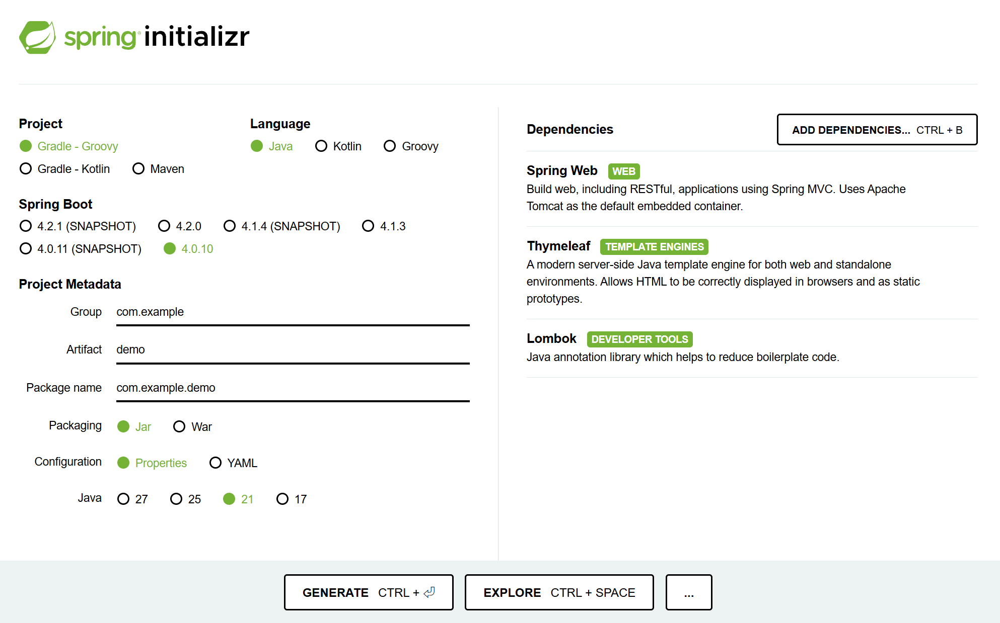

# 4장 Spring MVC

> **본 교재 참고**  
> 5장 「스프링 부트로 게시판 만들기」의 5.1 「웹 애플리케이션과 MVC 모델」, 5.2 「템플릿 엔진과 타임리프」, 5.4 「스프링 부트 게시판 애플리케이션 만들기」

웹 API가 JSON을 응답했다면, 이번 장은 사용자가 브라우저에서 직접 사용할 HTML 화면을 만듭니다. Spring MVC는 요청을 받는 Controller, 화면에 전달할 데이터인 Model, 최종 HTML을 만드는 View로 역할을 나눕니다.

Thymeleaf는 HTML 템플릿에 데이터를 넣어 완성된 HTML을 만드는 템플릿 엔진입니다. 브라우저가 DB나 JPA를 직접 호출하는 것이 아니라 서버가 조회한 데이터를 템플릿에 넣어 응답합니다.

**학습 순서**

1. spring-thymeleaf에서 DB 없이 값 출력·조건·반복·폼을 연습합니다.
2. spring-mvc에서 H2의 실제 데이터를 웹 화면으로 조회·등록·수정·삭제합니다.
3. 같은 회원 등록에 검증을 추가한 버전을 비교합니다.
4. 게시글 관계·페이징과 공통 오류 화면으로 확장합니다.

두 프로젝트를 동시에 8080 포트로 실행하지 않습니다. 단계가 바뀔 때 앞 앱을 종료합니다.

## 4.1 Thymeleaf 기본 문법

> **본 교재 참고**  
> 5.2.1 「타임리프 프로젝트 생성」, 5.2.3 「타임리프 표현식」

**프로젝트 생성과 의존성 선택**

먼저 Spring Initializr에서 다음 의존성을 선택하고, 생성한 프로젝트 폴더를 `spring-thymeleaf`로 준비합니다.

| 의존성 | 역할 |
|---|---|
| Spring Web | 브라우저의 요청을 Controller에서 처리합니다. |
| Thymeleaf | HTML 템플릿에 데이터를 넣어 화면을 만듭니다. |
| Lombok | 화면에 전달할 회원 객체를 간단히 작성합니다. |



HTML의 h1·h2는 제목, p는 문단, a는 링크, table·tr·th·td는 표, form·input·button은 입력과 전송을 표현합니다. Thymeleaf의 th: 속성은 서버에서 처리한 후 최종 HTML을 만듭니다. 동적인 결과는 파일을 더블클릭하는 대신 서버 URL로 접속해 확인합니다.

이 절의 [Member](../spring-thymeleaf/src/main/java/com/example/demo/model/Member.java)는 엔티티가 아닌 단순 화면용 객체입니다. Controller가 회원 네 명을 직접 준비하므로 DB는 필요하지 않습니다. templates/common.html의 상하단 조각은 이미 준비되어 있으며 4.1.8에서 설명합니다.

### 4.1.1 Model과 화면 이름

Model은 Controller에서 화면으로 값을 전달하는 공간입니다. @Controller 메서드가 일반 문자열을 반환하면 이 예제에서는 그 이름의 템플릿을 찾아 HTML을 만듭니다. REST의 @RestController처럼 문자열 자체를 응답하는 것과 구분합니다.

**실습 코드**

[ThymeleafController.java — index()](../spring-thymeleaf/src/main/java/com/example/demo/controller/ThymeleafController.java)

```java
@GetMapping("/")
public String index() {
    // 반환한 이름에 해당하는 templates/index.html을 사용한다.
    return "index";
}
```

[ThymeleafController.java — sampleMembers()](../spring-thymeleaf/src/main/java/com/example/demo/controller/ThymeleafController.java)

```java
// 각 실습에서 사용할 회원 4명을 만든다. DB 연결은 필요하지 않다.
private List<Member> sampleMembers() {
    return List.of(
            Member.builder().id(1L).name("윤서준").email("SeojunYoon@campus.com").age(10).build(),
            Member.builder().id(2L).name("윤광철").email("KwangcheolYoon@campus.com").age(43).build(),
            Member.builder().id(3L).name("공미영").email("MiyeongKong@campus.com").age(23).build(),
            Member.builder().id(4L).name("김도윤").email("DoyunKim@campus.com").age(10).build()
    );
}
```

[ThymeleafController.java — text()](../spring-thymeleaf/src/main/java/com/example/demo/controller/ThymeleafController.java)

```java
@GetMapping("/text")
public String text(Model model) {
    // Model에 넣은 값은 HTML에서 같은 이름으로 사용할 수 있다.
    model.addAttribute("name", "윤서준");
    model.addAttribute("member", sampleMembers().getFirst());
    return "text";
}
```

**코드 설명**

`return "index"`는 templates/index.html, `return "text"`는 templates/text.html을 의미합니다. model.addAttribute의 첫 인자는 화면에서 찾을 이름, 두 번째는 실제 데이터입니다. sampleMembers()의 ID 1~4는 메모리 예제에서 직접 지정한 값입니다. 실제 DB의 ID 규칙과는 관계가 없습니다.

**실행과 예상 결과**

spring-thymeleaf의 DemoApplication을 실행하고 http://localhost:8080 에서 실습 메뉴를 엽니다.

값 출력·조건문·목록·링크·폼·날짜 실습으로 이동할 수 있습니다. /text에서는 윤서준 데이터를 사용합니다.

### 4.1.2 값·객체·문장 출력

변수 표현식 ${...}는 Model의 값을 읽고, 점(.)은 객체의 속성을 읽습니다. th:text는 태그 안의 내용을 해당 값으로 바꿉니다.

**실습 코드**

[text.html](../spring-thymeleaf/src/main/resources/templates/text.html)

```html
<!DOCTYPE html>
<html lang="ko" xmlns:th="http://www.thymeleaf.org">
<head>
    <meta charset="UTF-8">
    <title>값과 객체 출력</title>
</head>
<body>
<header th:replace="~{common :: header}"></header>
<h2>값과 객체 출력</h2>
<!-- th:text는 태그 안의 내용을 Model의 값으로 바꾼다. -->
<p th:text="${name}">회원 이름</p>
<!-- 점(.)으로 객체의 속성에 접근한다. -->
<p th:text="${member.name}">윤서준</p>
<p th:text="${member.email}">SeojunYoon@campus.com</p>
<p th:text="${member.age}">10</p>
<!-- |...| 안에서 문장과 값을 함께 사용할 수 있다. -->
<p th:text="|${member.name}님, 환영합니다!|">회원님, 환영합니다!</p>
<footer th:replace="~{common :: footer}"></footer>
</body>
</html>
```

**코드 설명**

`${name}`은 Model에 넣은 name, `${member.name}`은 member 객체의 이름입니다. `|...|`는 문장 안에 값을 넣기 위한 문법입니다. HTML에 미리 적힌 본문은 템플릿을 읽을 때의 예시이며 서버 처리 후 실제 값으로 교체됩니다. th:text는 입력값을 일반 텍스트로 출력하므로 HTML 태그 문자열을 그대로 실행하지 않습니다.

**실행과 예상 결과**

실습 메뉴에서 값과 객체 출력을 선택하거나 /text에 접속합니다.

윤서준의 이름·이메일·나이와 `윤서준님, 환영합니다!`를 확인합니다.

### 4.1.3 조건에 따라 표시

조건문은 조건에 맞는 태그만 HTML 결과에 포함합니다. th:if는 참, th:unless는 거짓일 때 표시합니다.

**실습 코드**

[ThymeleafController.java — condition()](../spring-thymeleaf/src/main/java/com/example/demo/controller/ThymeleafController.java)

```java
@GetMapping("/condition")
public String condition(Model model) {
    // 회원의 나이를 20 이상으로 바꾸면 표시되는 문구가 달라진다.
    model.addAttribute("member", sampleMembers().getFirst());
    return "condition";
}
```

[condition.html](../spring-thymeleaf/src/main/resources/templates/condition.html)

```html
<!DOCTYPE html>
<html lang="ko" xmlns:th="http://www.thymeleaf.org">
<head>
    <meta charset="UTF-8">
    <title>조건에 따라 표시</title>
</head>
<body>
<header th:replace="~{common :: header}"></header>
<h2>조건에 따라 표시</h2>
<p th:text="|${member.name}님은 ${member.age}살입니다.|">윤서준님은 10살입니다.</p>
<!-- 실습에서는 20살 이상을 성인으로 구분한다. -->
<!-- th:if는 조건이 참일 때 태그를 표시한다. -->
<p th:if="${member.age >= 20}">성인 회원입니다.</p>
<!-- th:unless는 조건이 거짓일 때 태그를 표시한다. -->
<p th:unless="${member.age >= 20}">미성년자 회원입니다.</p>
<footer th:replace="~{common :: footer}"></footer>
</body>
</html>
```

**코드 설명**

현재 코드는 실습 기준으로 나이가 20 이상인지 비교합니다. 20살이라는 기준은 이 예제의 표시 조건입니다. 두 문구를 모두 출력한 뒤 CSS로 숨기는 방식이 아니라 서버에서 조건에 맞는 태그만 결과에 포함합니다.

**실행과 예상 결과**

/condition을 엽니다. Controller에서 전달할 회원의 나이를 바꾸거나 sampleMembers의 다른 회원을 선택해 재시작하고 비교합니다.

현재 첫 회원 윤서준은 10살이므로 미성년자 문구만 표시됩니다. 43살 회원이면 성인 문구만 표시됩니다.

### 4.1.4 회원 목록 반복 출력

목록의 각 요소에 대해 같은 HTML 구조를 반복하려면 th:each를 사용합니다. 자바 for문처럼 현재 요소를 가리키는 이름을 정해 사용할 수 있습니다.

**실습 코드**

[ThymeleafController.java — list()](../spring-thymeleaf/src/main/java/com/example/demo/controller/ThymeleafController.java)

```java
@GetMapping("/list")
public String list(Model model) {
    model.addAttribute("members", sampleMembers());
    return "list";
}
```

[list.html](../spring-thymeleaf/src/main/resources/templates/list.html)

```html
<!DOCTYPE html>
<html lang="ko" xmlns:th="http://www.thymeleaf.org">
<head>
    <meta charset="UTF-8">
    <title>회원 목록 출력</title>
</head>
<body>
<header th:replace="~{common :: header}"></header>
<h2>회원 목록</h2>
<table>
    <thead>
    <tr><th>순번</th><th>이름</th><th>이메일</th><th>나이</th></tr>
    </thead>
    <tbody>
    <!-- th:each는 회원 수만큼 행을 반복한다. status.count는 1부터 시작하는 순번이다. -->
    <tr th:each="member, status : ${members}">
        <td th:text="${status.count}">1</td>
        <td th:text="${member.name}">윤서준</td>
        <td th:text="${member.email}">SeojunYoon@campus.com</td>
        <td th:text="${member.age}">10</td>
    </tr>
    </tbody>
</table>
<footer th:replace="~{common :: footer}"></footer>
</body>
</html>
```

**코드 설명**

`member, status : ${members}`는 목록의 각 회원과 반복 상태를 제공합니다. status.count는 1부터 시작하는 순번이고 DB 회원 ID가 아닙니다. 반복을 tr에 붙였으므로 회원마다 행이 하나씩 만들어집니다.

**실행과 예상 결과**

/list를 엽니다.

회원 4명이 순번 1~4로 표시됩니다. 메모리에서 만든 List의 순서대로 윤서준·윤광철·공미영·김도윤이 나옵니다.

### 4.1.5 회원 정보 링크

@{...}는 URL을 만드는 표현식입니다. 링크에 검색 조건을 넣으면 Controller가 @RequestParam으로 받아 해당 데이터를 골라 전달할 수 있습니다.

**실습 코드**

[ThymeleafController.java — link()](../spring-thymeleaf/src/main/java/com/example/demo/controller/ThymeleafController.java)

```java
@GetMapping("/link")
public String link(@RequestParam(name = "id", defaultValue = "1") Long id, Model model) {
    model.addAttribute("members", sampleMembers());
    // 링크의 id에 해당하는 회원을 화면에 전달한다.
    for (Member member : sampleMembers()) {
        if (member.getId().equals(id)) {
            model.addAttribute("member", member);
            break;
        }
    }
    return "link";
}
```

[link.html](../spring-thymeleaf/src/main/resources/templates/link.html)

```html
<!DOCTYPE html>
<html lang="ko" xmlns:th="http://www.thymeleaf.org">
<head>
    <meta charset="UTF-8">
    <title>회원 정보 링크</title>
</head>
<body>
<header th:replace="~{common :: header}"></header>
<h2>회원 정보 링크</h2>
<ul>
    <li th:each="member : ${members}">
        <!-- @{...}는 URL을 만든다. 예: /link?id=1 -->
        <a th:href="@{/link(id=${member.id})}" th:text="${member.name}">윤서준</a>
    </li>
</ul>
<section th:if="${member != null}">
    <h3>선택한 회원</h3>
    <p th:text="${member.name}">윤서준</p>
    <p th:text="${member.email}">SeojunYoon@campus.com</p>
    <p th:text="|${member.age}살|">10살</p>
</section>
<footer th:replace="~{common :: footer}"></footer>
</body>
</html>
```

**코드 설명**

`@{/link(id=${member.id})}`는 /link?id=1 같은 URL을 만듭니다. @RequestParam의 defaultValue는 id를 생략했을 때 사용할 값입니다. Controller의 반복문은 ID가 같은 회원을 찾아 Model에 넣습니다. 문법 실습에서는 화면에 제공된 회원 1~4의 링크를 사용합니다.

**실행과 예상 결과**

/link에서 회원 이름을 차례로 누르고 브라우저 주소와 선택 정보가 함께 바뀌는지 확인합니다.

공미영 링크를 누르면 id=3과 공미영의 이메일·23살 정보가 표시됩니다.

### 4.1.6 입력 폼과 객체 연결

> **본 교재 참고**  
> 5.4.5 「게시판 웹 화면 구현」

form은 입력값을 서버에 전송합니다. method="post"는 POST 요청, th:action은 보낼 주소입니다. th:object로 객체를 선택하고 *{속성}으로 그 객체의 값을 다룹니다.

**실습 코드**

[ThymeleafController.java — form()](../spring-thymeleaf/src/main/java/com/example/demo/controller/ThymeleafController.java)

```java
@GetMapping("/form")
public String form(Model model) {
    // 빈 객체를 전달하면 th:field로 입력칸을 연결할 수 있다.
    model.addAttribute("member", new Member());
    return "form";
}
```

[ThymeleafController.java — submit()](../spring-thymeleaf/src/main/java/com/example/demo/controller/ThymeleafController.java)

```java
@PostMapping("/form")
public String submit(@ModelAttribute("member") Member member) {
    // 폼의 name, email, age를 객체에 담아 결과 화면에 전달한다. DB에는 저장하지 않는다.
    return "result";
}
```

[form.html](../spring-thymeleaf/src/main/resources/templates/form.html)

```html
<!DOCTYPE html>
<html lang="ko" xmlns:th="http://www.thymeleaf.org">
<head>
    <meta charset="UTF-8">
    <title>회원 정보 입력</title>
</head>
<body>
<header th:replace="~{common :: header}"></header>
<h2>회원 정보 입력</h2>
<p>정혁 / JungHyuk@campus.com / 10살을 입력해 보세요.</p>
<!-- th:action은 전송할 URL, th:object는 입력값을 담을 객체를 지정한다. -->
<form th:action="@{/form}" th:object="${member}" method="post">
    <!-- *{name}은 선택한 member의 name이다. th:field가 id, name, value를 설정한다. -->
    <p>
        <label for="name">이름</label>
        <input type="text" th:field="*{name}" required>
    </p>
    <p>
        <label for="email">이메일</label>
        <input type="email" th:field="*{email}" required>
    </p>
    <p>
        <label for="age">나이</label>
        <input type="number" th:field="*{age}" min="0" required>
    </p>
    <button type="submit">입력 내용 확인</button>
</form>
<footer th:replace="~{common :: footer}"></footer>
</body>
</html>
```

[result.html](../spring-thymeleaf/src/main/resources/templates/result.html)

```html
<!DOCTYPE html>
<html lang="ko" xmlns:th="http://www.thymeleaf.org">
<head>
    <meta charset="UTF-8">
    <title>입력 결과</title>
</head>
<body>
<header th:replace="~{common :: header}"></header>
<h2>입력 결과</h2>
<!-- @ModelAttribute로 전달된 객체의 값을 출력한다. -->
<dl th:object="${member}">
    <dt>이름</dt>
    <dd th:text="*{name}">정혁</dd>
    <dt>이메일</dt>
    <dd th:text="*{email}">JungHyuk@campus.com</dd>
    <dt>나이</dt>
    <dd th:text="*{age}">10</dd>
</dl>
<p>입력한 정보는 DB에 저장하지 않습니다.</p>
<a th:href="@{/form}">다시 입력하기</a>
<footer th:replace="~{common :: footer}"></footer>
</body>
</html>
```

**코드 설명**

GET /form은 빈 Member를 화면에 보냅니다. th:field가 입력칸의 name·id·value를 객체 속성에 연결합니다. label의 for와 입력칸 id가 연결됩니다. POST /form의 @ModelAttribute는 폼 이름·이메일·나이를 Member에 바인딩하고 Model에서도 사용할 수 있게 합니다. JSON 본문을 받는 @RequestBody와는 입력 형식이 다릅니다.

**실행과 예상 결과**

/form에서 정혁 / JungHyuk@campus.com / 10을 입력하고 버튼을 누릅니다.

result.html에 입력 내용이 나타납니다. 이 프로젝트는 저장 기능이 없어서 DB에는 추가되지 않습니다. 결과 화면 새로고침 시 브라우저가 POST 재전송을 물을 수 있으며, 뒤의 실제 CRUD에서는 처리 후 리다이렉트를 배웁니다.

### 4.1.7 날짜와 시간 출력

자바의 LocalDateTime을 그대로 출력하는 대신 화면에서 읽기 쉬운 형식으로 바꿀 수 있습니다.

**실습 코드**

[ThymeleafController.java — utility()](../spring-thymeleaf/src/main/java/com/example/demo/controller/ThymeleafController.java)

```java
@GetMapping("/utility")
public String utility(Model model) {
    model.addAttribute("now", LocalDateTime.now());
    return "utility";
}
```

[utility.html](../spring-thymeleaf/src/main/resources/templates/utility.html)

```html
<!DOCTYPE html>
<html lang="ko" xmlns:th="http://www.thymeleaf.org">
<head>
    <meta charset="UTF-8">
    <title>날짜 출력</title>
</head>
<body>
<header th:replace="~{common :: header}"></header>
<h2>현재 시간</h2>
<!-- #temporals.format은 날짜·시간을 지정한 형식의 문자열로 바꾼다. MM은 월, mm은 분이다. -->
<p th:text="${#temporals.format(now, 'yyyy-MM-dd HH:mm')}">2026-11-22 09:30</p>
<footer th:replace="~{common :: footer}"></footer>
</body>
</html>
```

**코드 설명**

#temporals.format이 날짜·시간을 문자열로 바꿉니다. yyyy는 연도, MM은 월, dd는 일, HH는 24시간제 시, mm은 분입니다. 월 MM과 분 mm을 구분합니다.

**실행과 예상 결과**

/utility를 엽니다.

현재 서버 실행 환경의 날짜와 시간이 `연도-월-일 시:분`으로 표시됩니다. 교재에 적힌 고정 예시 시각과 같아야 하는 것은 아닙니다.

### 4.1.8 공통 화면 조각

> **본 교재 참고**  
> 5.2.4 「타임리프의 레이아웃 관리」

여러 화면에서 반복하는 메뉴와 하단 문구를 한곳에 모을 수 있습니다. fragment는 재사용할 HTML 부분의 이름입니다.

**실습 코드**

[common.html](../spring-thymeleaf/src/main/resources/templates/common.html)

```html
<!DOCTYPE html>
<html lang="ko" xmlns:th="http://www.thymeleaf.org">
<head>
    <meta charset="UTF-8">
    <title>공통 화면</title>
</head>
<body>
<!-- th:fragment는 다른 화면에서 재사용할 부분에 이름을 붙인다. -->
<header th:fragment="header">
    <h1>Thymeleaf 실습</h1>
    <nav><a th:href="@{/}">실습 메뉴</a></nav>
    <hr>
</header>
<footer th:fragment="footer">
    <hr>
    <p>회원 예제로 배우는 Thymeleaf</p>
</footer>
</body>
</html>
```

**코드 설명**

`th:fragment="header"`와 footer가 이름을 정의합니다. 앞에서 본 각 화면의 `th:replace="~{common :: header}"`는 common.html의 header 조각으로 그 태그 전체를 바꿉니다. 따라서 완성된 결과의 메뉴는 여러 파일에 직접 복사할 필요가 없습니다.

**실행과 예상 결과**

common.html의 하단 안내 문구를 바꾸고 앱을 재시작하거나 템플릿을 다시 로드해 두 화면을 확인합니다.

같은 fragment를 사용하는 화면들에 변경한 문구가 나타납니다. 변경 후 문구는 원래대로 복구합니다.

## 4.2 H2와 실제 웹 실습 준비

> **본 교재 참고**  
> 3.1.1 「데이터베이스 준비」, 3.4 「JPA」; 스키마 구성은 5.4.2 「스키마 구축」

**프로젝트 생성과 의존성 선택**

이제 DB를 사용하는 별도 프로젝트를 생성합니다. Spring Initializr에서 다음 의존성을 선택하고, 생성한 프로젝트 폴더를 `spring-mvc`로 준비합니다.

| 의존성 | 역할 |
|---|---|
| Spring Web | 화면의 조회·등록·수정·삭제 요청을 처리합니다. |
| Thymeleaf | 회원과 게시글 데이터를 HTML로 표시합니다. |
| Validation | 이름·이메일·나이 등의 입력 규칙을 검사합니다. |
| Spring Data JPA | Repository로 회원과 게시글을 저장하고 조회합니다. |
| H2 Database | 메모리에서 실행되는 실습용 DB를 제공합니다. |
| Lombok | 생성자·getter 등의 반복 코드를 줄여 줍니다. |


spring-mvc는 브라우저 입력을 DB에 반영합니다. H2 메모리 DB는 별도 서버를 설치하지 않고 앱 안에서 실행됩니다. 앱을 종료하면 데이터가 사라지고 다음 실행에서 SQL로 다시 준비하므로 외부 MariaDB의 기존 데이터와 독립적으로 실습할 수 있습니다.

### 4.2.1 스키마와 데이터 자동 초기화

Spring Boot는 이 프로젝트의 내장 메모리 DB를 준비하면서 resources의 schema.sql과 data.sql을 실행합니다. schema.sql이 테이블을 만들고 data.sql이 값을 넣습니다.

**실습 코드**

[application.properties](../spring-mvc/src/main/resources/application.properties)

```properties
spring.application.name=demo

# 브라우저에서 /h2-console로 H2 데이터베이스를 확인한다.
spring.h2.console.enabled=true

# 테이블은 schema.sql로 생성하므로 JPA의 자동 생성을 끈다.
spring.jpa.hibernate.ddl-auto=none
```

[schema.sql](../spring-mvc/src/main/resources/schema.sql)

```sql
-- MariaDB/MySQL과 H2에서 공통으로 사용하는 실습 스키마이다.
-- 회원 테이블을 먼저 만든 뒤, 회원을 참조하는 게시글 테이블을 만든다.
CREATE TABLE IF NOT EXISTS member (
    id BIGINT AUTO_INCREMENT PRIMARY KEY,
    name VARCHAR(128) NOT NULL,
    email VARCHAR(256) NOT NULL UNIQUE,
    age INTEGER
);

CREATE TABLE IF NOT EXISTS article (
    id BIGINT AUTO_INCREMENT PRIMARY KEY,
    title VARCHAR(256),
    description VARCHAR(4096),
    created TIMESTAMP,
    updated TIMESTAMP,
    member_id BIGINT,
    FOREIGN KEY (member_id) REFERENCES member(id)
);
```

**코드 설명**

ddl-auto=none은 JPA의 별도 테이블 생성을 끕니다. 테이블 생성은 SQL이 담당하도록 역할을 정한 것입니다. H2 기본 모드는 공통 SQL의 AUTO_INCREMENT를 지원합니다. data.sql의 본문은 [공통 샘플](../spring-mvc/src/main/resources/data.sql)을 사용합니다. 회원 4명과 각 25개의 글을 준비합니다.

현재 MVC 설정에는 H2 콘솔 활성화가 있습니다. 사용하려면 /h2-console에서 로그의 실제 jdbc:h2:mem:... 주소와 sa·빈 비밀번호를 입력합니다. 이 장의 화면 CRUD를 실행하는 데 콘솔을 반드시 열 필요는 없습니다.

**실행과 예상 결과**

spring-thymeleaf를 종료한 뒤 spring-mvc의 DemoApplication을 실행합니다. http://localhost:8080 으로 접속합니다.

홈 요청은 /members로 리다이렉트되고 회원 4명이 표시됩니다. 앱을 다시 실행하면 등록·수정 결과는 초기 샘플 상태로 돌아갑니다.

## 4.3 Member 화면 CRUD

> **본 교재 참고**  
> 5.1.1 「웹 애플리케이션 아키텍처와 MVC 패턴」, 5.4.6 「관리자 기능 구현」

화면 CRUD는 입력 화면을 여는 GET과 값을 처리하는 POST를 나눕니다. HTML form은 name이 있는 입력값을 보내고 Controller는 @ModelAttribute로 받습니다. 기본 등록·수정에서는 Member 엔티티를 직접 사용합니다.

아래 실습의 [MemberController](../spring-mvc/src/main/java/com/example/demo/controller/MemberController.java)는 MemberRepository와 ArticleRepository를 주입받습니다. 회원·게시글 엔티티 구조는 JPA 장과 같고, ArticleRepository.existsByMember()는 작성한 글이 있는지 확인할 때 사용합니다. 로그인 기능은 아직 없습니다.

### 4.3.1 회원 목록·상세 화면

Controller는 조회 결과를 Model에 넣고 화면 이름을 반환합니다. 템플릿은 이름이 일치하는 Model 값을 사용해 회원 목록과 상세 정보를 출력합니다.

**실습 코드**

[MemberController.java — list()](../spring-mvc/src/main/java/com/example/demo/controller/MemberController.java)

```java
@GetMapping("/members")
public String list(Model model) {
    model.addAttribute("members", memberRepository.findAll());
    return "member-list";
}
```

[MemberController.java — detail()](../spring-mvc/src/main/java/com/example/demo/controller/MemberController.java)

```java
@GetMapping("/members/{id}")
public String detail(@PathVariable("id") Long id, Model model) {
    model.addAttribute("member", findMember(id));
    return "member-detail";
}
```

[MemberController.java — findMember()](../spring-mvc/src/main/java/com/example/demo/controller/MemberController.java)

```java
private Member findMember(Long id) {
    // 조회 결과가 없으면 공통 예외 처리에서 404 화면을 표시한다.
    return memberRepository.findById(id)
            .orElseThrow(() -> new NoSuchElementException("회원을 찾을 수 없습니다."));
}
```

[member-list.html](../spring-mvc/src/main/resources/templates/member-list.html)

```html
<!DOCTYPE html>
<html lang="ko" xmlns:th="http://www.thymeleaf.org">
<head>
    <meta charset="UTF-8">
    <title>회원 목록</title>
</head>
<body>
<div th:replace="~{common :: header}"></div>
<h2>회원 목록</h2>
<table>
    <tr>
        <th>ID</th>
        <th>이름</th>
        <th>이메일</th>
        <th>나이</th>
        <th>수정</th>
    </tr>

    <!-- 회원 한 명마다 한 행을 출력한다. -->
    <tr th:each="member : ${members}">
        <td th:text="${member.id}">1</td>
        <td><a th:href="@{/members/{id}(id=${member.id})}" th:text="${member.name}">윤서준</a></td>
        <td th:text="${member.email}">SeojunYoon@campus.com</td>
        <td th:text="${member.age}">10</td>
        <td><a th:href="@{/members/{id}/edit(id=${member.id})}">수정</a></td>
    </tr>

</table>
<p th:if="${#lists.isEmpty(members)}">등록된 회원이 없습니다.</p>
<p><a th:href="@{/members/new}">회원 등록하기</a></p>
<div th:replace="~{common :: footer}"></div>
</body>
</html>
```

[member-detail.html](../spring-mvc/src/main/resources/templates/member-detail.html)

```html
<!DOCTYPE html>
<html lang="ko" xmlns:th="http://www.thymeleaf.org">
<head>
    <meta charset="UTF-8">
    <title>회원 상세</title>
</head>
<body>
<div th:replace="~{common :: header}"></div>
<h2>회원 상세</h2>
<p th:if="${message != null}" th:text="${message}">안내 메시지</p>
<div th:object="${member}">
    <p>ID: <span th:text="*{id}">1</span></p>
    <p>이름: <span th:text="*{name}">윤서준</span></p>
    <p>이메일: <span th:text="*{email}">SeojunYoon@campus.com</span></p>
    <p>나이: <span th:text="*{age}">10</span></p>
</div>
<p><a th:href="@{/members/{id}/edit(id=${member.id})}">수정하기</a></p>
<!-- 데이터가 바뀌는 삭제 요청은 링크의 GET 대신 폼의 POST로 보낸다. -->
<form th:action="@{/members/{id}/delete(id=${member.id})}" method="post">
    <button type="submit">삭제하기</button>
</form>
<p><a th:href="@{/members}">목록으로</a></p>
<div th:replace="~{common :: footer}"></div>
</body>
</html>
```

**코드 설명**

목록의 회원 이름은 실제 ID가 들어간 상세 링크입니다. URL의 {id}는 @PathVariable로 받습니다. findMember()는 공통으로 조회하고 없으면 NoSuchElementException을 던집니다. 상세 화면의 th:object는 member를 선택하고 *{name} 등으로 값을 출력합니다. 메뉴와 하단은 MVC의 common fragment를 사용합니다.

**실행과 예상 결과**

/members에서 이름을 눌러 상세 화면을 엽니다. ID를 직접 외워 입력하지 않아도 됩니다.

회원 4명의 목록이 보이고 선택한 회원의 이름·이메일·나이를 확인할 수 있습니다. 상세에서 수정이나 목록으로 이동할 수 있습니다.

### 4.3.2 회원 등록

등록 화면은 빈 Member를 입력칸과 연결합니다. 등록 요청을 처리한 뒤에는 redirect를 사용해 목록 GET 요청으로 이동합니다.

**실습 코드**

[MemberController.java — addForm()](../spring-mvc/src/main/java/com/example/demo/controller/MemberController.java)

```java
@GetMapping("/members/new")
public String addForm(@ModelAttribute("member") Member member) {
    // 빈 회원 객체를 전달해 입력칸과 연결한다.
    return "member-add";
}
```

[MemberController.java — add()](../spring-mvc/src/main/java/com/example/demo/controller/MemberController.java)

```java
@PostMapping("/members")
public String add(@ModelAttribute("member") Member member) {
    // 입력한 값을 엔티티로 받고, ID는 DB가 새로 부여하게 한다.
    member.setId(null);
    memberRepository.save(member);
    // 저장 후 목록으로 이동해 새로고침해도 다시 등록되지 않게 한다.
    return "redirect:/members";
}
```

[member-add.html](../spring-mvc/src/main/resources/templates/member-add.html)

```html
<!DOCTYPE html>
<html lang="ko" xmlns:th="http://www.thymeleaf.org">
<head>
    <meta charset="UTF-8">
    <title>회원 등록</title>
</head>
<body>
<div th:replace="~{common :: header}"></div>
<h2>회원 등록</h2>
<p>정혁 / JungHyuk@campus.com / 10살을 입력해 보세요.</p>
<!-- 입력값을 Member 엔티티에 담아 등록한다. -->
<form th:action="@{/members}" th:object="${member}" method="post">
    <!-- th:field는 회원 객체의 속성과 입력칸을 연결한다. -->
    <p>
        <label for="name">이름</label>
        <input type="text" th:field="*{name}">
    </p>
    <p>
        <label for="email">이메일</label>
        <input type="email" th:field="*{email}">
    </p>
    <p>
        <label for="age">나이</label>
        <input type="number" th:field="*{age}">
    </p>
    <button type="submit">등록하기</button>
</form>
<p><a th:href="@{/members}">목록으로</a></p>
<div th:replace="~{common :: footer}"></div>
</body>
</html>
```

**코드 설명**

GET /members/new의 @ModelAttribute가 빈 객체를 준비합니다. 폼의 object 이름 member와 Controller의 이름이 같습니다. POST /members는 입력값을 엔티티로 받아 ID를 비우고 저장합니다. `return "member-add"`는 화면 렌더링, `return "redirect:/members"`는 브라우저에 다른 주소로 다시 요청하도록 하는 응답입니다.

**실행과 예상 결과**

정혁 / JungHyuk@campus.com / 10으로 등록합니다.

브라우저가 목록으로 이동하고 정혁이 추가됩니다. 브라우저 개발자 도구에서는 보통 등록 POST의 302 이동 응답과 뒤따르는 목록 GET의 200 응답을 볼 수 있습니다. 목록 새로고침은 새 등록을 반복하지 않습니다.

### 4.3.3 회원 수정

수정 화면에는 기존 값을 채워 보여 주고, 저장 요청에서는 URL ID로 찾은 회원을 갱신합니다.

**실습 코드**

[MemberController.java — editForm()](../spring-mvc/src/main/java/com/example/demo/controller/MemberController.java)

```java
@GetMapping("/members/{id}/edit")
public String editForm(@PathVariable("id") Long id, Model model) {
    model.addAttribute("member", findMember(id));
    return "member-edit";
}
```

[MemberController.java — edit()](../spring-mvc/src/main/java/com/example/demo/controller/MemberController.java)

```java
@PostMapping("/members/{id}/edit")
public String edit(@PathVariable("id") Long id,
                   @ModelAttribute("member") Member member) {
    // URL의 ID로 회원을 찾고, 입력한 값으로 바꾸어 저장한다.
    Member found = findMember(id);
    found.setName(member.getName());
    found.setEmail(member.getEmail());
    found.setAge(member.getAge());
    memberRepository.save(found);
    return "redirect:/members";
}
```

[member-edit.html](../spring-mvc/src/main/resources/templates/member-edit.html)

```html
<!DOCTYPE html>
<html lang="ko" xmlns:th="http://www.thymeleaf.org">
<head>
    <meta charset="UTF-8">
    <title>회원 수정</title>
</head>
<body>
<div th:replace="~{common :: header}"></div>
<h2>회원 수정</h2>
<!-- 조회한 Member 엔티티의 값을 입력칸에 표시한다. 수정 대상 ID는 URL로 보낸다. -->
<form th:action="@{/members/{id}/edit(id=${member.id})}" th:object="${member}" method="post">
    <!-- th:field는 회원 객체의 속성과 입력칸을 연결한다. -->
    <p>
        <label for="name">이름</label>
        <input type="text" th:field="*{name}">
    </p>
    <p>
        <label for="email">이메일</label>
        <input type="email" th:field="*{email}">
    </p>
    <p>
        <label for="age">나이</label>
        <input type="number" th:field="*{age}">
    </p>
    <button type="submit">수정하기</button>
</form>
<p><a th:href="@{/members/{id}(id=${member.id})}">취소하기</a></p>
<div th:replace="~{common :: footer}"></div>
</body>
</html>
```

**코드 설명**

폼의 th:field가 조회한 회원 값을 표시합니다. 수정 대상의 ID는 action URL에 들어갑니다. 저장 시 찾은 기존 엔티티에 name·email·age를 복사하므로 URL의 ID가 수정 대상을 결정합니다. POST 본문에 임의로 id를 넣는 방식으로 대상을 바꾸지 않습니다.

**실행과 예상 결과**

등록한 정혁의 나이를 11로 수정하고 목록·상세에서 확인합니다.

이름·이메일은 유지되고 나이가 11로 표시됩니다. DB 변경은 HTTP 요청이 처리되면 유지되지만 H2 앱을 재시작하면 초기화됩니다.

### 4.3.4 회원 삭제와 안내 메시지

관계가 있는 데이터를 무조건 지우지 않도록 작성한 글의 존재 여부를 확인합니다. 안내가 필요하면 이동한 화면에서 한 번 사용할 메시지를 전달할 수 있습니다.

**실습 코드**

[MemberController.java — delete()](../spring-mvc/src/main/java/com/example/demo/controller/MemberController.java)

```java
@PostMapping("/members/{id}/delete")
public String delete(@PathVariable("id") Long id, RedirectAttributes redirectAttributes) {
    Member member = findMember(id);
    // 게시글의 작성자 정보가 사라지지 않도록 삭제를 제한한다.
    if (articleRepository.existsByMember(member)) {
        // 다음 화면에서 한 번 표시할 메시지를 전달한다.
        redirectAttributes.addFlashAttribute("message", "작성한 게시글이 있는 회원은 삭제할 수 없습니다.");
        return "redirect:/members/" + id;
    }
    memberRepository.delete(member);
    return "redirect:/members";
}
```

**코드 설명**

기존 샘플 회원은 모두 게시글 작성자입니다. existsByMember()가 true이면 삭제하지 않고 RedirectAttributes.addFlashAttribute()로 안내를 전달한 뒤 상세로 이동합니다. flash 값은 리다이렉트 후 화면에서 사용하는 일회성 값입니다. 글이 없는 회원은 delete() 후 목록으로 갑니다. 상세 HTML의 삭제 form은 POST 요청입니다.

**실행과 예상 결과**

먼저 새로 등록한 정혁을 삭제합니다. 이어서 샘플 작성자를 선택해 삭제 요청을 비교합니다.

정혁은 목록에서 사라집니다. 샘플 작성자는 상세로 돌아와 `작성한 게시글이 있는 회원은 삭제할 수 없습니다.`가 보입니다. 다른 회원 실습을 위해 관련 글을 무단으로 삭제할 필요는 없습니다.

## 4.4 같은 등록 기능에 검증 추가하기

> **본 교재 참고**  
> 5.4.4 「사용자 로그인 구현」의 회원가입 폼, 5.4.5 「게시판 웹 화면 구현」의 입력 검증

기본 등록이 값을 받아 저장하는 흐름이었다면 검증 버전은 잘못된 입력을 입력 화면에서 고칠 수 있도록 안내합니다. DB의 NOT NULL은 null을 막지만 빈 문자열이나 이메일 형식까지 모두 검사하지는 않습니다. 사용자 입력 조건은 별도로 정의할 필요가 있습니다.

두 버전은 같은 MemberController 안에서 기본 add() 다음에 배치되어 있습니다. 기본 화면은 /members/new, 검증 화면은 /members/new-validation입니다. 검증 버전은 이름·이메일·나이를 입력받습니다.

### 4.4.1 MemberForm에 검증 규칙 선언

폼 객체는 화면에서 입력받을 값과 검증 규칙을 모읍니다. DB 매핑용 엔티티와 구분하면 화면의 입력 조건을 따로 표현하기 쉽습니다.

**실습 코드**

[MemberForm.java](../spring-mvc/src/main/java/com/example/demo/form/MemberForm.java)

```java
package com.example.demo.form;

import jakarta.validation.constraints.Email;
import jakarta.validation.constraints.Min;
import jakarta.validation.constraints.NotBlank;
import jakarta.validation.constraints.NotNull;
import jakarta.validation.constraints.Size;
import lombok.Data;

// 회원 등록의 검증 버전에서 사용할 입력값과 검증 규칙을 모은다.
@Data
public class MemberForm {
    @NotBlank(message = "이름을 입력하세요.")
    @Size(max = 128, message = "이름은 128자 이하로 입력하세요.")
    private String name;

    @NotBlank(message = "이메일을 입력하세요.")
    @Email(message = "이메일 형식으로 입력하세요.")
    @Size(max = 256, message = "이메일은 256자 이하로 입력하세요.")
    private String email;

    @NotNull(message = "나이를 입력하세요.")
    @Min(value = 0, message = "나이는 0 이상으로 입력하세요.")
    private Integer age;

    /*
     * 주요 Validation 애노테이션
     * @NotNull: null을 허용하지 않는다. 빈 문자열과 공백은 허용한다.
     * @NotEmpty: null과 빈 문자열·빈 컬렉션을 허용하지 않는다. 공백 문자열은 허용한다.
     * @NotBlank: 문자열이 null이거나 비어 있거나 공백만 있으면 오류이다.
     * @Size(min = 2, max = 20): 문자열 길이 또는 컬렉션·배열의 크기를 제한한다.
     * @Email: 문자열이 이메일 형식인지 확인한다. 실제 존재하는 주소인지는 확인하지 않는다.
     * @Min(0), @Max(150): 숫자의 최솟값과 최댓값을 제한한다. 경계값도 허용한다.
     * @Positive: 0보다 큰 숫자만 허용한다.
     * @PositiveOrZero: 0 이상의 숫자를 허용한다.
     * @Pattern(regexp = "[0-9]+"): 숫자로만 된 문자열인지 확인한다. 정규식으로 규칙을 지정한다.
     * @Past, @Future: 날짜·시간이 현재보다 과거인지, 미래인지 확인한다.
     *
     * @Size, @Email, 숫자·날짜·정규식 검증은 null을 허용하므로 필수값에는
     * @NotNull 또는 문자열용 @NotBlank 등을 함께 사용한다.
     * message는 검증 실패 시 표시할 문구이다.
     * Controller의 입력 객체에 @Valid를 붙이면 선언한 검증 규칙을 확인한다.
     */
}
```

**코드 설명**

NotBlank는 null·빈 문자열·공백만 있는 문자열을 막습니다. Email은 이메일 형식을, Size는 문자열 길이를 확인합니다. 나이의 NotNull과 Min(0)은 필수 입력과 0 이상 조건입니다. Min이나 Email 등은 null 자체를 막는 규칙이 아니므로 필수 조건을 함께 사용합니다. 파일 마지막 주석은 자주 사용하는 다른 검증 애노테이션을 정리한 참고표입니다.

**실행과 예상 결과**

폼과 엔티티의 필드를 비교합니다. 현재 두 객체 모두 이름·이메일·나이를 다루지만 역할과 애노테이션이 다릅니다.

검증 버전은 MemberForm으로 값을 받으며, 규칙에 맞는 데이터만 Member로 옮겨 저장합니다.

### 4.4.2 검증 결과와 입력값 유지

@Valid는 폼의 검증 규칙을 실행하게 하고 BindingResult는 오류 정보를 받습니다. DB 조회가 필요한 이메일 중복은 직접 검사해 같은 오류 목록에 넣습니다.

**실습 코드**

[MemberController.java — addValidationForm()](../spring-mvc/src/main/java/com/example/demo/controller/MemberController.java)

```java
// 기본 등록에 입력 검증을 추가한 버전이다.
@GetMapping("/members/new-validation")
public String addValidationForm(@ModelAttribute("memberForm") MemberForm form) {
    return "member-add-validation";
}
```

[MemberController.java — addValidation()](../spring-mvc/src/main/java/com/example/demo/controller/MemberController.java)

```java
@PostMapping("/members/validation")
public String addValidation(@Valid @ModelAttribute("memberForm") MemberForm form,
                            BindingResult bindingResult) {
    // @Valid가 폼의 검증 규칙을 확인한다. BindingResult는 바로 뒤에 두어 오류를 받는다.
    if (memberRepository.findByEmail(form.getEmail()).isPresent()) {
        // 이메일 중복처럼 DB 조회가 필요한 검증은 직접 추가한다.
        bindingResult.rejectValue("email", "duplicate", "이미 사용 중인 이메일입니다.");
    }
    if (bindingResult.hasErrors()) {
        // 같은 화면을 반환하면 입력값과 오류 메시지가 유지된다.
        return "member-add-validation";
    }

    // 검증을 통과한 폼의 값으로 Member 엔티티를 만들어 저장한다.
    Member member = Member.builder()
            .name(form.getName()).email(form.getEmail()).age(form.getAge()).build();
    memberRepository.save(member);
    return "redirect:/members";
}
```

[member-add-validation.html](../spring-mvc/src/main/resources/templates/member-add-validation.html)

```html
<!DOCTYPE html>
<html lang="ko" xmlns:th="http://www.thymeleaf.org">
<head>
    <meta charset="UTF-8">
    <title>회원 등록(검증)</title>
</head>
<body>
<div th:replace="~{common :: header}"></div>
<h2>회원 등록(검증)</h2>
<p>정혁 / JungHyuk@campus.com / 10살로 등록해 보세요.</p>
<!-- novalidate로 브라우저의 검증을 끄고 서버의 한글 오류 메시지를 확인한다. -->
<form th:action="@{/members/validation}" th:object="${memberForm}" method="post" novalidate>
    <!-- th:field는 폼의 입력값을 연결하고 th:errors는 해당 항목의 오류를 표시한다. -->
    <p>
        <label for="name">이름</label>
        <input type="text" th:field="*{name}">
        <span th:errors="*{name}"></span>
    </p>
    <p>
        <label for="email">이메일</label>
        <input type="email" th:field="*{email}">
        <span th:errors="*{email}"></span>
    </p>
    <p>
        <label for="age">나이</label>
        <input type="number" th:field="*{age}">
        <span th:errors="*{age}"></span>
    </p>
    <button type="submit">등록하기</button>
</form>
<p><a th:href="@{/members}">목록으로</a></p>
<div th:replace="~{common :: footer}"></div>
</body>
</html>
```

**코드 설명**

BindingResult는 검증 대상 매개변수 바로 뒤에 둡니다. rejectValue의 첫 값 email은 오류가 생긴 필드, duplicate는 오류 코드, 마지막 문자열은 표시 문구입니다. hasErrors()면 같은 템플릿 이름을 반환해 입력 객체와 오류 정보를 유지합니다. th:errors가 해당 항목의 메시지를 출력합니다. novalidate는 브라우저의 내장 형식 검증을 끄고 서버 메시지를 관찰하기 위한 HTML 속성입니다.

**실행과 예상 결과**

기본 CRUD에서 등록한 정혁을 삭제한 뒤 검증 화면을 엽니다. 빈 이름·잘못된 이메일·음수 나이를 제출하고, 기존 샘플 이메일 중복도 확인합니다. 마지막으로 정상 정보로 등록합니다.

잘못된 입력은 같은 화면에서 한글 메시지와 기존 입력값이 보입니다. 정혁 / JungHyuk@campus.com / 10으로 정상 등록하면 목록으로 이동합니다. 기본 등록과 달리 자동 검증을 먼저 수행하는 차이를 확인합니다.

## 4.5 게시글 조회와 페이징

> **본 교재 참고**  
> 5.4.3 「모델 객체와 서비스 계층 작성」, 5.4.5 「게시판 웹 화면 구현」

회원에서는 CRUD 흐름을 익혔습니다. 게시글에서는 같은 작업을 모두 반복하기보다 작성자 이름을 포함한 조회와 페이지 이동을 배웁니다. Controller → Service → Repository 구조는 REST 장에서 배운 것과 같지만 JSON 대신 HTML을 응답합니다.

### 4.5.1 화면에 전달할 게시글 DTO

엔티티에 연결된 작성자 객체 전체를 화면에 넘기기보다 화면에서 사용할 정보만 담을 수 있습니다.

**실습 코드**

[ArticleResponse.java](../spring-mvc/src/main/java/com/example/demo/dto/ArticleResponse.java)

```java
package com.example.demo.dto;

import lombok.Builder;
import lombok.Getter;

import java.time.LocalDateTime;

// 화면에서 사용할 게시글 정보만 담는다. 작성자는 이름으로 제공한다.
@Getter
@Builder
public class ArticleResponse {
    private Long id;
    private String title;
    private String description;
    private String writerName;
    private LocalDateTime created;
    private LocalDateTime updated;
}
```

[ArticleService.java](../spring-mvc/src/main/java/com/example/demo/service/ArticleService.java)

```java
package com.example.demo.service;

import com.example.demo.dto.ArticleResponse;
import com.example.demo.entity.Article;
import com.example.demo.repository.ArticleRepository;
import lombok.RequiredArgsConstructor;
import org.springframework.data.domain.Page;
import org.springframework.data.domain.Pageable;
import org.springframework.stereotype.Service;

import java.util.NoSuchElementException;

@Service
@RequiredArgsConstructor
public class ArticleService {
    private final ArticleRepository articleRepository;

    public Page<ArticleResponse> findAll(Pageable pageable) {
        Page<Article> page = articleRepository.findAll(pageable);
        // 각 게시글을 DTO로 바꾸고, 전체 개수와 페이지 정보는 유지한다.
        return page.map(this::toResponse);
    }

    public ArticleResponse findById(Long id) {
        // 조회 결과가 없으면 공통 예외 처리에서 404 화면을 표시한다.
        Article article = articleRepository.findById(id)
                .orElseThrow(() -> new NoSuchElementException("게시글을 찾을 수 없습니다."));
        return toResponse(article);
    }

    private ArticleResponse toResponse(Article article) {
        return ArticleResponse.builder()
                .id(article.getId())
                .title(article.getTitle())
                .description(article.getDescription())
                .writerName(article.getMember().getName())
                .created(article.getCreated())
                .updated(article.getUpdated())
                .build();
    }
}
```

**코드 설명**

ArticleResponse는 제목·본문·날짜·작성자 이름을 담습니다. Service는 엔티티를 조회해 toResponse()로 변환합니다. findAll()은 Page.map()으로 내용만 바꾸고 페이지 메타 정보를 유지합니다. findById()가 결과를 찾지 못하면 NoSuchElementException으로 다음 공통 오류 처리에 연결합니다.

**실행과 예상 결과**

DTO 필드와 Service의 builder 코드를 연결해 읽습니다.

writerName에는 Article의 Member에서 꺼낸 이름이 들어갑니다. 화면은 엔티티 관계의 내부 구조 대신 DTO 속성을 사용합니다.

### 4.5.2 게시글 목록·상세 화면

목록은 Page의 content를 반복하고, 제목 링크는 실제 게시글 ID로 상세 화면을 엽니다.

**실습 코드**

[ArticleController.java — list()](../spring-mvc/src/main/java/com/example/demo/controller/ArticleController.java)

```java
@GetMapping("/articles")
public String list(@PageableDefault(size = 10, sort = "id", direction = Sort.Direction.DESC)
                   Pageable pageable, Model model) {
    // /articles?page=0처럼 조회하며, 페이지 번호는 0부터 시작한다.
    model.addAttribute("page", articleService.findAll(pageable));
    return "article-list";
}
```

[ArticleController.java — detail()](../spring-mvc/src/main/java/com/example/demo/controller/ArticleController.java)

```java
@GetMapping("/articles/{id}")
public String detail(@PathVariable("id") Long id, Model model) {
    model.addAttribute("article", articleService.findById(id));
    return "article-detail";
}
```

[article-list.html](../spring-mvc/src/main/resources/templates/article-list.html)

```html
<!DOCTYPE html>
<html lang="ko" xmlns:th="http://www.thymeleaf.org">
<head>
    <meta charset="UTF-8">
    <title>게시글 목록</title>
</head>
<body>
<div th:replace="~{common :: header}"></div>
<h2>게시글 목록</h2>
<!-- 전체 게시글 개수와 현재 페이지를 확인한다. -->
<p th:text="|전체 ${page.totalElements}개 · 현재 ${page.number + 1} / ${page.totalPages}페이지|">전체 100개</p>
<table>
    <tr>
        <th>ID</th>
        <th>제목</th>
        <th>작성자</th>
        <th>작성일</th>
    </tr>

    <!-- page.content에는 현재 페이지의 게시글만 들어 있다. -->
    <tr th:each="article : ${page.content}">
        <td th:text="${article.id}">1</td>
        <td><a th:href="@{/articles/{id}(id=${article.id})}" th:text="${article.title}">제주도 푸른 바다</a></td>
        <td th:text="${article.writerName}">윤서준</td>
        <td th:text="${#temporals.format(article.created, 'yyyy-MM-dd HH:mm')}">2026-11-22 09:30</td>
    </tr>

</table>
<p th:if="${page.empty}">게시글이 없습니다.</p>
<!-- 공통 페이징에 페이지 정보와 게시글 목록 주소를 전달한다. -->
<div th:replace="~{common :: pagination(${page}, '/articles')}"></div>
<div th:replace="~{common :: footer}"></div>
</body>
</html>
```

[article-detail.html](../spring-mvc/src/main/resources/templates/article-detail.html)

```html
<!DOCTYPE html>
<html lang="ko" xmlns:th="http://www.thymeleaf.org">
<head>
    <meta charset="UTF-8">
    <title>게시글 상세</title>
</head>
<body>
<div th:replace="~{common :: header}"></div>
<h2>게시글 상세</h2>
<h3 th:text="${article.title}">제주도 푸른 바다</h3>
<p th:text="|작성자: ${article.writerName}|">작성자: 윤서준</p>
<p>작성일: <span th:text="${#temporals.format(article.created, 'yyyy-MM-dd HH:mm')}">2026-11-22 09:30</span></p>
<p>수정일: <span th:text="${#temporals.format(article.updated, 'yyyy-MM-dd HH:mm')}">2026-11-22 09:30</span></p>
<!-- th:text로 본문을 일반 텍스트로 출력한다. -->
<p th:text="${article.description}">협재 해변에서 맑은 바다를 보며 여유를 즐겼다.</p>
<p><a th:href="@{/articles}">목록으로</a></p>
<div th:replace="~{common :: footer}"></div>
</body>
</html>
```

**코드 설명**

PageableDefault는 한 페이지 10개·ID 내림차순의 기본 조건입니다. @Controller의 return 값은 DTO가 아니라 화면 이름입니다. Model에 page 또는 article을 넣고 템플릿에서 같은 이름으로 읽습니다. 날짜는 #temporals.format()으로 표시합니다. 본문은 th:text를 사용해 일반 텍스트로 출력합니다.

**실행과 예상 결과**

/articles에서 제목을 누르고 상세에서 목록으로 돌아옵니다.

샘플 기준 전체 100개와 첫 10개가 보입니다. ID 내림차순이므로 새로 생성된 ID의 글부터 나옵니다. 각 제목의 상세에서 실제 작성자 이름과 본문을 확인합니다.

### 4.5.3 페이징 fragment 연결

> **본 교재 참고**  
> 5.2.4 「타임리프의 레이아웃 관리」, 5.4.5 「게시판 웹 화면 구현」

페이징은 URL의 page 값을 바꾸어 같은 목록을 다시 요청하는 방식입니다. 공통 fragment는 Page와 목록 주소를 인자로 받습니다.

**실습 코드**

[common.html](../spring-mvc/src/main/resources/templates/common.html)

```html
<!DOCTYPE html>
<html lang="ko" xmlns:th="http://www.thymeleaf.org">
<head><meta charset="UTF-8"><title>공통 화면</title></head>
<body>
<!-- 이름을 붙인 화면 조각을 각 화면에서 th:replace로 재사용한다. -->
<div th:fragment="header">
    <h1>Spring MVC 실습</h1>
    <div>
        <a th:href="@{/members}">회원 목록</a>
        <a th:href="@{/members/new}">회원 등록</a>
        <a th:href="@{/members/new-validation}">회원 등록(검증)</a>
        <a th:href="@{/articles}">게시글 목록</a>
    </div>
    <hr>
</div>
<!-- page는 페이지 정보, baseUrl은 목록을 조회할 주소이다. -->
<div th:fragment="pagination(page, baseUrl)" th:if="${page.totalPages > 0}">
    <!-- 첫 페이지에는 이전 링크, 마지막 페이지에는 다음 링크를 표시하지 않는다. -->
    <a th:if="${!page.first}" th:href="@{${baseUrl}(page=${page.number - 1}, size=${page.size})}">이전</a>
    <!-- 서버의 페이지 번호는 0부터 시작하지만 화면에는 1을 더해 표시한다. -->
    <span th:each="number : ${#numbers.sequence(0, page.totalPages - 1)}">
        <strong th:if="${number == page.number}" th:text="${number + 1}">1</strong>
        <a th:unless="${number == page.number}"
           th:href="@{${baseUrl}(page=${number}, size=${page.size})}" th:text="${number + 1}">2</a>
    </span>
    <a th:if="${!page.last}" th:href="@{${baseUrl}(page=${page.number + 1}, size=${page.size})}">다음</a>
</div>
<div th:fragment="footer">
    <hr>
    <p>H2 메모리 DB를 사용합니다. 앱을 다시 실행하면 샘플 데이터로 시작합니다.</p>
</div>
</body>
</html>
```

**코드 설명**

`pagination(page, baseUrl)`이 페이지 정보와 주소를 받습니다. 목록의 `common :: pagination(${'${page}'}, '/articles')`가 호출 위치입니다. #numbers.sequence(0, totalPages-1)은 페이지 번호 목록을 만듭니다. 화면에는 1을 더해 표시하고 현재 번호는 strong으로 굵게 표시합니다. 첫 페이지에서는 이전, 마지막에서는 다음 링크를 만들지 않습니다. 페이지가 하나도 없으면 번호 목록 생성을 건너뜁니다.

**실행과 예상 결과**

페이지 1·2·10을 클릭하며 주소의 page=0·1·9와 굵게 표시된 번호를 확인합니다.

100개·크기 10이면 10페이지입니다. 첫 페이지에는 이전이 없고 마지막 페이지에는 다음이 없습니다. 링크에 size도 전달하므로 현재 페이지 크기를 유지합니다.

## 4.6 공통 오류 처리

여러 Controller에서 같은 예외를 처리할 때 공통 처리기를 둘 수 있습니다. @ControllerAdvice는 공통 적용 범위, @ExceptionHandler는 처리할 예외 종류를 지정합니다. 오류 화면에 적는 숫자와 실제 HTTP 응답 상태는 다른 개념이므로 @ResponseStatus로 응답도 지정합니다.

### 4.6.1 404·409·500 예외 처리

조회 대상 없음, DB 제약 위반, 예상하지 못한 오류를 구분해 같은 오류 화면에 전달합니다.

**실습 코드**

[GlobalExceptionHandler.java](../spring-mvc/src/main/java/com/example/demo/controller/GlobalExceptionHandler.java)

```java
package com.example.demo.controller;

import lombok.extern.slf4j.Slf4j;
import org.springframework.dao.DataIntegrityViolationException;
import org.springframework.http.HttpStatus;
import org.springframework.ui.Model;
import org.springframework.web.bind.annotation.ControllerAdvice;
import org.springframework.web.bind.annotation.ExceptionHandler;
import org.springframework.web.bind.annotation.ResponseStatus;

import java.util.NoSuchElementException;

// 여러 Controller에서 발생한 예외를 한곳에서 처리한다.
@ControllerAdvice
@Slf4j
public class GlobalExceptionHandler {

    @ExceptionHandler(NoSuchElementException.class)
    @ResponseStatus(HttpStatus.NOT_FOUND)
    public String handleNotFound(NoSuchElementException ex, Model model) {
        // @ResponseStatus는 실제 HTTP 응답을 404로 설정한다.
        // Model의 status와 message는 오류 화면에 표시할 값이다.
        model.addAttribute("status", 404);
        model.addAttribute("message", ex.getMessage());
        return "error";
    }

    @ExceptionHandler(DataIntegrityViolationException.class)
    @ResponseStatus(HttpStatus.CONFLICT)
    public String handleConflict(DataIntegrityViolationException ex, Model model) {
        // 중복 이메일 등 DB 제약 위반은 409로 응답한다. 상세 원인은 로그에 남긴다.
        log.error("데이터 제약 위반으로 요청을 처리하지 못했습니다.", ex);
        model.addAttribute("status", 409);
        model.addAttribute("message", "데이터 제약으로 요청을 처리할 수 없습니다. 중복 이메일 등을 확인하세요.");
        return "error";
    }

    @ExceptionHandler(Exception.class)
    @ResponseStatus(HttpStatus.INTERNAL_SERVER_ERROR)
    public String handleException(Exception ex, Model model) {
        // 예상하지 못한 오류는 자세한 내용을 로그에 남기고 공통 안내를 표시한다.
        log.error("요청 처리 중 예상하지 못한 오류가 발생했습니다.", ex);
        model.addAttribute("status", 500);
        model.addAttribute("message", "처리 중 오류가 발생했습니다. 잠시 후 다시 시도해 주세요.");
        return "error";
    }
}
```

[error.html](../spring-mvc/src/main/resources/templates/error.html)

```html
<!DOCTYPE html>
<html lang="ko" xmlns:th="http://www.thymeleaf.org">
<head>
    <meta charset="UTF-8">
    <title>오류 안내</title>
</head>
<body>
<div th:replace="~{common :: header}"></div>
<h2>요청을 처리할 수 없습니다.</h2>
<!-- 공통 예외 처리에서 전달한 상태 코드와 안내 메시지를 표시한다. -->
<p>상태 코드: <span th:text="${status}">500</span></p>
<p th:text="${message}">처리 중 오류가 발생했습니다.</p>
<p><a th:href="@{/members}">회원 목록으로</a></p>
<div th:replace="~{common :: footer}"></div>
</body>
</html>
```

**코드 설명**

회원·게시글 조회의 NoSuchElementException은 404입니다. DataIntegrityViolationException은 409로 바꿉니다. 그 밖에 이 처리기로 전달되는 Exception은 500입니다. DB 예외 전문은 로그에 남기고 화면에는 정해진 메시지를 표시합니다. 회원 등록 검증 버전의 BindingResult는 예외를 던지는 대신 원래 입력 화면에서 처리합니다.

**실행과 예상 결과**

없는 ID의 회원·게시글을 조회합니다. 기본 회원 등록에서 기존 이메일로 등록해 DB 예외도 확인합니다. 브라우저 Network에서 상태 코드를 확인합니다.

없는 데이터는 404 화면, 기본 등록 이메일 중복은 409 화면입니다. 검증 등록의 이메일 중복은 입력 화면에서 고칠 수 있게 표시됩니다. 500은 예상치 못한 예외의 처리 코드이며 이 교재를 위해 앱에 고의 오류 URL을 추가할 필요는 없습니다.

## 4.7 학습 확인

- @Controller의 문자열 반환과 @RestController의 객체 반환을 비교합니다.
- 화면 이름 반환과 redirect 반환이 브라우저에서 어떻게 다른지 설명합니다.
- 기본 등록과 검증 등록에서 같은 이메일 중복이 어디서 처리되는지 설명합니다.
- page=0이 화면의 1페이지인 이유를 말해 봅니다.
- 화면에 404 숫자를 출력하는 것과 HTTP 404 상태를 설정하는 차이를 설명합니다.

[목차](README.md) · [이전: 3장 RESTful API](03-restful-api.md) · [다음: 5장 Spring Security](05-spring-security.md)
