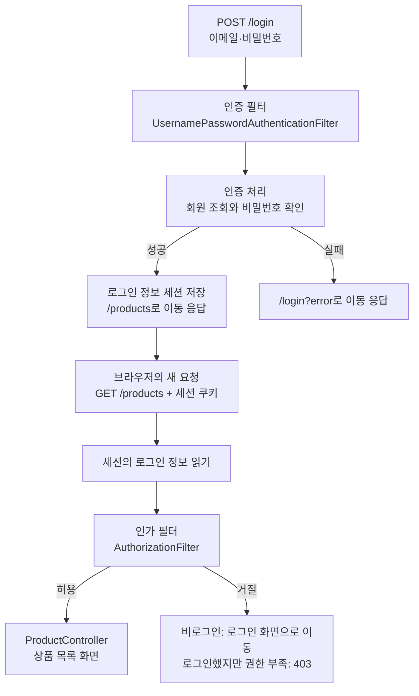
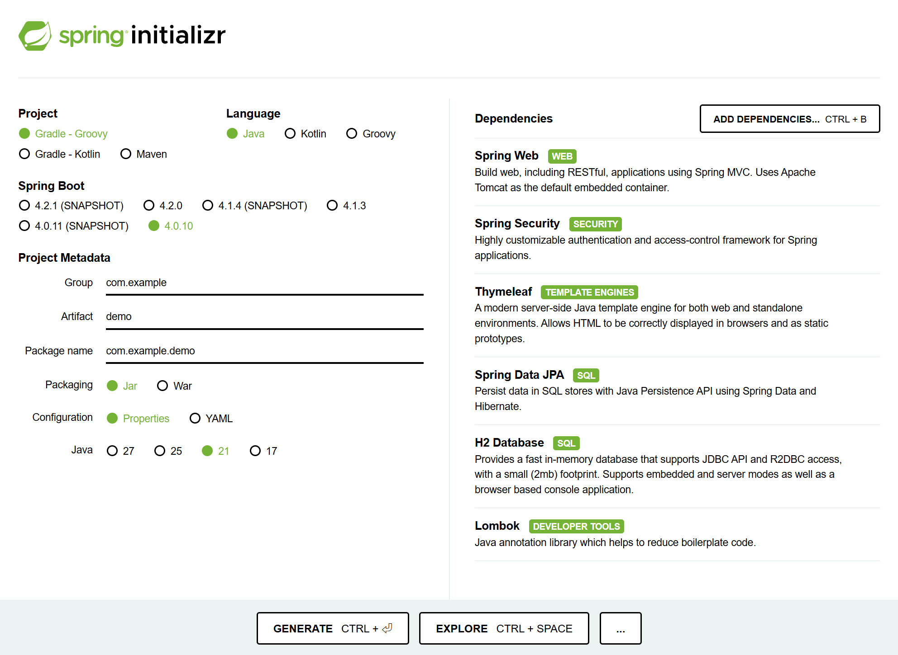

# 5장 Spring Security

> **본 교재 참고**  
> 5장 「스프링 부트로 게시판 만들기」의 5.3 「스프링 시큐리티」

인증은 요청한 사용자가 누구인지 확인하는 과정입니다. 이 예제에서는 이메일과 비밀번호로 로그인해 사용자를 확인합니다. 인가는 확인된 사용자에게 어떤 작업을 허용할지 결정하는 과정입니다. 일반 회원도 로그인할 수 있지만 상품을 등록하거나 삭제하려면 관리자 권한이 있어야 합니다.

Spring Security는 요청이 컨트롤러에 도달하기 전에 로그인 상태와 접근 규칙을 확인합니다. 따라서 상품 컨트롤러마다 로그인 여부를 직접 검사하는 코드를 작성할 필요가 없습니다. 이 장에서는 계정 조회와 비밀번호 확인, 요청별 권한 설정이 화면의 동작으로 어떻게 이어지는지 살펴봅니다.

**필터 체인과 인증·인가**

필터(Filter)는 컨트롤러 앞에서 웹 요청을 확인하거나 처리하는 구성 요소입니다. 여러 필터를 정해진 순서대로 연결한 것이 필터 체인입니다. 각 필터는 다음 처리를 이어 가거나, 로그인 성공 시 이동 응답을 보내는 것처럼 그 자리에서 요청 처리를 마칠 수 있습니다. SecurityFilterChain은 보안에 필요한 필터들을 묶은 체인입니다.

이 예제에서는 인증 필터(Authentication Filter)와 인가 필터(Authorization Filter)의 역할을 구분하면 충분합니다.

| 구분 | 이 예제에서 하는 일 | 관련 설정 |
|---|---|---|
| 인증 필터 | POST /login의 이메일·비밀번호를 받아 인증 절차에 전달합니다. 실제 필터 클래스는 `UsernamePasswordAuthenticationFilter`입니다. | `formLogin()`, `usernameParameter("email")` |
| 인가 필터 | 요청한 주소에 접근할 수 있는지 로그인 상태와 권한을 확인합니다. 실제 필터 클래스는 `AuthorizationFilter`입니다. | `authorizeHttpRequests()`, `authenticated()`, `hasRole("ADMIN")` |

여기서 Authentication Filter는 인증을 담당하는 필터를 가리키는 표현입니다. 현재 폼 로그인을 처리하는 클래스 이름은 UsernamePasswordAuthenticationFilter입니다. 필터를 직접 구현하지 않고 SecurityConfig에서 기능과 규칙을 설정합니다.

아래 그림은 핵심 역할만 추린 흐름입니다. 로그인 요청과 로그인 후의 상품 요청은 서로 다른 HTTP 요청입니다. 실제 체인에는 로그인 정보를 읽는 처리와 CSRF 검사, 로그아웃 등 다른 보안 필터도 포함됩니다.



인증 과정에서는 UserDetailsService로 회원을 조회하고 PasswordEncoder로 비밀번호를 확인합니다. 성공하면 이 예제는 세션에 로그인 정보를 보관합니다. 이후 상품 요청에서는 이메일·비밀번호를 다시 보내지 않고 세션 쿠키로 로그인 상태를 이어 갑니다. 인가 필터는 이 로그인 정보와 요청별 규칙을 사용해 접근을 판단합니다. 세부 흐름은 [폼 로그인](https://docs.spring.io/spring-security/reference/servlet/authentication/passwords/form.html)과 [요청 인가](https://docs.spring.io/spring-security/reference/servlet/authorization/authorize-http-requests.html) 공식 문서에서도 확인할 수 있습니다.

**학습 목표**

- 이메일과 비밀번호로 로그인한다.
- 일반 회원과 관리자의 상품 접근 범위를 비교한다.
- 로그인 정보와 권한별 링크를 화면에 표시한다.
- 확인 화면을 거쳐 로그아웃하고 POST 폼의 CSRF 토큰을 확인한다.

**준비**: spring-security를 열고 다른 8080 포트 앱을 종료합니다. 이 프로젝트는 별도의 H2 메모리 DB를 사용하며 외부 DB 환경변수가 필요하지 않습니다. 로그인 비밀번호는 네 계정 모두 `12345678`입니다.

## 5.1 인증·권한과 초기 데이터

> **본 교재 참고**  
> 5.3.1 「스프링 시큐리티 설정」, 5.4.2 「스키마 구축」

회원 정보에는 이름·이메일·나이에 비밀번호 해시와 권한을 추가합니다. 로그인 ID는 이메일입니다. 상품은 이름과 가격만 가진 간단한 엔티티로 준비해 화면 CRUD보다 보안 규칙에 집중합니다.

### 5.1.1 의존성과 H2 초기화

**프로젝트 생성과 의존성 선택**

Spring Initializr에서 다음 의존성을 선택하고, 생성한 프로젝트 폴더를 `spring-security`로 준비합니다.

| 의존성 | 역할 |
|---|---|
| Spring Web | 로그인 화면과 상품 관련 웹 요청을 처리합니다. |
| Spring Security | 로그인·로그아웃과 사용자 권한을 확인합니다. |
| Thymeleaf | 로그인 화면과 상품 화면을 만듭니다. |
| Spring Data JPA | 회원 계정과 상품 데이터를 조회하고 저장합니다. |
| H2 Database | 로그인 계정과 상품을 담는 메모리 DB를 제공합니다. |
| Lombok | 생성자·getter·로그 코드를 간단히 작성합니다. |



화면에서 로그인 정보와 권한을 표시하는 `thymeleaf-extras-springsecurity6` 의존성도 아래 `build.gradle`에서 확인합니다.

Security 의존성은 웹 요청의 보안 처리를 제공하고 Thymeleaf 보안 확장은 화면에서 로그인·권한 정보를 읽게 합니다. H2에 테이블과 계정을 SQL로 준비합니다.

**실습 코드**

[build.gradle — dependencies 발췌](../spring-security/build.gradle)

```groovy
dependencies {
	implementation 'org.springframework.boot:spring-boot-h2console'
	implementation 'org.springframework.boot:spring-boot-starter-data-jpa'
	implementation 'org.springframework.boot:spring-boot-starter-security'
	implementation 'org.springframework.boot:spring-boot-starter-thymeleaf'
	implementation 'org.springframework.boot:spring-boot-starter-webmvc'
	implementation 'org.thymeleaf.extras:thymeleaf-extras-springsecurity6'
	compileOnly 'org.projectlombok:lombok'
	runtimeOnly 'com.h2database:h2'
	annotationProcessor 'org.projectlombok:lombok'
	testImplementation 'org.springframework.boot:spring-boot-starter-data-jpa-test'
	testImplementation 'org.springframework.boot:spring-boot-starter-security-test'
	testImplementation 'org.springframework.boot:spring-boot-starter-thymeleaf-test'
	testImplementation 'org.springframework.boot:spring-boot-starter-webmvc-test'
	testCompileOnly 'org.projectlombok:lombok'
	testRuntimeOnly 'org.junit.platform:junit-platform-launcher'
	testAnnotationProcessor 'org.projectlombok:lombok'
}
```

[application.properties](../spring-security/src/main/resources/application.properties)

```properties
spring.application.name=demo

# 테이블은 schema.sql로 생성하고 샘플 데이터는 data.sql로 넣는다.
spring.jpa.hibernate.ddl-auto=none
```

[schema.sql](../spring-security/src/main/resources/schema.sql)

```sql
-- H2 메모리 DB에 로그인용 회원과 상품 테이블을 준비한다.
CREATE TABLE member (
    id BIGINT GENERATED BY DEFAULT AS IDENTITY PRIMARY KEY,
    name VARCHAR(128) NOT NULL,
    email VARCHAR(256) NOT NULL UNIQUE,
    age INTEGER,
    password VARCHAR(100) NOT NULL,
    authority VARCHAR(32) NOT NULL
);

CREATE TABLE product (
    id BIGINT GENERATED BY DEFAULT AS IDENTITY PRIMARY KEY,
    name VARCHAR(128) NOT NULL,
    price INTEGER NOT NULL
);
```

[data.sql](../spring-security/src/main/resources/data.sql)

```sql
-- 로그인 비밀번호는 네 회원 모두 12345678이다. 아래에는 미리 만든 BCrypt 해시를 저장한다.
-- password는 평문이 아니며, 로그인할 때 PasswordEncoder가 일치 여부를 확인한다.
INSERT INTO member (name, email, age, password, authority) VALUES
('윤서준', 'SeojunYoon@campus.com', 10, '$2a$10$WNWod6wVX5vhbwJ62XWTDenxLGndTtx5lZswXW4Z/YF8sCoFF22vu', 'ROLE_USER'),
('윤광철', 'KwangcheolYoon@campus.com', 43, '$2a$10$WNWod6wVX5vhbwJ62XWTDenxLGndTtx5lZswXW4Z/YF8sCoFF22vu', 'ROLE_ADMIN'),
('공미영', 'MiyeongKong@campus.com', 23, '$2a$10$WNWod6wVX5vhbwJ62XWTDenxLGndTtx5lZswXW4Z/YF8sCoFF22vu', 'ROLE_USER'),
('김도윤', 'DoyunKim@campus.com', 10, '$2a$10$WNWod6wVX5vhbwJ62XWTDenxLGndTtx5lZswXW4Z/YF8sCoFF22vu', 'ROLE_USER');

-- 관리자가 등록·수정·삭제할 상품 샘플이다.
INSERT INTO product (name, price) VALUES
('아이폰', 1200000),
('맥북', 950000);
```

**코드 설명**

회원 테이블에는 이메일 중복을 막는 제약 조건과 로그인에 필요한 비밀번호 해시·권한 정보가 저장됩니다. 상품 테이블에는 상품 이름과 가격을 저장합니다. 테이블은 schema.sql로 만들고 ddl-auto=none으로 JPA의 별도 생성을 끕니다.

data.sql의 password 값은 미리 만든 BCrypt 해시입니다. 로그인할 때 사용자가 입력한 비밀번호와 저장된 해시가 대응하는지 확인합니다. 앞 장의 회원·게시글 SQL과 구분해, 이 프로젝트의 로그인 계정과 상품을 준비하는 전용 SQL을 사용합니다.

**실행과 예상 결과**

DemoApplication을 실행하고 http://localhost:8080 에 접속합니다. SQL 초기화가 실패하면 테이블·컬럼 이름과 파일 인코딩을 확인합니다.

홈 화면을 볼 수 있고 회원 4명과 상품 2개가 준비됩니다. 앱을 다시 실행하면 수정한 상품과 세션 상태가 초기화됩니다.

### 5.1.2 로그인용 회원과 상품 구조

보안 사용자 정보와 상품은 각각 별도의 테이블에 저장합니다. 회원 엔티티 자체를 로그인 화면의 응답으로 내보내는 구조는 아닙니다.

**실습 코드**

[Member.java](../spring-security/src/main/java/com/example/demo/entity/Member.java)

```java
package com.example.demo.entity;

import jakarta.persistence.*;
import lombok.*;

// 로그인에 사용할 회원 정보이다. 비밀번호는 BCrypt 해시로 저장한다.
@Entity
@Table(name = "member")
@Getter
@Setter
@Builder
@NoArgsConstructor
@AllArgsConstructor
public class Member {
    @Id
    @GeneratedValue(strategy = GenerationType.IDENTITY)
    private Long id;
    private String name;
    private String email;
    private Integer age;
    private String password;
    // 한 회원에게 하나의 권한을 지정한다. 예: ROLE_USER, ROLE_ADMIN
    private String authority;
}
```

[Product.java](../spring-security/src/main/java/com/example/demo/entity/Product.java)

```java
package com.example.demo.entity;

import jakarta.persistence.*;
import lombok.*;

// 상품 CRUD는 앞에서 배운 MVC 방식으로 처리한다.
@Entity
@Table(name = "product")
@Data
@Builder
@NoArgsConstructor
@AllArgsConstructor
public class Product {
    @Id
    @GeneratedValue(strategy = GenerationType.IDENTITY)
    private Long id;
    private String name;
    private Integer price;
}
```

[MemberRepository.java](../spring-security/src/main/java/com/example/demo/repository/MemberRepository.java)

```java
package com.example.demo.repository;

import com.example.demo.entity.Member;
import org.springframework.data.jpa.repository.JpaRepository;

import java.util.Optional;

public interface MemberRepository extends JpaRepository<Member, Long> {
    // 로그인할 때 입력한 이메일로 회원을 조회한다.
    Optional<Member> findByEmail(String email);
}
```

[ProductRepository.java](../spring-security/src/main/java/com/example/demo/repository/ProductRepository.java)

```java
package com.example.demo.repository;

import com.example.demo.entity.Product;
import org.springframework.data.jpa.repository.JpaRepository;

public interface ProductRepository extends JpaRepository<Product, Long> {
}
```

**코드 설명**

회원은 한 개의 authority 문자열을 갖습니다. ROLE_USER 또는 ROLE_ADMIN입니다. 이 실습에서는 별도 권한 엔티티나 여러 권한 연결 테이블을 만들지 않습니다. MemberRepository.findByEmail()은 로그인 계정을 찾습니다. ProductRepository는 기본 CRUD만 필요합니다.

**실행과 예상 결과**

data.sql과 엔티티 필드, Repository 검색 조건을 대응시킵니다.

윤광철은 ROLE_ADMIN, 윤서준·공미영·김도윤은 ROLE_USER입니다. 상품은 아이폰 1200000원과 맥북 950000원입니다.

## 5.2 이메일 로그인과 비밀번호 확인

> **본 교재 참고**  
> 5.3.2 「인증」, 5.3.6 「로그인/로그아웃 커스텀」

**로그인 상태가 유지되는 과정**

브라우저는 화면의 링크를 누를 때마다 서버에 새로운 HTTP 요청을 보냅니다. 로그인에 성공한 뒤 상품 목록을 조회할 때도 별도의 요청이 발생합니다. 사용자가 매번 이메일과 비밀번호를 입력하지 않아도 되도록, 이 예제에서는 서버의 세션으로 로그인 상태를 유지합니다.

세션은 서버가 사용자별로 정보를 보관하는 공간입니다. 브라우저는 쿠키에 저장된 세션 ID를 이후 요청에 함께 보내고, 서버는 그 ID로 어떤 세션의 요청인지 확인합니다. 이메일과 비밀번호를 요청마다 다시 전송하는 방식과 구분합니다.

| 순서 | 처리 과정 |
|---|---|
| 1 | 브라우저가 로그인 폼의 이메일과 비밀번호를 POST /login으로 보냅니다. |
| 2 | Security가 UserDetailsService로 회원을 조회하고 PasswordEncoder로 비밀번호를 확인합니다. |
| 3 | 인증에 성공하면 로그인 정보를 세션에 보관하고 상품 목록으로 이동합니다. |
| 4 | 브라우저가 세션 ID 쿠키를 함께 보내 GET /products를 요청합니다. |
| 5 | Security가 세션의 로그인 정보와 접근 규칙을 확인하고 목록 조회를 허용합니다. |

뒤의 로그아웃 실습에서는 이 로그인 정보를 정리합니다. 실제 로그아웃 후 상품 목록을 다시 요청하면 로그인 화면으로 이동하는 이유도, 서버가 더 이상 그 요청을 로그인한 사용자의 요청으로 처리하지 않기 때문입니다.

로그인 폼의 email·password는 Security가 받습니다. 개발자는 계정을 어떻게 찾을지와 비밀번호를 어떻게 확인할지 연결합니다. 직접 Controller에서 비밀번호 문자열을 비교하는 코드를 작성하지 않습니다.

| 이름 | 이메일 | 비밀번호 | 권한 |
|---|---|---|---|
| 윤서준 | SeojunYoon@campus.com | 12345678 | ROLE_USER |
| 윤광철 | KwangcheolYoon@campus.com | 12345678 | ROLE_ADMIN |
| 공미영 | MiyeongKong@campus.com | 12345678 | ROLE_USER |
| 김도윤 | DoyunKim@campus.com | 12345678 | ROLE_USER |

### 5.2.1 비밀번호 해시와 PasswordEncoder

해시는 비밀번호를 그대로 저장하지 않기 위한 단방향 변환입니다. 로그인 시 저장된 해시를 복호화하는 것이 아니라 입력값이 해시에 대응하는지 matches()로 확인합니다.

이 장의 설정 메서드는 모두 같은 SecurityConfig 클래스 안에 들어갑니다. 다음은 메서드를 제외한 선언부입니다. @Configuration은 설정 클래스를 표시하고, 뒤에서 작성할 각 @Bean 메서드는 Security가 사용할 객체를 빈으로 등록합니다.

```java
@Configuration
public class SecurityConfig {
}
```

**실습 코드**

[SecurityConfig.java — passwordEncoder()](../spring-security/src/main/java/com/example/demo/config/SecurityConfig.java)

```java
@Bean
public PasswordEncoder passwordEncoder() {
    // 비밀번호를 해시로 바꾸고, 입력한 비밀번호가 해시와 일치하는지 확인한다.
    return new BCryptPasswordEncoder();
}
```

[PasswordEncoderTests.java](../spring-security/src/test/java/com/example/demo/PasswordEncoderTests.java)

```java
package com.example.demo;

import lombok.extern.slf4j.Slf4j;
import org.junit.jupiter.api.Test;
import org.springframework.security.crypto.bcrypt.BCryptPasswordEncoder;
import org.springframework.security.crypto.password.PasswordEncoder;

@Slf4j
class PasswordEncoderTests {
    @Test
    void encodeAndMatch() {
        PasswordEncoder encoder = new BCryptPasswordEncoder();
        // 같은 비밀번호도 실행할 때마다 다른 해시가 만들어질 수 있다.
        String encoded = encoder.encode("12345678");
        log.info("비밀번호 해시: {}", encoded);
        // 해시 문자열을 직접 비교하지 않고 matches로 비밀번호가 맞는지 확인한다.
        log.info("같은 비밀번호 확인: {}", encoder.matches("12345678", encoded));
        log.info("다른 비밀번호 확인: {}", encoder.matches("wrong-password", encoded));
    }
}
```

**코드 설명**

BCryptPasswordEncoder는 PasswordEncoder 인터페이스를 구현한 클래스입니다. encode()는 비밀번호의 해시를 만들고, matches(입력값, 저장된해시)는 입력한 비밀번호가 저장된 해시와 일치하는지 확인합니다.

BCrypt는 비밀번호마다 다른 해시를 만들 수 있도록 salt라는 임의의 값을 함께 사용합니다. 따라서 같은 비밀번호를 encode()해도 문자열이 달라질 수 있습니다. matches()는 저장된 해시에 포함된 정보를 이용해 입력한 비밀번호를 검증합니다. 로그인 검증에서는 새로 만든 해시를 equals()로 비교하지 않고 이 메서드를 사용합니다.

**실행과 예상 결과**

PasswordEncoderTests.encodeAndMatch를 실행합니다. @SpringBootTest가 없는 작은 실습으로 DB가 필요하지 않습니다.

해시 문자열과 함께 같은 비밀번호 확인 true, 다른 비밀번호 확인 false가 출력됩니다. 해시 문자열 자체가 data.sql의 것과 같아야 하는 것은 아닙니다.

### 5.2.2 이메일로 계정 조회

UserDetailsService는 Spring Security가 로그인할 사용자를 조회할 때 사용하는 인터페이스입니다. 이 예제에서는 이메일로 Member를 찾은 뒤, Security가 이해할 수 있는 사용자 정보로 바꾸어 반환합니다. DB 엔티티의 필드와 Security가 인증에 사용하는 값 사이를 연결하는 역할입니다.

**실습 코드**

[SecurityConfig.java — userDetailsService()](../spring-security/src/main/java/com/example/demo/config/SecurityConfig.java)

```java
@Bean
public UserDetailsService userDetailsService(MemberRepository memberRepository) {
    // 로그인 처리는 Security가 담당한다. 여기서는 이메일로 회원 정보를 찾아 제공한다.
    return email -> {
        var member = memberRepository.findByEmail(email)
                .orElseThrow(() -> new UsernameNotFoundException("회원을 찾을 수 없습니다."));
        return User.builder()
                .username(member.getEmail())
                .password(member.getPassword())
                .authorities(member.getAuthority())
                .build();
    };
}
```

**코드 설명**

@Bean 메서드의 매개변수인 MemberRepository는 스프링이 준비해 전달합니다. 반환하는 람다는 UserDetailsService의 사용자 조회 동작을 구현합니다. Security가 로그인 ID를 전달하면 그 값이 email 매개변수에 들어가고, findByEmail()로 실제 회원을 조회합니다. 회원이 없으면 UsernameNotFoundException을 던집니다.

조회한 회원은 User.builder()로 인증에 사용할 정보로 변환합니다. username에는 회원 이름이 아니라 이메일을, password에는 저장된 BCrypt 해시를, authorities에는 ROLE_로 시작하는 권한을 넣습니다. 이후 Security가 PasswordEncoder로 비밀번호를 확인합니다.

**실행과 예상 결과**

다음 로그인 화면 실습에서 준비된 이메일로 로그인합니다.

로그인한 사용자의 name을 화면에서 출력하면 윤서준이라는 이름 대신 SeojunYoon@campus.com이 나옵니다. Security의 로그인 ID를 이메일로 정했기 때문입니다.

### 5.2.3 로그인 화면과 성공·실패

GET /login은 Controller가 화면을 보여 주고, POST /login은 인증 필터가 받아 인증을 진행합니다. 로그인에 성공하면 상품 목록으로 이동하도록 설정되어 있습니다.

**실습 코드**

[HomeController.java — login()](../spring-security/src/main/java/com/example/demo/controller/HomeController.java)

```java
@GetMapping("/login")
public String login() {
    // GET은 로그인 화면을 보여 주고, POST /login은 Security가 처리한다.
    return "login";
}
```

[login.html](../spring-security/src/main/resources/templates/login.html)

```html
<!DOCTYPE html>
<html lang="ko" xmlns:th="http://www.thymeleaf.org">
<head>
    <meta charset="UTF-8">
    <title>이메일 로그인</title>
</head>
<body>
<h2>이메일 로그인</h2>
<p th:if="${param.error != null}">이메일 또는 비밀번호가 올바르지 않습니다.</p>
<!-- POST /login은 Controller가 아니라 Spring Security가 처리한다. -->
<form th:action="@{/login}" method="post">
    <p>
        <label for="email">이메일</label>
        <input type="email" id="email" name="email" autocomplete="username" required>
    </p>
    <p>
        <label for="password">비밀번호</label>
        <input type="password" id="password" name="password" autocomplete="current-password" required>
    </p>
    <button type="submit">로그인</button>
</form>
<p><a th:href="@{/}">홈으로</a></p>
</body>
</html>
```

**코드 설명**

email 입력칸의 name은 SecurityConfig의 usernameParameter("email")과 연결됩니다. password는 기본 비밀번호 파라미터입니다. Controller에는 POST /login 메서드가 없습니다. th:action이 지정된 POST 폼에는 CSRF 토큰도 자동으로 추가됩니다. 실패 시 /login?error로 이동하고 param.error를 보고 한글 문구를 출력합니다.

**실행과 예상 결과**

홈의 로그인 링크를 누릅니다. 먼저 틀린 비밀번호를 보내고, 이어서 윤서준 이메일과 12345678로 로그인합니다.

실패하면 `이메일 또는 비밀번호가 올바르지 않습니다.`가 표시됩니다. 성공하면 /products로 이동합니다. 로그인 화면에 비밀번호를 다시 채워 출력하지 않습니다.

## 5.3 권한별 상품 관리

> **본 교재 참고**  
> 5.3.3 「권한」, 5.3.4 「로그인 사용자 정보 사용」

인증된 사용자는 누구나 상품 목록을 볼 수 있지만, 관리 기능은 ROLE_ADMIN이 있어야 합니다. 화면에서 링크를 숨기는 것과 서버에서 요청을 거절하는 것은 서로 다른 작업입니다. 두 가지를 함께 적용합니다.

**시작 상태와 실행 순서**

상품 2개가 준비된 상태에서 윤서준으로 목록과 접근 제한을 확인합니다. 실제 로그아웃을 마친 뒤 윤광철로 로그인해 관리자 기능을 실습합니다. 계정을 바꾸어 로그인해도 상품 데이터는 유지되므로, 아래 CRUD는 같은 앱 실행 상태에서 이어서 진행합니다.

| 단계 | 수행할 작업 | 상품 상태 |
|---|---|---|
| 일반 회원 조회 | 윤서준으로 상품 목록과 관리 주소 접근을 확인합니다. | 초기 상품 2개 |
| 관리자 등록 | 윤광철로 로그인해 무선 키보드를 등록합니다. | 상품 3개 |
| 관리자 수정 | 새 상품의 가격을 79000으로 바꿉니다. | 상품 3개, 변경한 가격 유지 |
| 관리자 삭제 | 새로 등록한 무선 키보드를 삭제합니다. | 초기 상품 2개 |

앱을 재시작하면 상품은 초기 샘플로 돌아가고 로그인 상태도 다시 확인해야 합니다. 등록한 상품의 수정·삭제를 이어서 실습하는 동안에는 앱을 계속 실행해 둡니다.

### 5.3.1 요청별 접근 규칙

SecurityFilterChain은 어떤 요청을 누구에게 허용하고 로그인·로그아웃을 어떻게 처리할지 설정합니다. 현재 예제는 한 체인으로 구성합니다. formLogin()은 폼 로그인을 처리할 인증 필터를 구성하고, authorizeHttpRequests()의 규칙은 인가 필터가 사용합니다. 설정 메서드를 작성한 순서가 필터 실행 순서는 아닙니다. 필터 순서는 Spring Security가 구성합니다.

**실습 코드**

[SecurityConfig.java — securityFilterChain()](../spring-security/src/main/java/com/example/demo/config/SecurityConfig.java)

```java
@Bean
public SecurityFilterChain securityFilterChain(HttpSecurity http) throws Exception {
    return http
            .authorizeHttpRequests(auth -> auth
                    // 오류 응답은 Spring Boot의 /error 처리로 화면을 표시한다.
                    .requestMatchers("/", "/login", "/error").permitAll()
                    // 먼저 일치하는 규칙을 적용한다. 목록 조회는 로그인한 사용자에게 허용한다.
                    .requestMatchers(HttpMethod.GET, "/products").authenticated()
                    // hasRole("ADMIN")은 ROLE_ADMIN 권한을 확인한다.
                    .requestMatchers("/products", "/products/**").hasRole("ADMIN")
                    .anyRequest().authenticated())
            .formLogin(login -> login
                    .loginPage("/login")
                    // 로그인 폼의 email 입력값을 로그인 ID로 사용한다.
                    .usernameParameter("email")
                    // 로그인에 성공하면 상품 목록으로 이동한다.
                    .defaultSuccessUrl("/products", true)
                    .permitAll())
            .logout(logout -> logout
                    // GET은 확인 화면을 보여 주고, 실제 POST /logout은 Security가 처리한다.
                    .logoutSuccessUrl("/")
                    .permitAll())
            // 일반 화면의 CSRF 보호는 유지한다. POST 폼에는 th:action을 사용한다.
            .build();
}
```

**코드 설명**

1. 홈·로그인·/error는 모두 허용합니다. /error는 Boot 오류 화면 처리를 위해 필요합니다.
2. GET /products는 로그인 상태만 확인합니다.
3. 나머지 /products 및 하위 경로는 ADMIN 역할이 필요합니다. 앞에서 먼저 일치한 규칙이 적용되므로 등록 POST가 목록 GET과 같은 권한이 되는 것은 아닙니다.
4. hasRole("ADMIN")은 ROLE_ADMIN 권한을 확인합니다. 문자열에 ROLE_를 다시 붙여 넘기지 않습니다.
5. defaultSuccessUrl("/products", true)는 이전 요청과 관계없이 로그인 성공 시 목록으로 보냅니다.
6. logoutSuccessUrl("/")은 실제 로그아웃 후 홈으로 보냅니다. 별도 exceptionHandling 설정은 없습니다.

**실행과 예상 결과**

비로그인 상태에서 /products, 일반 회원 로그인 후 /products/new를 각각 요청합니다.

로그인하지 않은 사용자가 상품 목록에 접근하면 로그인 화면으로 이동합니다. 로그인한 일반 회원이 관리 화면을 요청하면 필요한 권한이 없어 403 응답을 받습니다. 관리자로 로그인하면 상품 목록에서 등록·수정·삭제 기능을 사용할 수 있습니다.

### 5.3.2 홈·상품 목록과 권한별 링크

Thymeleaf 보안 확장의 sec:authorize는 조건에 맞는 화면 요소만 표시합니다. sec:authentication은 현재 로그인 정보를 출력합니다.

**실습 코드**

[HomeController.java — home()](../spring-security/src/main/java/com/example/demo/controller/HomeController.java)

```java
@GetMapping("/")
public String home(Authentication authentication) {
    // 로그인했다면 Authentication으로 로그인 ID(이메일)를 확인할 수 있다.
    if (authentication != null) {
        log.info("로그인 이메일: {}", authentication.getName());
    }
    return "home";
}
```

[home.html](../spring-security/src/main/resources/templates/home.html)

```html
<!DOCTYPE html>
<html lang="ko" xmlns:th="http://www.thymeleaf.org"
      xmlns:sec="http://www.thymeleaf.org/thymeleaf-extras-springsecurity6">
<head>
    <meta charset="UTF-8">
    <title>홈</title>
</head>
<body>
<h2>홈</h2>
<div sec:authorize="isAnonymous()">
    <a th:href="@{/login}">로그인하기</a>
</div>
<div sec:authorize="isAuthenticated()">
    <!-- name은 UserDetailsService에서 지정한 로그인 ID이며, 이 예제에서는 이메일이다. -->
    <p>로그인 이메일: <strong sec:authentication="name">SeojunYoon@campus.com</strong></p>
    <!-- GET /logout은 확인 화면을 연다. 실제 로그아웃은 그 화면의 POST 폼으로 처리한다. -->
    <p><a th:href="@{/logout}">로그아웃</a></p>
    <p><a th:href="@{/products}">상품 목록 보기</a></p>
    <!-- 관리자에게만 등록 링크를 표시하고, 서버에서도 권한을 검사한다. -->
    <p sec:authorize="hasRole('ADMIN')"><a th:href="@{/products/new}">상품 등록</a></p>
</div>
</body>
</html>
```

[ProductController.java — list()](../spring-security/src/main/java/com/example/demo/controller/ProductController.java)

```java
@GetMapping("/products")
public String list(Model model) {
    model.addAttribute("products", productRepository.findAll());
    return "product-list";
}
```

[product-list.html](../spring-security/src/main/resources/templates/product-list.html)

```html
<!DOCTYPE html>
<html lang="ko" xmlns:th="http://www.thymeleaf.org"
      xmlns:sec="http://www.thymeleaf.org/thymeleaf-extras-springsecurity6">
<head>
    <meta charset="UTF-8">
    <title>상품 목록</title>
</head>
<body>
<h2>상품 목록</h2>
<p>
    <strong sec:authentication="name">SeojunYoon@campus.com</strong>
    <a th:href="@{/logout}">로그아웃</a>
</p>
<table>
    <tr>
        <th>ID</th>
        <th>상품명</th>
        <th>가격</th>
        <th sec:authorize="hasRole('ADMIN')">관리</th>
    </tr>

    <tr th:each="product : ${products}">
        <td th:text="${product.id}">1</td>
        <td th:text="${product.name}">아이폰</td>
        <td th:text="|${product.price}원|">1200000원</td>
        <!-- 링크를 표시하는 것과 별개로 SecurityConfig에서도 관리자 권한을 검사한다. -->
        <td sec:authorize="hasRole('ADMIN')">
            <a th:href="@{/products/{id}/edit(id=${product.id})}">수정</a>
            <a th:href="@{/products/{id}/delete(id=${product.id})}">삭제</a>
        </td>
    </tr>

</table>
<p sec:authorize="hasRole('ADMIN')"><a th:href="@{/products/new}">상품 등록하기</a></p>
<p><a th:href="@{/}">홈으로</a></p>
</body>
</html>
```

**코드 설명**

홈 화면은 로그인하지 않은 사용자에게 로그인 링크를 보여 주고, 로그인한 사용자에게는 이메일·상품 목록·로그아웃 링크를 보여 줍니다. 상품 목록 상단에도 이메일과 로그아웃 링크가 함께 표시됩니다. 관리자에게만 상품 등록과 수정·삭제 링크가 추가됩니다.

컨트롤러에서 로그인 ID를 사용하려면 Authentication을 받을 수 있습니다. 예제의 홈 컨트롤러는 이 객체가 있을 때 getName()으로 이메일을 읽어 로그에 남깁니다.

**실행과 예상 결과**

윤서준과 윤광철로 번갈아 로그인합니다.

초기 상품이 준비된 상태에서 화면의 주요 차이는 다음과 같습니다.

| 확인할 항목 | 윤서준으로 로그인 | 윤광철로 로그인 |
|---|---|---|
| 상단의 로그인 ID | SeojunYoon@campus.com | KwangcheolYoon@campus.com |
| 상품 목록 | 아이폰·맥북 조회 가능 | 아이폰·맥북 조회 가능 |
| 상품 등록 링크 | 표시하지 않음 | 표시함 |
| 상품별 수정·삭제 링크 | 표시하지 않음 | 표시함 |
| /products/new 직접 요청 | 403 오류 화면 | 상품 등록 화면 |

화면에서 링크를 숨기는 것은 사용 가능한 기능을 보여 주는 역할입니다. 주소를 직접 입력한 요청도 차단하려면 서버의 권한 검사가 필요합니다. 이 예제에서는 sec:authorize로 화면을 구성하고, SecurityConfig로 서버의 접근 규칙을 적용합니다.

### 5.3.3 관리자 상품 등록

상품 등록은 이미 배운 MVC 흐름입니다. Security가 먼저 권한을 검사하고 허용된 요청만 Controller로 전달합니다.

**실습 코드**

[ProductController.java — addForm()](../spring-security/src/main/java/com/example/demo/controller/ProductController.java)

```java
@GetMapping("/products/new")
public String addForm(@ModelAttribute("product") Product product) {
    return "product-add";
}
```

[ProductController.java — add()](../spring-security/src/main/java/com/example/demo/controller/ProductController.java)

```java
@PostMapping("/products")
public String add(@ModelAttribute("product") Product product) {
    product.setId(null);
    productRepository.save(product);
    return "redirect:/products";
}
```

[product-add.html](../spring-security/src/main/resources/templates/product-add.html)

```html
<!DOCTYPE html>
<html lang="ko" xmlns:th="http://www.thymeleaf.org">
<head>
    <meta charset="UTF-8">
    <title>상품 등록</title>
</head>
<body>
<h2>상품 등록</h2>
<form th:action="@{/products}" th:object="${product}" method="post">
    <p>
        <label for="name">상품명</label>
        <input type="text" th:field="*{name}" required maxlength="128">
    </p>
    <p>
        <label for="price">가격</label>
        <input type="number" th:field="*{price}" min="0" required>
    </p>
    <button type="submit">등록하기</button>
</form>
<p><a th:href="@{/products}">목록으로</a></p>
</body>
</html>
```

**코드 설명**

GET /products/new는 빈 Product를 입력칸에 연결합니다. POST /products는 ID를 비우고 저장한 뒤 목록으로 이동합니다. 브라우저의 required·min은 입력 도움 조건이며 별도의 서버 Bean Validation 예제는 이 장에서 추가하지 않습니다.

**실행과 예상 결과**

윤광철로 로그인하고 무선 키보드 / 89000을 등록합니다.

상품 목록으로 돌아가 새 상품이 보입니다. 응답 ID를 외우지 말고 목록의 링크가 사용하는 실제 ID를 확인합니다.

### 5.3.4 관리자 상품 수정

수정 링크는 GET으로 폼을 열고, 저장은 POST로 처리합니다. 화면 이동과 변경 요청을 구분합니다.

**실습 코드**

[ProductController.java — editForm()](../spring-security/src/main/java/com/example/demo/controller/ProductController.java)

```java
@GetMapping("/products/{id}/edit")
public String editForm(@PathVariable("id") Long id, Model model) {
    model.addAttribute("product", findProduct(id));
    return "product-edit";
}
```

[ProductController.java — edit()](../spring-security/src/main/java/com/example/demo/controller/ProductController.java)

```java
@PostMapping("/products/{id}/edit")
public String edit(@PathVariable("id") Long id, @ModelAttribute("product") Product product) {
    Product found = findProduct(id);
    found.setName(product.getName());
    found.setPrice(product.getPrice());
    productRepository.save(found);
    return "redirect:/products";
}
```

[ProductController.java — findProduct()](../spring-security/src/main/java/com/example/demo/controller/ProductController.java)

```java
private Product findProduct(Long id) {
    return productRepository.findById(id)
            .orElseThrow(() -> new ResponseStatusException(HttpStatus.NOT_FOUND, "상품을 찾을 수 없습니다."));
}
```

[product-edit.html](../spring-security/src/main/resources/templates/product-edit.html)

```html
<!DOCTYPE html>
<html lang="ko" xmlns:th="http://www.thymeleaf.org">
<head>
    <meta charset="UTF-8">
    <title>상품 수정</title>
</head>
<body>
<h2>상품 수정</h2>
<form th:action="@{/products/{id}/edit(id=${product.id})}" th:object="${product}" method="post">
    <p>
        <label for="name">상품명</label>
        <input type="text" th:field="*{name}" required maxlength="128">
    </p>
    <p>
        <label for="price">가격</label>
        <input type="number" th:field="*{price}" min="0" required>
    </p>
    <button type="submit">수정하기</button>
</form>
<p><a th:href="@{/products}">목록으로</a></p>
</body>
</html>
```

**코드 설명**

조회한 Product의 값이 폼에 들어갑니다. URL ID로 기존 상품을 찾고 이름·가격을 변경합니다. findProduct가 대상이 없으면 ResponseStatusException의 404를 전달합니다. 현재 Security 모듈은 MVC 장의 GlobalExceptionHandler를 사용하지 않습니다.

**실행과 예상 결과**

새로 등록한 상품의 가격을 79000으로 바꾸어 저장합니다.

상품 목록으로 돌아가 79000원이 표시됩니다. 일반 회원이 같은 수정 URL을 직접 요청하면 403으로 차단됩니다.

### 5.3.5 관리자 상품 삭제 링크

현재 학습용 상품 예제의 삭제는 일반 링크를 눌러 GET으로 처리합니다. 3장의 REST DELETE와 4장의 회원 삭제 POST를 구분해 현재 Controller 매핑을 읽습니다.

**실습 코드**

[ProductController.java — delete()](../spring-security/src/main/java/com/example/demo/controller/ProductController.java)

```java
@GetMapping("/products/{id}/delete")
public String delete(@PathVariable("id") Long id) {
    // 실습에서는 삭제 링크의 GET 요청으로 상품을 삭제한다.
    productRepository.delete(findProduct(id));
    return "redirect:/products";
}
```

**코드 설명**

상품 목록의 삭제 링크가 /products/실제ID/delete로 이동합니다. @GetMapping 메서드는 상품을 찾아 삭제하고 목록으로 리다이렉트합니다. 삭제 링크에는 JavaScript나 form을 넣지 않습니다. 관리자 여부는 다른 상품 관리 요청처럼 먼저 검사됩니다. 뒤에서 배우는 POST 폼의 CSRF 검증과 GET 링크의 권한 검사를 같은 기능으로 생각하지 않습니다.

**실행과 예상 결과**

일반 회원이 관리자의 삭제 주소를 직접 요청하면 403인지 확인합니다. 관리자로 로그인한 뒤 새로 등록한 무선 키보드를 삭제합니다.

일반 회원의 거절된 요청은 상품을 삭제하지 않습니다. 관리자의 삭제 요청 후 목록으로 돌아오면 해당 상품이 사라집니다.

### 5.3.6 자동 403 오류 화면

인증은 됐지만 필요한 권한이 없으면 403으로 응답합니다. Spring Boot는 상태 코드에 맞는 templates/error/403.html을 오류 화면으로 선택합니다.

**실습 코드**

[403.html](../spring-security/src/main/resources/templates/error/403.html)

```html
<!DOCTYPE html>
<html lang="ko" xmlns:th="http://www.thymeleaf.org">
<head>
    <meta charset="UTF-8">
    <title>접근할 수 없습니다</title>
</head>
<body>
<h2>접근할 수 없습니다</h2>
<!-- 403 응답이면 Spring Boot가 이 파일을 오류 화면으로 사용한다. -->
<p>상태 코드: 403</p>
<p>이 요청을 처리할 권한이 없거나 요청이 올바르지 않습니다.</p>
<p><a th:href="@{/}">홈으로</a></p>
</body>
</html>
```

**코드 설명**

화면에는 상태와 안내 문구, 홈 / 링크가 있습니다. 별도 오류 Controller를 추가하거나 SecurityConfig.exceptionHandling()으로 주소를 지정하지 않았습니다. /error 요청은 보안 규칙에서 허용합니다. CSRF 토큰 오류도 403이므로 문구를 특정 권한 문제에만 한정하지 않습니다.

**실행과 예상 결과**

일반 회원으로 /products/new에 직접 접속한 뒤 홈 링크를 누릅니다.

HTTP 403과 안내가 표시되고 홈으로 돌아갈 수 있습니다. 브라우저 Network에서 실제 상태 코드도 확인합니다.

## 5.4 로그아웃과 CSRF

> **본 교재 참고**  
> 5.3.6 「로그인/로그아웃 커스텀」, 5.3.7 「CSRF와 CORS」

로그인 정보는 세션을 통해 다음 요청에서도 사용됩니다. 로그아웃은 로그인 세션의 인증 정보를 정리하는 작업입니다. 확인 화면을 보는 것과 실제 로그아웃을 수행하는 요청을 나누어 이해합니다.

브라우저는 로그인한 사이트로 요청할 때 세션 ID 쿠키를 함께 보냅니다. 이 특성을 악용해 다른 사이트에서 사용자가 원하지 않는 변경 요청을 보내게 하는 공격을 CSRF라고 합니다. 서버가 로그인 상태만 확인하면, 사용자가 의도해서 보낸 요청인지 구분하기 어려울 수 있습니다.

Spring Security는 POST 같은 요청에서 CSRF 토큰을 확인해 요청을 검증합니다. 이 실습에서는 로그인·로그아웃·상품 등록·수정 저장 폼의 숨김 입력값을 관찰합니다. 토큰을 확인하는 과정과 관리자 권한을 확인하는 과정은 서로 다른 검사입니다. 현재 상품 삭제의 GET 링크에는 POST 폼의 토큰 검사가 적용되지 않으며, 관리자 권한 검사는 별도로 적용됩니다.

### 5.4.1 로그아웃 확인과 실제 처리

로그아웃 링크의 GET은 확인 화면만 엽니다. 실제 정리는 POST /logout을 받은 Security가 수행합니다.

**실습 코드**

[HomeController.java — logout()](../spring-security/src/main/java/com/example/demo/controller/HomeController.java)

```java
@GetMapping("/logout")
public String logout() {
    // 이 요청은 확인 화면만 표시한다. 확인 버튼을 눌러야 실제로 로그아웃된다.
    return "logout";
}
```

[logout.html](../spring-security/src/main/resources/templates/logout.html)

```html
<!DOCTYPE html>
<html lang="ko" xmlns:th="http://www.thymeleaf.org">
<head>
    <meta charset="UTF-8">
    <title>로그아웃 확인</title>
</head>
<body>
<h2>로그아웃 확인</h2>
<p>로그아웃하시겠습니까?</p>
<!-- th:action을 사용하는 POST 폼에는 CSRF 토큰이 자동으로 추가된다. -->
<!-- POST /logout은 Spring Security가 처리한다. -->
<form th:action="@{/logout}" method="post">
    <button type="submit">로그아웃</button>
</form>
<p><a th:href="@{/}">취소하고 홈으로</a></p>
</body>
</html>
```

**코드 설명**

Controller가 직접 세션을 지우는 코드를 작성하지 않습니다. 확인 화면의 form이 POST /logout으로 전송하고 Security의 로그아웃 처리가 인증 정보를 정리합니다. 취소 링크는 홈으로 돌아갈 뿐 로그아웃을 실행하지 않습니다.

**실행과 예상 결과**

로그인 후 로그아웃 링크를 열고, 확인 버튼을 누르기 전에 상품 목록에 다시 접근해 봅니다. 이어서 확인 버튼을 누르고 목록에 다시 접근합니다.

확인 화면만 열었을 때는 목록 조회가 가능합니다. 실제 POST 로그아웃 후 홈으로 이동하고, 목록을 다시 요청하면 로그인 화면으로 이동합니다.

### 5.4.2 CSRF 토큰 확인

앞 소절의 logout.html과 상품 등록·수정 HTML에서 `th:action`과 `method="post"`를 확인합니다. 서버가 화면을 만들 때 폼 안에 `name="_csrf"`인 숨김 입력값을 추가합니다. 토큰은 실행마다 달라질 수 있으므로 교재나 소스에 고정값을 넣지 않습니다.

**실행과 예상 결과**

1. 관리자로 로그인하고 상품 등록 화면을 엽니다.
2. 개발자 도구의 Elements에서 form 안의 _csrf 입력값을 찾습니다. 템플릿 원본 파일에 직접 적지 않았는데 결과 HTML에는 생기는 것을 확인합니다.
3. 실습용 등록 요청에서 숨김 입력값을 제거한 뒤 전송합니다.
4. 403 화면으로 거절되는 것을 확인합니다. 상품 목록에서 해당 상품이 추가되지 않았는지도 확인합니다.
5. 입력 화면을 다시 열어 정상 토큰이 포함된 폼으로 등록합니다.

이 실습은 POST 폼에서 토큰이 정상적으로 전달되는지 확인하는 과정입니다. 앞에서 본 GET 삭제 링크와 요청 방식이 다르므로, 두 요청의 검사 범위를 구분해 읽습니다.

## 5.5 학습 확인

- 인증과 인가를 각각 로그인과 상품 관리에 연결해 설명합니다.
- 필터 체인이 Controller 앞에서 동작하며, 인증 필터와 인가 필터가 서로 다른 역할을 한다는 점을 설명합니다.
- UserDetailsService가 반환하는 username이 회원 이름 대신 이메일인 이유를 설명합니다.
- 해시를 직접 equals로 비교하지 않는 이유를 설명합니다.
- 화면에서 관리 링크가 안 보이는 것만으로 서버 요청도 차단됐다고 할 수 있는지 생각해 봅니다.
- 로그아웃 확인 GET과 실제 로그아웃 POST의 차이를 설명합니다.

[목차](README.md) · [이전: 4장 Spring MVC](04-spring-mvc.md)
