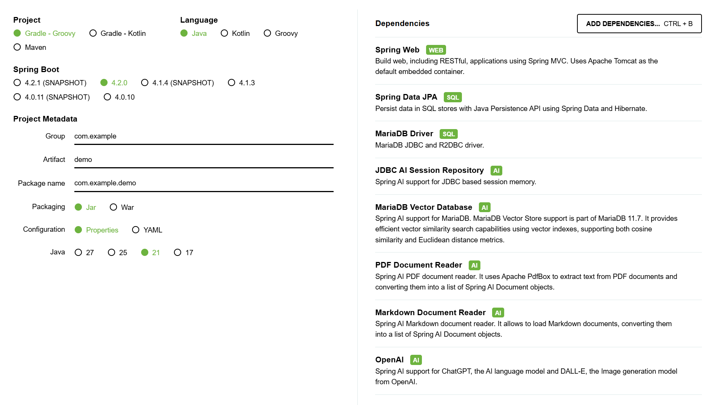

# 6장 Spring AI

사용자의 질문에 답하는 기능에서 시작해, 이전 대화를 이어 가고 쇼핑몰의 문서와 주문 데이터를 활용하는 상담 기능으로 확장합니다. Spring AI는 모델 호출, 대화 이력 처리, 문서 검색과 도구 실행을 자바 코드에서 연결할 수 있도록 제공합니다.

이 장에서는 먼저 `ChatModel`로 모델을 직접 호출하고, `ChatClient`로 요청을 구성합니다. 이어서 Session API로 대화를 유지하고, 문서 검색과 주문 조회·취소 도구를 적용한 뒤 답변을 조금씩 전달하는 스트리밍까지 실습합니다. AI가 생성하는 답변의 문구는 매번 달라질 수 있으므로, 문장 자체보다 사용한 데이터와 처리 결과를 확인합니다.

**학습 목표**

- 모델 호출과 시스템·사용자 메시지의 역할을 구분합니다.
- 요청 옵션을 지정하고 세션 ID로 대화를 이어 갑니다.
- 텍스트를 임베딩하여 저장하고 PDF·Markdown 문서를 검색합니다.
- 검색 결과를 답변에 활용하고 주문 조회·취소를 도구로 연결합니다.
- 스트리밍 응답을 HTTP 요청과 채팅 화면에서 확인합니다.

**준비**: `spring-ai`를 IntelliJ IDEA에서 열고 Java 21과 외부 MariaDB를 준비합니다. 프로젝트는 Spring Boot 4.2.0, Spring AI 2.1.0을 사용하며, 다른 8080 포트 웹 앱은 종료합니다. AI 호출에는 OpenAI API 키가 필요하고, 채팅·임베딩 요청에는 사용량에 따른 비용이 발생할 수 있습니다.

## 실습 준비

### 프로젝트 구성과 의존성

새 프로젝트를 만든다면 Spring Initializr의 Gradle - Groovy, Java, Group `com.example`, Artifact `demo`, Package name `com.example.demo`, Jar, Properties, Java 21 설정을 사용합니다. 내려받은 프로젝트 폴더 이름은 `spring-ai`로 정하며, 최종 의존성과 버전은 제공된 `build.gradle`에 맞춥니다.



캡처에는 기존 JDBC Chat Memory Repository가 표시되어 있지만, 이 장은 Spring AI 2.1의 Session API를 사용합니다. 해당 의존성 대신 `spring-ai-starter-model-session-jdbc`를 적용하고, Lombok과 벡터 검색용 Advisor 의존성도 다음 설정에서 확인합니다.

| 의존성 | 실습에서 하는 일 |
|---|---|
| Spring Web | HTTP 요청을 받아 채팅·문서 검색 결과를 응답합니다. |
| Spring Data JPA, MariaDB Driver | 주문 데이터를 조회하고 취소할 주문을 삭제합니다. |
| OpenAI | 채팅 모델과 임베딩 모델을 연결합니다. |
| JDBC Session | 대화 이력을 MariaDB에 저장합니다. |
| MariaDB Vector Store | 문서와 벡터를 저장하고 유사한 문서를 검색합니다. |
| PDF·Markdown Document Reader | 업로드한 파일에서 텍스트를 읽습니다. |
| Vector Store Advisor | 검색한 문서를 모델 요청에 함께 전달합니다. |
| Lombok | DTO·엔티티의 반복 코드와 로그 필드를 생성합니다. |

**관련 코드**: `spring-ai/build.gradle`의 버전·의존성 설정입니다.

```groovy
ext {
	set('springAiVersion', "2.1.0")
}

dependencies {
	compileOnly 'org.projectlombok:lombok'
	annotationProcessor 'org.projectlombok:lombok'
	testCompileOnly 'org.projectlombok:lombok'
	testAnnotationProcessor 'org.projectlombok:lombok'
	implementation 'org.springframework.boot:spring-boot-starter-data-jpa'
	implementation 'org.springframework.boot:spring-boot-starter-webmvc'
	implementation 'org.springframework.ai:spring-ai-markdown-document-reader'
	implementation 'org.springframework.ai:spring-ai-pdf-document-reader'
	implementation 'org.springframework.ai:spring-ai-starter-model-session-jdbc'
	implementation 'org.springframework.ai:spring-ai-starter-model-openai'
	implementation 'org.springframework.ai:spring-ai-starter-vector-store-mariadb'
	implementation 'org.springframework.ai:spring-ai-vector-store-advisor'
	runtimeOnly 'org.mariadb.jdbc:mariadb-java-client'
	testImplementation 'org.springframework.boot:spring-boot-starter-data-jpa-test'
	testImplementation 'org.springframework.boot:spring-boot-starter-webmvc-test'
	testRuntimeOnly 'org.junit.platform:junit-platform-launcher'
}

dependencyManagement {
	imports {
		mavenBom "org.springframework.ai:spring-ai-bom:${springAiVersion}"
	}
}

tasks.named('test') {
	useJUnitPlatform {
		excludeTags 'integration'
	}
}
```

`springAiVersion`은 Spring AI 모듈의 버전을 맞추는 기준입니다. `dependencyManagement`에서는 Spring AI BOM을 가져와 각 의존성에 같은 계열의 버전을 적용합니다.

### 실행 설정과 데이터 준비

MariaDB는 벡터 기능을 지원하는 11.7 이상의 버전을 사용합니다. 앞 장의 일반 테이블이 있는 DB라도 서버 버전이 낮으면 벡터 저장소를 사용할 수 없으므로, DB 연결과 벡터 기능 지원 여부를 함께 확인합니다. 버전 요구 사항은 공식 MariaDB Vector Store 안내(https://docs.spring.io/spring-ai/reference/api/vectordbs/mariadb.html)에서도 확인할 수 있습니다.

애플리케이션 실행 설정과 뒤에서 실행할 JUnit 테스트 설정에 다음 환경변수를 등록합니다. API 키는 실제 발급받은 값을 사용하며 소스 파일에 직접 적지 않습니다.

| 환경변수 | 값 또는 역할 |
|---|---|
| `DB_URL` | 예: `jdbc:mariadb://localhost:3306/lecture` |
| `DB_USER` | 실습 DB의 사용자 이름 |
| `DB_PASS` | 실습 DB의 비밀번호 |
| `OPENAI_API_KEY` | OpenAI API 호출에 사용할 키 |

**관련 코드**: `spring-ai/src/main/resources/application.properties`

```properties
spring.application.name=demo

spring.datasource.url=${DB_URL}
spring.datasource.username=${DB_USER}
spring.datasource.password=${DB_PASS}

spring.ai.openai.api-key=${OPENAI_API_KEY}
spring.ai.session.repository.jdbc.initialize-schema=always
spring.ai.vectorstore.mariadb.initialize-schema=true

spring.ai.openai.chat.model=gpt-5.6-sol
spring.ai.openai.chat.reasoning-effort=none
spring.ai.openai.chat.service-tier=default
spring.ai.openai.chat.temperature=1.0
spring.ai.openai.chat.top-p=1.0
```

`${DB_URL}` 같은 표현은 실행 환경의 값을 읽습니다. `initialize-schema=always`는 Session 저장소의 테이블을, 벡터 저장소의 `initialize-schema=true`는 벡터 검색에 필요한 테이블을 초기화하도록 지정합니다. 주문 테이블은 별도로 준비해야 합니다.

DB 도구에서 `DB_URL`이 가리키는 DB에 연결하고, `spring-ai/sql/schema.sql`을 실행한 뒤 빈 주문 테이블에 `spring-ai/sql/data.sql`을 한 번 실행합니다. 앞 장의 회원·게시글 SQL을 다시 실행할 필요는 없으며, 이 장에서는 다음 주문 데이터를 사용합니다.

| 사용자 이름 | 상품준비중 | 배송중 | 배송완료 |
|---|---|---|---|
| 윤서준 | ORD-1001 | ORD-1002 | ORD-1003 |
| 윤광철 | ORD-2001 | ORD-2002 | ORD-2003 |
| 공미영 | ORD-3001 | ORD-3002 | ORD-3003 |
| 김도윤 | ORD-4001 | ORD-4002 | ORD-4003 |

주문번호는 고유하므로 데이터가 남아 있는 상태에서 `data.sql`을 다시 실행하지 않습니다. 주문 취소 실습은 실제 행을 삭제하므로, 취소한 주문은 앱을 재시작해도 복원되지 않습니다.

`DemoApplication`을 실행하고 8080 포트의 서버가 시작되는지 확인합니다. 이 프로젝트는 처음부터 Session·벡터 저장소를 함께 구성하므로 기본 채팅만 실습할 때도 DB 연결과 API 키 설정을 준비합니다.

### HTTP 요청 실행 방법

IntelliJ IDEA에서 임시 HTTP 요청 파일을 만들고, 각 절의 `http` 코드 블록을 복사하여 실행합니다. 요청을 구분하는 `###` 위쪽의 실행 버튼을 사용하며, 파일 경로를 사용하는 업로드 요청은 6.7절의 안내를 따릅니다.

`Content-Type: text/plain; charset=UTF-8` 요청은 본문에 질문만 작성합니다. 문자열 양쪽에 큰따옴표를 붙이거나 JSON 객체로 감싸지 않으며, 제품 정보만 `application/json`으로 보냅니다. 모델 답변은 예시와 표현이 달라도 질문과 조건에 맞으면 정상입니다.

아래 표는 실습 중 실행할 코드의 위치입니다. 자바 파일의 경로는 `spring-ai/src/main/java/com/example/demo`를 기준으로 읽습니다.

| 순서 | 주제 | 확인할 파일·메서드 |
|---|---|---|
| 1 | ChatModel | `controller/ApiController.java`의 `postChatModel` |
| 2 | ChatClient.Builder와 ChatClient | 같은 클래스의 `postChatClient` |
| 3 | 시스템·사용자 메시지 | 같은 클래스의 `postMarketing`, `dto/ProductRequest.java` |
| 4 | ChatOptions | 같은 클래스의 `postChatOptions` |
| 5 | Session과 Advisor | `config/AppConfig.java`, `postAdvisorChat`, `deleteSession` |
| 6 | 임베딩·벡터 저장소 | `src/test/java/com/example/demo/RagTests.java` |
| 7 | 문서 읽기·검색 | `controller/DocumentController.java` |
| 8 | QuestionAnswerAdvisor | `ApiController`의 `postRag` |
| 9 | 주문 도구 | `postToolChat`, `tool/ProductOrderTool.java` |
| 10 | 검색 도구 | `postToolRag`, `tool/KnowledgeSearchTool.java` |
| 11 | 스트리밍 | `postStreamChat`, `src/main/resources/static`의 채팅 화면 |

## 6.1 ChatModel로 질문하고 답변받기

모델을 호출하는 가장 작은 예제부터 확인합니다. `ChatModel`은 질문을 모델에 전달하고 응답을 받는 인터페이스이며, OpenAI 의존성과 설정을 바탕으로 스프링이 구현 객체를 준비합니다.

**관련 코드**: `controller/ApiController.java`에서 이번 실습에 필요한 패키지·import·클래스 선언, 주입 필드와 `postChatModel`을 발췌한 코드입니다.

```java
package com.example.demo.controller;

import org.springframework.ai.chat.model.ChatModel;
import org.springframework.beans.factory.annotation.Autowired;
import org.springframework.web.bind.annotation.PostMapping;
import org.springframework.web.bind.annotation.RequestBody;
import org.springframework.web.bind.annotation.RestController;

@RestController
public class ApiController {
    @Autowired
    private ChatModel chatModel;

    @PostMapping("/api/chat-model/chats")
    public String postChatModel(@RequestBody String message) {
        return chatModel.call(message);
    }
}
```

새 프로젝트에서는 `src/main/java/com/example/demo/controller` 아래에 `ApiController.java`를 만듭니다. 이후 절의 주입 필드와 메서드는 이 클래스의 마지막 닫는 중괄호 앞에 추가하고, 필요한 import도 함께 추가합니다. 제공된 프로젝트에는 이 코드가 이미 있으므로 해당 위치를 찾아 확인합니다.

`@RequestBody String message`는 HTTP 요청 본문을 문자열로 받습니다. `chatModel.call(message)`는 답변을 받을 때까지 기다린 뒤 문자열을 반환하며, Controller는 이 값을 HTTP 응답 본문으로 보냅니다.

**실행**

```http
### 모델에 질문하기
POST http://localhost:8080/api/chat-model/chats
Content-Type: text/plain; charset=UTF-8

스프링 부트가 무엇인지 두 문장으로 설명해 줘.
```

**예상 결과**: 200 응답과 함께 스프링 부트에 관한 답변이 표시됩니다. 이 메서드는 대화 이력을 저장하지 않으므로, 이어서 보낸 질문이 앞선 요청을 자동으로 기억한다고 가정하지 않습니다.

## 6.2 ChatClient.Builder로 요청 구성하기

질문뿐 아니라 역할, 옵션, 대화 이력과 도구를 함께 다루려면 요청을 단계별로 구성하는 방식이 편리합니다. `ChatClient`는 이러한 설정을 이어 붙여 모델을 호출하고, 필요한 응답 형태를 선택할 수 있게 합니다.

**관련 코드**: `controller/ApiController.java`의 `builder` 필드와 `postChatClient`입니다.

```java
    @Autowired
    private ChatClient.Builder builder;

    @PostMapping("/api/chat-client/chats")
    public String postChatClient(@RequestBody String message) {
        var simpleChatClient = builder.build();
        return simpleChatClient.prompt()
                .user(message)
                .call()
                .content();
    }
```

`ChatClient.Builder`는 `ChatClient`를 구성하는 객체이며, `build()`가 호출에 사용할 클라이언트를 만듭니다. 스프링이 자동 구성한 Builder를 주입받으므로 모델 연결 정보를 메서드마다 다시 작성하지 않습니다.

| 코드 | 역할 |
|---|---|
| `builder.build()` | 기본 설정으로 클라이언트를 만듭니다. |
| `prompt()` | 이번 모델 요청을 구성하기 시작합니다. |
| `user(message)` | 사용자의 질문을 추가합니다. |
| `call()` | 응답이 준비될 때까지 기다리는 방식으로 호출합니다. |
| `content()` | 모델 응답 중 텍스트 내용을 얻습니다. |

**실행**

```http
### ChatClient로 질문하기
POST http://localhost:8080/api/chat-client/chats
Content-Type: text/plain; charset=UTF-8

스프링 부트가 무엇인지 두 문장으로 설명해 줘.
```

**예상 결과**: 6.1절과 같이 텍스트 답변을 받습니다. 결과는 비슷하지만 이후 예제에서는 `system()`, `options()`, `advisors()`, `tools()`를 추가하면서 이 요청 구성을 확장합니다.

## 6.3 시스템 메시지와 사용자 메시지 구분하기

제품마다 입력 정보는 달라져도 홍보 문구의 작성 규칙은 일정하게 유지하고 싶을 수 있습니다. 이때 모델의 역할과 답변 규칙은 시스템 메시지에, 이번에 처리할 제품 정보는 사용자 메시지에 나누어 전달합니다.

| 메시지 | 이 실습에서 전달할 내용 |
|---|---|
| System Message | 마케팅 카피라이터라는 역할, 문구의 길이·어조·필수 포함 항목 |
| User Message | 제품명, 가격, 구매 링크, 제품 특징 |

**관련 코드**: `controller/ApiController.java`의 두 문자열 필드와 `postMarketing`입니다.

```java
    private final String systemMessage = """
                너는 전문 마케팅 카피라이터야.
                입력된 제품 정보를 기반으로 온라인 쇼핑몰/블로그/홍보 페이지에 사용할 매력적인 마케팅 문구를 작성해 줘.
                작성 조건
                1. 소비자의 관심을 끌 수 있도록 첫 문장은 강렬하거나 공감 가는 표현을 사용해.
                2. 제품 특징을 자연스럽게 녹여서 장점이 잘 드러나게 작성해.
                3. 가격과 구매 링크는 구매를 자극하는 문구와 함께 포함시켜.
                   - 예: "지금 2,400원에 만나보세요  http://example.com/p123"
                4. 글자 수는 약 300~500자로 하고, 캐주얼하지만 설득력 있는 톤으로 작성해.
                5. 필요하면 감각적인 이모지도 활용해.
            """;

    private final String userMessage = """
                입력 정보
                - 제품명: {name}
                - 가격: {price}
                - 구매 링크: {link}
                - 제품 특징: {features}
            """;

    @PostMapping("/api/marketing")
    public String postMarketing(@RequestBody ProductRequest product) {
        var simpleChatClient = builder.build();
        return simpleChatClient.prompt()
                .system(systemMessage)
                .user(user -> user.text(userMessage)
                        .param("name", product.getName())
                        .param("price", product.getPrice())
                        .param("link", product.getLink())
                        .param("features", product.getFeatures()))
                .call()
                .content();
    }
```

`userMessage`의 `{name}`, `{price}` 같은 자리는 요청마다 바뀌는 값이 들어갈 위치입니다. `user -> ...`의 `user`는 사용자 메시지를 구성하는 객체이며, `param()`으로 DTO의 값을 지정하면 각 자리에 제품 정보가 들어갑니다.

`ProductRequest`는 네 필드 `name`, `price`, `link`, `features`를 가진 요청 DTO입니다. 필드가 모두 `String`이므로 이 예제에서는 가격도 문자열로 보내며, JSON을 자바 객체로 받는 과정은 REST API 실습과 같습니다.

**실행**

```http
### 제품 홍보 문구 만들기
POST http://localhost:8080/api/marketing
Content-Type: application/json

{
  "name": "캠퍼스 텀블러",
  "price": "19,800원",
  "link": "https://example.com/products/tumbler",
  "features": "보온·보냉 기능, 500mL 용량, 가방에 넣기 좋은 크기"
}
```

**예상 결과**: 제품 특징과 가격, 구매 링크를 포함한 홍보 문구를 반환합니다. 제품명과 특징을 바꾸어 다시 요청하고, 입력 내용은 달라져도 시스템 메시지의 작성 규칙을 따르는지 비교합니다. 글자 수와 표현은 모델이 생성하므로 정확히 고정된 결과를 기대하지 않습니다.

## 6.4 ChatOptions로 모델 호출 옵션 지정하기

같은 질문이라도 사용할 모델과 처리 옵션을 요청별로 달리 지정할 수 있습니다. 공통값은 설정 파일에 두고, 특정 요청에서는 `options()`로 필요한 값을 지정합니다.

**관련 코드**: `controller/ApiController.java`의 `postChatOptions`입니다.

```java
    @PostMapping("/api/chat-options/chats")
    public String postChatOptions(@RequestBody String message) {
        var simpleChatClient = builder.build();
        return simpleChatClient.prompt()
                .options(OpenAiChatOptions.builder()
                        .model("gpt-5.6-terra")
                        .serviceTier("default")
                        .reasoningEffort("none"))
                .user(message)
                .call()
                .content();
    }
```

`OpenAiChatOptions`는 OpenAI 호출에 사용할 옵션을 모으는 객체입니다. Builder에 값을 지정한 뒤 `options()`에 전달하며, 지정하지 않은 항목은 적용되는 기본 설정을 따릅니다.

| 옵션 | 이 예제의 값 | 확인할 의미 |
|---|---|---|
| `model` | `gpt-5.6-terra` | 이 요청에 사용할 모델 이름입니다. |
| `serviceTier` | `default` | 제공자의 기본 서비스 등급을 요청합니다. |
| `reasoningEffort` | `none` | 이 모델 호출의 추론 노력 수준을 지정합니다. |

설정 파일의 기본 모델은 `gpt-5.6-sol`이고 이 메서드는 `gpt-5.6-terra`를 명시합니다. 모델과 옵션의 지원 여부는 사용하는 계정·모델에 따라 확인해야 하며, 모델 이름만 바꿀 때도 해당 옵션을 함께 사용할 수 있는지 살펴봅니다.

**실행**

```http
### 요청별 옵션으로 질문하기
POST http://localhost:8080/api/chat-options/chats
Content-Type: text/plain; charset=UTF-8

스프링의 의존성 주입을 한 문장으로 설명해 줘.
```

**예상 결과**: 지정한 옵션으로 호출한 모델의 텍스트 답변을 받습니다. 답변 문구만으로 실제 모델을 판별하기보다 코드의 옵션과 제공자의 사용 내역을 확인합니다.

## 6.5 Session과 Advisor로 대화 이어 가기

사용자가 이름을 알려 준 뒤 다시 이름을 물으면 앞선 대화가 필요합니다. Session은 대화 기록을 보관하고, Advisor는 모델 호출 전후에 이력을 읽고 저장하는 처리를 연결합니다. 매번 Controller에서 과거 메시지를 직접 조회해 붙이지 않고도 대화를 이어 갈 수 있습니다.

이 장의 Session은 AI 대화 기록을 관리하는 Spring AI의 기능입니다. 앞 장에서 로그인 정보를 보관할 때 사용한 HTTP 세션과 구분하며, 여기서는 요청의 `sessionId`로 어떤 대화에 속하는지 지정합니다.

### 6.5.1 공통 ChatClient에 Session Advisor 등록

**관련 코드**: `config/AppConfig.java`

```java
package com.example.demo.config;

import org.springframework.ai.chat.client.ChatClient;
import org.springframework.ai.openai.OpenAiChatOptions;
import org.springframework.ai.session.EventFilter;
import org.springframework.ai.session.SessionService;
import org.springframework.ai.session.advisor.SessionAdvisors;
import org.springframework.context.annotation.Bean;
import org.springframework.context.annotation.Configuration;

@Configuration
public class AppConfig {
    @Bean
    public ChatClient chatClient(ChatClient.Builder builder, SessionService sessionService) {
        return builder
                .defaultOptions(OpenAiChatOptions.builder()
                        .model("gpt-5.6-terra")
                        .serviceTier("default")
                        .reasoningEffort("none"))
                .defaultAdvisors(SessionAdvisors.builder(sessionService)
                        .memory(memory -> memory.eventFilter(EventFilter.lastN(20)))
                        .build())
                .build();
    }
}
```

`@Bean`으로 등록한 `ChatClient`에는 모델 옵션과 Session Advisor가 기본으로 적용됩니다. `SessionAdvisors.builder(sessionService).build()`는 세션을 준비하고 대화 이력을 처리하는 Advisor들을 함께 구성하며, `SessionService`는 JDBC Session 의존성을 통해 자동 구성됩니다.

이벤트는 사용자 메시지나 모델 응답 등을 세션에 저장하는 개별 기록입니다. 턴은 사용자 질문부터 최종 답변까지 이어지는 한 차례의 처리이며, 도구를 사용하는 경우에는 도구 호출과 실행 결과도 같은 턴에 포함됩니다.

`memory -> ...`는 대화 이력을 읽을 Advisor의 설정입니다. `EventFilter.lastN(20)`은 최근 이벤트 20개를 기준으로 읽되, 턴이 중간에서 잘리지 않도록 범위를 넓힐 수 있습니다. 따라서 항상 정확히 20개라는 뜻은 아니며, 범위에서 빠진 원본 기록을 DB에서 삭제하는 설정도 아닙니다.

앞의 세 예제에서 사용하는 `simpleChatClient`는 Controller에 별도로 주입한 Builder로 만듭니다. 자동 구성된 Builder는 주입 위치마다 별도로 제공되므로 `AppConfig`에서 추가한 기본 Advisor가 앞부분 예제에 자동 적용되지는 않습니다. 이로써 6.1~6.4절은 세션 없이, 이 절부터는 세션을 사용하는 흐름으로 구분됩니다.

### 6.5.2 세션 ID로 대화 구분

**관련 코드**: `controller/ApiController.java`의 `chatClient` 필드와 `postAdvisorChat`입니다.

```java
    @Autowired
    private ChatClient chatClient;

    @PostMapping("/api/session/chats")
    public String postAdvisorChat(@RequestBody String message,
                                  @RequestParam("sessionId") String sessionId) {
        return chatClient.prompt()
                .system("질문에 짧고 명료하게 답변해 줘.")
                .advisors(SessionAdvisors.session(sessionId))
                .user(message)
                .call()
                .content();
    }
```

`SessionAdvisors.session(sessionId)`는 이번 요청이 사용할 대화를 지정합니다. 처음 쓰는 ID는 Advisor가 세션을 준비하며, 다음 요청에도 같은 ID를 보내면 이전 대화를 모델 요청에 포함합니다. 기본 Session Advisor가 적용된 요청에는 세션 ID를 매번 전달합니다.

**실행**: 다음 요청을 위에서부터 차례대로 보냅니다. `session-basic-01`은 흐름을 확인하기 위한 고정 예시이며, 다른 실습자와 서버를 공유한다면 서로 다른 ID를 사용합니다.

```http
### 이름 알려 주기
POST http://localhost:8080/api/session/chats?sessionId=session-basic-01
Content-Type: text/plain; charset=UTF-8

내 이름은 윤서준이야. 기억해 줘.

### 같은 세션에서 이름 물어보기
POST http://localhost:8080/api/session/chats?sessionId=session-basic-01
Content-Type: text/plain; charset=UTF-8

내 이름이 뭐야?

### 다른 세션에서 이름 물어보기
POST http://localhost:8080/api/session/chats?sessionId=session-basic-02
Content-Type: text/plain; charset=UTF-8

내 이름이 뭐야?
```

**예상 결과**: 두 번째 요청에서는 윤서준이라는 이름을 활용하고, 새 세션에서는 앞선 세션의 이름을 알 수 없습니다. 답변 내용으로 대화가 구분되는지 확인하며, 새 세션에서도 이름을 알려 준 적이 있다면 새로운 ID로 다시 비교합니다.

### 6.5.3 대화 기록 삭제

**관련 코드**: `controller/ApiController.java`의 `sessionService` 필드와 `deleteSession`입니다.

```java
    @Autowired
    private SessionService sessionService;

    @DeleteMapping("/api/session/chats")
    public void deleteSession(@RequestParam("sessionId") String sessionId) {
        sessionService.delete(sessionId);
    }
```

`sessionService.delete(sessionId)`는 해당 세션과 기록을 삭제합니다. 이 메서드는 응답 본문을 반환하지 않으며, 별도의 상태 코드를 지정하지 않은 현재 코드에서는 정상 처리 시 200 응답을 확인합니다.

```http
### 첫 번째 세션 삭제
DELETE http://localhost:8080/api/session/chats?sessionId=session-basic-01

### 삭제 후 같은 ID로 다시 질문하기
POST http://localhost:8080/api/session/chats?sessionId=session-basic-01
Content-Type: text/plain; charset=UTF-8

내 이름이 뭐야?
```

**예상 결과**: 삭제 후 질문하면 앞서 저장한 이름을 활용할 수 없습니다. 같은 ID를 다시 사용하면 새로운 대화가 만들어집니다. JDBC에 저장한 이력은 앱 재시작만으로 비워지지 않으므로, 처음부터 비교하려면 삭제 요청이나 새 ID를 사용합니다.

## 6.6 텍스트 임베딩과 벡터 저장소

질문에 답하려면 문서에서 같은 단어를 찾는 것만으로는 부족할 수 있습니다. 예를 들어 ‘돈은 언제 돌려받나요?’라는 질문과 ‘환불 처리 기간’이라는 문장은 표현이 달라도 관련이 있습니다. 임베딩은 텍스트를 의미 비교에 사용할 숫자 배열로 바꾸는 작업이며, 벡터 저장소는 이 배열과 원문을 저장해 질문과 가까운 문서를 찾습니다.

대화 이력을 저장하는 Session과 검색 대상 문서를 저장하는 Vector Store는 목적이 다릅니다. 전자는 ‘이 대화에서 무슨 말을 했는가’를, 후자는 ‘이 질문과 관련된 문서가 무엇인가’를 다룹니다.

### 6.6.1 임베딩 결과 확인

**관련 코드**: `spring-ai/src/test/java/com/example/demo/RagTests.java`의 클래스 선언, 주입 필드와 `testEmbedding`입니다.

```java
@Tag("integration")
@SpringBootTest
@Slf4j
class RagTests {

    @Autowired
    private EmbeddingModel embeddingModel;

    @Test
    void testEmbedding() {
        String text = """
                [무선 청소기 사용 설명서]
                제품 사용 전 반드시 배터리를 완전히 충전해 주세요.
                전원 버튼을 3초간 길게 눌러 전원을 켜면 LED 표시등이 점등됩니다.
                먼지통이 가득 차면 흡입력이 떨어질 수 있으므로, 청소 후 반드시 먼지통과 필터를 세척하세요.
                필터는 완전히 건조된 후 다시 장착해야 하며, 젖은 상태로 사용할 경우 고장의 원인이 될 수 있습니다.
                배터리는 약 500회 충전이 가능합니다.
                """;

        float[] embedding = embeddingModel.embed(text);

        log.info("임베딩 차원 수: {}", embedding.length);
        log.info("임베딩 벡터: {}", Arrays.toString(embedding));
    }
}
```

`EmbeddingModel`의 `embed()`는 입력 텍스트를 `float[]`로 반환합니다. 배열의 길이는 벡터의 차원 수이고 각 원소는 임베딩 모델이 계산한 숫자입니다. 배열의 각 숫자를 사람이 직접 해석하기보다, 같은 모델이 만든 벡터끼리 의미를 비교한다는 점에 집중합니다.

위 코드는 임베딩 실습에 필요한 부분만 발췌한 클래스입니다. 다음 절의 벡터 저장 코드는 같은 `RagTests` 클래스의 닫는 중괄호 앞에 이어지므로, 제공된 파일을 사용할 때는 메서드를 중복 작성하지 않습니다.

`@SpringBootTest`는 스프링 실행 환경을 준비하여 실제 `EmbeddingModel`을 주입받게 합니다. `@Slf4j`가 만든 `log`로 결과를 출력하며, 로그의 `{}` 자리에 차원 수와 배열 문자열이 들어갑니다.

**실행**: IDE에서 `testEmbedding()`을 개별 실행합니다. 이 테스트는 외부 API를 호출하므로 JUnit 실행 설정에도 DB 환경변수와 API 키를 적용합니다. 별도로 웹 서버를 먼저 실행할 필요는 없습니다.

현재 `build.gradle`은 기본 테스트 실행에서 `integration` 태그를 제외합니다. `RagTests`에는 이 태그가 있으므로 이 절은 IntelliJ IDEA의 테스트 실행기를 JUnit으로 선택해 메서드 옆 실행 버튼으로 수행합니다. Gradle로 실행되도록 설정되어 있으면 `--tests`로 메서드만 지정하더라도 태그 제외 규칙이 남아 실행되지 않을 수 있습니다.

**예상 결과**: 다음 형태의 로그가 출력됩니다. 차원 수와 숫자는 사용한 임베딩 모델에 따라 달라지므로 특정 숫자를 정답으로 비교하지 않습니다.

```text
임베딩 차원 수: ...
임베딩 벡터: [...]
```

### 6.6.2 문서를 벡터 저장소에 저장

**관련 코드**: 같은 `RagTests` 클래스의 `vectorStore`, `texts`, `testVectorStore`입니다.

```java
    @Autowired
    private VectorStore vectorStore;

    private final List<String> texts = List.of(
            """
            [무선 청소기 사용 설명서]
            제품 사용 전 반드시 배터리를 완전히 충전해 주세요.
            전원 버튼을 3초간 길게 눌러 전원을 켜면 LED 표시등이 점등됩니다.
            먼지통과 필터는 청소 후 세척하고 완전히 건조해야 합니다.
            """,
            """
            [전자제품 A/S 및 교환 정책]
            본 제품은 구입일로부터 1년간 무상 보증이 제공됩니다.
            제품 수리는 서비스 센터 방문 또는 택배 접수가 가능합니다.
            교환 또는 환불은 구입 후 7일 이내에 가능합니다.
            """,
            """
            [온라인 쇼핑몰 반품 정책]
            상품은 수령 후 7일 이내에 반품할 수 있습니다.
            단순 변심으로 인한 반품은 왕복 배송비가 청구될 수 있습니다.
            제품 이상이나 오배송의 경우 배송비는 당사에서 부담합니다.
            """
    );

    @Test
    void testVectorStore() {
        List<Document> documents = texts.stream()
                .map(Document::new)
                .toList();

        vectorStore.write(documents);

        log.info("저장한 문서 수: {}", documents.size());
    }
```

`Document`는 텍스트와 문서의 부가 정보를 담는 객체입니다. `Document::new`는 각 문자열을 `new Document(text)`로 바꾸는 생성자 참조이며, `toList()`가 변환한 문서를 목록으로 모읍니다.

`vectorStore.write(documents)`는 각 문서의 임베딩을 계산하고 원문과 함께 저장합니다. 따라서 이 메서드도 실제 임베딩 API와 MariaDB를 사용합니다. 뒤에서 검색할 때는 질문도 같은 임베딩 모델로 변환하므로, 기존 벡터와 다른 모델·차원으로 임의 변경하지 않습니다.

**실행**: `testVectorStore()`를 개별 실행하고 다음 로그를 확인합니다.

```text
저장한 문서 수: 3
```

이 테스트에는 데이터를 되돌리는 `@Transactional`이 없으므로 문서는 테스트 종료 후에도 DB에 남습니다. 메서드 실행 순서에 의존하지는 않지만 같은 문서를 반복 등록하지 않도록 필요한 때만 실행합니다. 이 단계의 문서에는 다음 절에서 추가할 `docType`, `businessCategory` 메타데이터가 없습니다.

## 6.7 Document Reader로 파일 읽고 검색하기

앞 절에서는 자바 코드 안의 문자열을 저장했습니다. 실제 상담 자료는 파일로 관리하므로, PDF와 Markdown 파일을 읽어 같은 `Document` 목록으로 바꾸고 벡터 저장소에 넣습니다.

이 절에서 사용하는 자료는 `spring-ai/documents`의 반품 정책 매뉴얼과 반품 FAQ입니다. 두 문서는 PDF와 Markdown 형식으로 각각 제공되며, 두 형식을 읽는 방법을 비교한 뒤 후반 실습에서는 Markdown 자료를 검색 대상으로 사용합니다.

### 6.7.1 PDF 파일 업로드

**관련 코드**: `controller/DocumentController.java`의 선언부와 `uploadPdf`입니다. 이 클래스의 import는 원본 파일에서 확인합니다.

```java
@RestController
public class DocumentController {

    @Autowired
    private VectorStore vectorStore;

    @PostMapping("/api/documents/pdf")
    public String uploadPdf(@RequestParam("file") MultipartFile file) {
        // PDF 파일 읽기
        DocumentReader reader = new PagePdfDocumentReader(file.getResource());
        List<Document> documents = reader.read();

        // Custom Metadata 추가
        documents.forEach(document -> {
            document.getMetadata().put("docType", "pdf");
            document.getMetadata().put("businessCategory", "return-policy");
            document.getMetadata().put("sourceFile", file.getOriginalFilename());
        });

        // 벡터데이터베이스에 저장
        vectorStore.write(documents);

        return "저장한 문서 수: " + documents.size();
    }
}
```

`MultipartFile`은 HTTP 파일 업로드로 받은 데이터를 나타냅니다. `file.getResource()`로 읽을 대상을 전달하고, `PagePdfDocumentReader.read()`로 PDF의 페이지를 읽어 문서 목록을 얻습니다. 이 예제는 텍스트가 포함된 PDF를 사용하며, 이미지로만 된 스캔 문서의 글자를 인식하는 코드는 포함하지 않습니다.

저장하기 전에 `getMetadata().put()`으로 검색 조건에 사용할 정보를 덧붙입니다. 메타데이터는 본문과 구분하여 보관하는 부가 정보이며, 아래 키는 이 프로젝트에서 정한 이름입니다.

| 키 | PDF 값 | Markdown 값 | 목적 |
|---|---|---|---|
| `docType` | `pdf` | `markdown` | 파일 형식에 따른 검색 범위를 구분합니다. |
| `businessCategory` | `return-policy` | `return-policy` | 반품 정책 자료를 구분합니다. |
| `sourceFile` | 업로드한 파일 이름 | 업로드한 파일 이름 | 자료의 출처를 확인합니다. |

**실행**: 임시 HTTP 요청 파일을 `spring-ai` 프로젝트 폴더 바로 아래에 두면 다음 상대 경로를 사용할 수 있습니다. 다른 위치에 만들었다면 `<` 다음의 파일 경로를 실제 파일 위치로 바꿉니다.

```http
### 반품 정책 PDF 업로드
POST http://localhost:8080/api/documents/pdf
Content-Type: multipart/form-data; boundary=practice-boundary

--practice-boundary
Content-Disposition: form-data; name="file"; filename="return-policy.pdf"
Content-Type: application/pdf

< ./documents/캠퍼스 온라인 쇼핑몰 반품 정책 매뉴얼.pdf
--practice-boundary--
```

`name="file"`은 Controller의 `@RequestParam("file")`과 일치해야 합니다. `boundary`는 업로드 내용을 구분하는 문자열이며, 본문의 시작·끝 구분자에도 같은 값을 사용합니다. `filename`은 서버에 전달할 파일 이름이고 `<` 다음 경로는 실제로 읽을 로컬 파일입니다.

**예상 결과**: `저장한 문서 수: ...`라는 응답을 받습니다. 이 수는 읽은 `Document` 개수이므로, 업로드 파일 개수와 같다고 가정하지 않습니다.

### 6.7.2 Markdown 파일 업로드

**관련 코드**: 같은 `DocumentController`의 `uploadMarkdown`입니다.

```java
    @PostMapping("/api/documents/markdown")
    public String uploadMarkdown(@RequestParam("file") MultipartFile file) {
        // Markdown 파일 읽기
        DocumentReader reader = new MarkdownDocumentReader(
                file.getResource(),
                MarkdownDocumentReaderConfig.defaultConfig()
        );
        List<Document> documents = reader.read();

        // Custom Metadata 추가
        documents.forEach(document -> {
            document.getMetadata().put("docType", "markdown");
            document.getMetadata().put("businessCategory", "return-policy");
            document.getMetadata().put("sourceFile", file.getOriginalFilename());
        });

        // 벡터데이터베이스에 저장
        vectorStore.write(documents);

        return "저장한 문서 수: " + documents.size();
    }
```

`MarkdownDocumentReader`는 Markdown 내용을 읽고 `Document` 목록으로 변환합니다. PDF와 Reader는 다르지만 메타데이터를 추가하고 `vectorStore.write()`로 저장하는 흐름은 같습니다.

**실행**: 반품 정책 매뉴얼과 FAQ를 각각 등록합니다. HTTP 요청 파일은 앞 절과 같은 위치에서 사용합니다.

```http
### 반품 정책 Markdown 업로드
POST http://localhost:8080/api/documents/markdown
Content-Type: multipart/form-data; boundary=practice-boundary

--practice-boundary
Content-Disposition: form-data; name="file"; filename="return-policy.md"
Content-Type: text/markdown; charset=UTF-8

< ./documents/캠퍼스 온라인 쇼핑몰 반품 정책 매뉴얼.md
--practice-boundary--

### 반품 FAQ Markdown 업로드
POST http://localhost:8080/api/documents/markdown
Content-Type: multipart/form-data; boundary=practice-boundary

--practice-boundary
Content-Disposition: form-data; name="file"; filename="return-faq.md"
Content-Type: text/markdown; charset=UTF-8

< ./documents/캠퍼스 온라인 쇼핑몰 반품 FAQ.md
--practice-boundary--
```

**예상 결과**: 각 요청에서 저장한 문서 수를 반환합니다. 이후의 RAG와 검색 도구는 `docType == 'markdown'` 조건을 사용하므로, PDF만 등록하거나 6.6절의 테스트만 실행한 상태에서는 해당 자료를 검색하지 못합니다. 다음 절로 넘어가기 전에 두 Markdown 업로드를 마칩니다.

### 6.7.3 질문과 유사한 문서 검색

**관련 코드**: `DocumentController`의 `search`와 `searchFiltered`입니다.

```java
    @GetMapping("/api/documents/search")
    public List<Document> search(@RequestParam("question") String question) {
        return vectorStore.similaritySearch(question);
    }

    @GetMapping("/api/documents/search/filtered")
    public List<Document> searchFiltered(@RequestParam("question") String question) {
        return vectorStore.similaritySearch(SearchRequest.builder()
                .query(question)
                .similarityThreshold(0.7)
                .topK(2)
                .filterExpression("docType == 'markdown'")
                .build());
    }
```

`similaritySearch(question)`는 질문을 바탕으로 유사한 문서를 찾습니다. `SearchRequest`를 사용하면 검색어뿐 아니라 결과 개수와 유사도 기준, 메타데이터 조건을 함께 지정할 수 있습니다.

| 설정 | 이 예제의 의미 |
|---|---|
| `query(question)` | 검색할 질문을 지정합니다. |
| `similarityThreshold(0.7)` | 유사도 기준을 만족하는 문서만 선택합니다. |
| `topK(2)` | 검색 결과를 최대 2개로 제한합니다. |
| `filterExpression("docType == 'markdown'")` | Markdown으로 등록한 문서만 검색합니다. |

유사도 기준은 정답 확률이 아닙니다. 기준을 만족하는 문서가 적으면 2개보다 적게 반환되며, 조건에 맞는 문서가 없으면 빈 목록을 반환할 수 있습니다.

**실행**: 브라우저나 HTTP Client에서 다음 요청을 보냅니다. 아래 검색어는 ‘환불’을 URL에 넣을 수 있도록 인코딩한 값입니다.

```http
### 형식 제한 없이 문서 검색
GET http://localhost:8080/api/documents/search?question=%ED%99%98%EB%B6%88

### Markdown 문서만 최대 2개 검색
GET http://localhost:8080/api/documents/search/filtered?question=%ED%99%98%EB%B6%88
```

**예상 결과**: JSON 목록에서 문서의 본문과 메타데이터를 확인합니다. 필터 검색 결과의 `docType`은 `markdown`이어야 하며 최대 2개를 반환합니다. 이 API는 검색한 문서를 돌려줄 뿐, 모델이 만든 상담 답변을 반환하지는 않습니다.

## 6.8 QuestionAnswerAdvisor로 검색 결과를 답변에 활용하기

검색 API가 문서를 찾아 주더라도 사용자가 원하는 답변을 만들려면 질문과 관련 문서를 모델에 함께 전달해야 합니다. RAG는 Retrieval Augmented Generation의 약자로, 필요한 자료를 검색하여 답변 생성에 활용하는 방식입니다. 문서를 모델에 새로 학습시키는 것이 아니라 이번 요청에 참고 자료를 덧붙입니다.

**관련 코드**: `controller/ApiController.java`의 `vectorStore` 필드와 `postRag`입니다.

```java
    @Autowired
    private VectorStore vectorStore;

    @PostMapping("/api/chat-rag/chats")
    public String postRag(@RequestBody String message,
                          @RequestParam("sessionId") String sessionId) {
        return chatClient.prompt()
                .advisors(SessionAdvisors.session(sessionId))
                .advisors(QuestionAnswerAdvisor.builder(vectorStore)
                        .searchRequest(SearchRequest.builder()
                                .similarityThreshold(0.7)
                                .topK(2)
                                .filterExpression("docType == 'markdown'")
                                .build())
                        .build())
                .user(message)
                .call()
                .content();
    }
```

`QuestionAnswerAdvisor`는 사용자 질문으로 벡터 저장소를 검색하고 그 결과를 모델 요청에 반영합니다. 따라서 `SearchRequest`에는 검색어를 고정하지 않고 결과 개수·유사도·형식 조건만 지정합니다. 기본 Session Advisor도 유지되므로 같은 세션의 대화를 활용할 수 있습니다.

**실행**: Markdown 문서 업로드와 필터 검색이 정상인지 확인한 다음 요청합니다. 새 실습에는 앞 절과 다른 세션 ID를 사용합니다.

```http
### 반품 문서를 참고한 답변
POST http://localhost:8080/api/chat-rag/chats?sessionId=session-rag-01
Content-Type: text/plain; charset=UTF-8

단순 변심으로 반품하면 배송비는 누가 부담하나요?
```

**예상 결과**: 검색된 반품 자료에 근거하여 단순 변심의 왕복 배송비는 고객이 부담한다는 취지의 답변을 받습니다. 결과가 기대와 다르면 먼저 6.7절의 검색 API로 같은 질문에 어떤 문서가 나오는지 확인합니다.

이 예제의 문서 검색은 요청마다 Advisor가 수행합니다. 다음 두 절에서는 모델이 질문을 보고 필요한 도구를 요청하는 방식으로 확장하며, 이 차이를 비교합니다.

## 6.9 주문 조회·취소를 Tool로 연결하기

모델은 현재 DB에 어떤 주문이 있는지 알 수 없고, 답변 문장을 생성하는 것만으로 주문을 취소할 수도 없습니다. 애플리케이션의 조회·취소 메서드를 도구로 제공하면 모델이 필요한 도구와 인수를 요청하고, Spring AI가 자바 메서드를 실행하여 그 결과를 다시 모델에 전달합니다.

### 6.9.1 주문 데이터와 Repository 확인

주문 데이터는 `entity/ProductOrder.java`, 조회 메서드는 `repository/ProductOrderRepository.java`에서 확인합니다. 엔티티 매핑과 Spring Data JPA는 앞 장에서 익혔으므로 이 절에서는 도구에 필요한 필드와 조건만 살펴봅니다.

| 파일·항목 | 이 실습에서의 역할 |
|---|---|
| `ProductOrder` | 주문번호, 상품명, 배송주소, 배송상태, 주문자 이름을 저장합니다. |
| `findByMemberName(memberName)` | 해당 사용자의 주문 목록을 조회합니다. |
| `findByOrderNumberAndMemberName(orderNumber, memberName)` | 주문번호와 사용자 이름이 모두 일치하는 주문을 조회합니다. |
| `delete(productOrder)` | 취소할 주문 행을 삭제합니다. |

`dto/ProductRequest.java`는 6.3절의 홍보 문구 요청용 DTO입니다. 이 주문 도구에서는 JSON DTO를 받지 않고 사용자 이름은 요청 파라미터로, 취소할 주문번호는 모델의 도구 호출 인수로 전달받습니다.

### 6.9.2 도구 메서드 작성

**관련 코드**: `tool/ProductOrderTool.java`의 클래스 본문입니다. import는 원본 파일에서 확인합니다.

```java
@Component
@Slf4j
public class ProductOrderTool {
    @Autowired
    private ProductOrderRepository repository;

    @Tool(description = "주문목록(주문번호, 상품이름, 배송주소, 배송상태)을 조회합니다")
    String getProductOrders(ToolContext toolContext) {
        String username = (String) toolContext.getContext().get("username");
        log.info("getProductOrders called");
        var productOrders = repository.findByMemberName(username);
        if (productOrders.isEmpty()) {
            return "주문목록이 없습니다.";
        } else {
            StringBuilder result = new StringBuilder("주문목록은 다음과 같아요\n");
            for (var productOrder : productOrders) {
                result.append("주문번호: ").append(productOrder.getOrderNumber());
                result.append(", 상품이름: ").append(productOrder.getProductName());
                result.append(", 배송주소: ").append(productOrder.getShippingAddress());
                result.append(", 배송상태: ").append(productOrder.getShippingStatus());
                result.append("\n");
            }
            return result.toString();
        }
    }

    @Tool(description = "주문번호를 사용하여 상품주문을 취소합니다")
    String cancelProductOrder(@ToolParam(description = "주문번호") String orderNumber,
                              ToolContext toolContext) {
        String username = (String) toolContext.getContext().get("username");
        log.info("cancelProductOrder called with orderNumber: {}", orderNumber);
        var productOrder = repository.findByOrderNumberAndMemberName(orderNumber, username);
        if (productOrder.isPresent()) {
            if ("상품준비중".equals(productOrder.get().getShippingStatus())) {
                repository.delete(productOrder.get());
                return "주문이 취소 되었습니다.";
            } else if ("배송중".equals(productOrder.get().getShippingStatus())) {
                return "배송중인 상품은 취소할 수 없습니다.";
            } else {
                return "현재 배송상태에서는 주문을 취소할 수 없습니다.";
            }
        } else {
            return "없는 주문 번호입니다.";
        }
    }
}
```

`@Component`는 도구 객체를 스프링 빈으로 등록하고, `@Tool`은 모델이 사용할 메서드와 설명을 지정합니다. `@ToolParam`은 주문번호 인수가 무엇을 뜻하는지 설명하여 모델이 값을 구성하도록 돕습니다.

`ToolContext`는 애플리케이션에서 도구에 전달하는 부가 정보입니다. 이 예제에서는 서버가 받은 `username`을 넣으며, 조회 조건에는 모델이 문장에 적은 임의의 사용자 이름 대신 이 값을 사용합니다. 다만 사용자 이름 입력은 강의용 사용자 구분이며 로그인 인증을 구현한 것은 아닙니다.

주문번호와 이름으로 조회한 결과는 `Optional`이므로 `isPresent()`로 존재 여부를 먼저 확인합니다. 상품준비중이면 실제 주문 행을 삭제하고, 배송중 또는 그 밖의 상태에서는 취소할 수 없다는 결과를 반환합니다.

### 6.9.3 채팅 요청에 주문 도구 등록

**관련 코드**: `ApiController`의 `productOrderTool` 필드, 상담용 시스템 메시지와 `postToolChat`입니다.

```java
    @Autowired
    private ProductOrderTool productOrderTool;

    private static final String customerSupportSystemMessage = """
        당신은 캠퍼스 쇼핑몰의 고객지원 상담사입니다.
        다음 원칙에 따라 답변하세요.
        1. 확인된 사실에 근거하여 정확하게 답변합니다.
        2. 제공된 정보만으로 답변할 수 없거나 확실하지 않은 내용은 추측하지 않습니다.
        3. 답변하기 어려운 문의는 고객센터 02-500-5000으로 안내합니다.
        4. 답변은 짧고 명확하게 작성합니다.
        5. 답변은 순수 텍스트(Plain Text) 형식으로 작성하며, Markdown 문법은 사용하지 않습니다.
        6. 사용자가 인사만 하거나 구체적인 문의 없이 말을 건 경우에는 간단히 인사한 뒤 문의 내용을 요청합니다.
        7. 문의 내용을 요청할 때는 문의 유형이나 예시를 나열하지 않습니다.
        """;

    @PostMapping("/api/chat-tools/chats")
    public String postToolChat(@RequestBody String message,
                               @RequestParam("sessionId") String sessionId,
                               @RequestParam("username") String username) {
        return chatClient.prompt()
                .system(customerSupportSystemMessage)
                .advisors(SessionAdvisors.session(sessionId))
                .tools(productOrderTool)
                .toolContext(Map.of("username", username))
                .user(message)
                .call()
                .content();
    }
```

`tools(productOrderTool)`은 객체의 도구 메서드를 이번 요청에 제공합니다. `toolContext(Map.of("username", username))`의 키는 도구에서 읽는 `"username"`과 일치해야 합니다. `Map.of()`는 여기서 사용자 이름 한 항목을 담은 맵을 만드는 데 사용합니다.

도구를 등록했다고 항상 모든 도구가 실행되는 것은 아닙니다. 모델이 질문과 도구 설명을 보고 호출을 요청하며, 애플리케이션이 실행한 결과를 받아 최종 답변을 만듭니다. `getProductOrders called`, `cancelProductOrder called with orderNumber: ...` 로그로 실제 도구가 실행되었는지 확인합니다.

**실행**: SQL 샘플이 준비되어 있고 ORD-1001을 아직 취소하지 않은 상태에서 차례로 요청합니다. `%EC%9C%A4%EC%84%9C%EC%A4%80`은 윤서준을 URL 인코딩한 값입니다.

```http
### 윤서준의 주문 목록 조회
POST http://localhost:8080/api/chat-tools/chats?sessionId=session-tools-01&username=%EC%9C%A4%EC%84%9C%EC%A4%80
Content-Type: text/plain; charset=UTF-8

내 주문 목록을 조회해 줘.

### 배송중 주문 취소 시도
POST http://localhost:8080/api/chat-tools/chats?sessionId=session-tools-01&username=%EC%9C%A4%EC%84%9C%EC%A4%80
Content-Type: text/plain; charset=UTF-8

ORD-1002 주문을 취소해 줘.

### 상품준비중 주문 취소
POST http://localhost:8080/api/chat-tools/chats?sessionId=session-tools-01&username=%EC%9C%A4%EC%84%9C%EC%A4%80
Content-Type: text/plain; charset=UTF-8

ORD-1001 주문을 취소해 줘.

### 취소 후 목록 재조회
POST http://localhost:8080/api/chat-tools/chats?sessionId=session-tools-01&username=%EC%9C%A4%EC%84%9C%EC%A4%80
Content-Type: text/plain; charset=UTF-8

지금 DB에서 내 주문 목록을 다시 조회해 줘.
```

**예상 결과**: 처음에는 주문 3건을 확인하고, ORD-1002는 배송중이므로 취소되지 않습니다. ORD-1001은 취소 도구가 실행되면 삭제되므로 마지막 조회에서는 나머지 2건을 확인합니다. 모델이 추가 확인을 요청하면 대상 주문을 확인하여 답변하고, 최종 변경 여부는 도구 로그와 DB 조회로 확인합니다.

다른 사용자의 주문인 ORD-2001을 윤서준으로 취소하려고 하면 이름 조건이 일치하지 않아 삭제할 수 없습니다. 대화 기록 삭제는 주문 삭제와 별개이므로 ‘새 대화’를 시작해도 취소한 주문은 복원되지 않습니다.

## 6.10 문서 검색을 Tool로 제공하기

주문 조회에는 주문 DB가 필요하고 반품 규정에는 문서 검색이 필요합니다. 검색도 도구로 제공하면 모델이 문의의 성격에 따라 사용할 도구를 선택하고, 검색어를 구성하여 관련 자료를 요청할 수 있습니다.

### 6.10.1 반품 지식 검색 도구

**관련 코드**: `tool/KnowledgeSearchTool.java`의 클래스 본문입니다.

```java
@Component
@Slf4j
public class KnowledgeSearchTool {
    @Autowired
    private VectorStore vectorStore;

    @Tool(description = """
            반품 가능 조건, 반품 기간, 배송비, 환불 절차 등
            반품 FAQ와 반품 정책 매뉴얼에서 정보를 검색합니다.
            반품 정책에 관한 질문에는 반드시 호출합니다.""")
    public String searchReturnKnowledgeBase(
            @ToolParam(description = "이전 대화에서 생략된 대상을 보완하여 반품 문서 검색에 적합하게 작성한 질문")
            String query
    ) {
        log.info("searchReturnKnowledgeBase called with query: {}", query);

        List<Document> documents = vectorStore.similaritySearch(
                SearchRequest.builder()
                        .query(query)
                        .topK(3)
                        .similarityThreshold(0.7)
                        .filterExpression(
                                "businessCategory == 'return-policy' && docType == 'markdown'")
                        .build()
        );

        log.info("검색된 반품 문서 수: {}", documents.size());

        if (documents.isEmpty()) {
            return "관련 FAQ 또는 반품 정책 내용을 찾지 못했습니다.";
        }

        return documents.stream()
                .map(Document::getText)
                .collect(Collectors.joining("\n\n---\n\n"));
    }
}
```

검색어 `query`는 모델이 도구 호출 인수로 구성합니다. `@ToolParam`에는 앞선 대화에서 생략한 대상도 보완하도록 설명해 두었으므로, 예를 들어 ‘그럼 배송비는?’ 같은 질문을 더 구체적인 검색어로 만들도록 유도합니다.

검색은 반품 정책 범주이면서 Markdown인 문서 중 유사도 기준을 만족하는 최대 3개를 대상으로 합니다. 결과가 없으면 자료를 찾지 못했다는 문자열을 반환하고, 결과가 있으면 `Document::getText`로 본문만 꺼내 구분선과 함께 연결합니다. `Collectors.joining()`은 여러 문자열을 하나로 합치는 역할입니다.

### 6.10.2 주문 도구와 검색 도구 함께 사용

**관련 코드**: `ApiController`의 `knowledgeSearchTool` 필드와 `postToolRag`입니다. 상담용 시스템 메시지는 6.9절에서 확인한 필드를 사용합니다.

```java
    @Autowired
    private KnowledgeSearchTool knowledgeSearchTool;

    @PostMapping("/api/chat-tool-rag/chats")
    public String postToolRag(@RequestBody String message,
                              @RequestParam("sessionId") String sessionId,
                              @RequestParam("username") String username) {
        return chatClient.prompt()
                .system(customerSupportSystemMessage + """
                        반품 문의 처리 원칙
                        1. 반품 정책에 관한 질문은 지식 검색 도구를 호출하고 그 결과를 근거로 답변합니다.
                        2. 검색 결과에 필요한 정보가 없으면 추측하지 말고 고객센터로 안내합니다.
                        """)
                .advisors(SessionAdvisors.session(sessionId))
                .tools(productOrderTool, knowledgeSearchTool)
                .toolContext(Map.of("username", username))
                .user(message)
                .call()
                .content();
    }
```

`tools(productOrderTool, knowledgeSearchTool)`로 두 객체의 도구를 함께 제공합니다. 시스템 메시지는 반품 정책 질문에 검색 도구를 호출하고, 근거가 없으면 추측하지 말고 고객센터로 안내하도록 지정합니다. 실제 호출 여부와 검색된 문서 수는 도구의 로그에서 확인합니다.

**실행**: 6.7절에서 반품 Markdown 두 파일을 등록한 뒤 요청합니다. 다음 실습은 새로운 세션을 사용하지만 취소로 변경된 주문 데이터는 그대로 유지됩니다.

```http
### 반품 정책 검색 도구 사용
POST http://localhost:8080/api/chat-tool-rag/chats?sessionId=session-tool-rag-01&username=%EC%9C%A4%EC%84%9C%EC%A4%80
Content-Type: text/plain; charset=UTF-8

단순 변심으로 반품하려고 해. 언제까지 신청할 수 있어?

### 같은 세션에서 후속 질문
POST http://localhost:8080/api/chat-tool-rag/chats?sessionId=session-tool-rag-01&username=%EC%9C%A4%EC%84%9C%EC%A4%80
Content-Type: text/plain; charset=UTF-8

그 경우 배송비는 누가 부담해?
```

**예상 결과**: 단순 변심의 신청 기간과 배송비에 관한 답변을 받고, 로그에서 `searchReturnKnowledgeBase called with query: ...`와 검색 문서 수를 확인합니다. 검색 문서 수가 0이면 답변만 반복 요청하기보다 업로드 여부와 필터 검색 결과를 먼저 확인합니다.

| 방식 | 검색이 수행되는 시점 | 이 실습의 검색어 |
|---|---|---|
| `QuestionAnswerAdvisor` | 해당 Advisor를 등록한 요청에서 검색합니다. | 사용자 질문을 바탕으로 검색합니다. |
| `KnowledgeSearchTool` | 모델이 검색 도구 호출을 요청할 때 검색합니다. | 모델이 도구 인수로 구성합니다. |

두 방식 모두 검색한 자료를 답변의 근거로 전달합니다. 도구 방식은 주문 처리와 문서 검색을 한 요청에서 함께 제공할 수 있다는 점을 확인합니다.

## 6.11 스트리밍으로 답변 전달하기

지금까지의 `call().content()`는 최종 답변이 준비될 때까지 기다립니다. 답변이 길어지면 화면이 멈춘 것처럼 보일 수 있으므로, `stream()`으로 생성되는 내용을 조금씩 전달하여 사용자가 먼저 도착한 부분부터 읽을 수 있게 합니다.

### 6.11.1 스트리밍 Controller

**관련 코드**: `ApiController`의 `jsonMapper` 필드와 `postStreamChat`입니다.

```java
    @Autowired
    private JsonMapper jsonMapper;

    @PostMapping(value = {"/api/chat-stream/chats", "/chats"}, produces = MediaType.TEXT_EVENT_STREAM_VALUE)
    public Flux<String> postStreamChat(@RequestBody String message,
                                       @RequestParam("sessionId") String sessionId,
                                       @RequestParam("username") String username) {
        return chatClient.prompt()
                .system(customerSupportSystemMessage + """
                        반품 문의 처리 원칙
                        1. 반품 정책에 관한 질문은 지식 검색 도구를 호출하고 그 결과를 근거로 답변합니다.
                        2. 검색 결과에 필요한 정보가 없으면 추측하지 말고 고객센터로 안내합니다.
                        """)
                .advisors(SessionAdvisors.session(sessionId))
                .tools(productOrderTool, knowledgeSearchTool)
                .toolContext(Map.of("username", username))
                .user(message)
                .stream()
                .content()
                .map(jsonMapper::writeValueAsString);
    }
```

`Flux<String>`은 문자열을 여러 번 순서대로 전달할 수 있는 반환 타입입니다. 자바의 컬렉션을 처리하는 `Stream`과 구분하며, 이 예제에서는 Spring MVC가 `text/event-stream` 형식으로 각 내용을 클라이언트에 보냅니다. 이 전송 형식을 SSE(Server-Sent Events)라고 부릅니다.

`stream().content()`는 모델이 전달하는 텍스트 조각을 얻고, `map(jsonMapper::writeValueAsString)`은 각 조각을 JSON 문자열로 변환합니다. JSON 문자열은 따옴표와 줄바꿈 같은 문자를 안전하게 표현하므로, 프런트엔드는 이벤트의 데이터를 `JSON.parse()`로 읽어 원래 텍스트를 복원합니다. JSON 문자열 변환까지 포함한 서버·클라이언트의 형식을 함께 유지합니다.

### 6.11.2 HTTP 요청으로 스트리밍 확인

```http
### 반품 상담 스트리밍
POST http://localhost:8080/api/chat-stream/chats?sessionId=session-stream-01&username=%EC%9C%A4%EC%84%9C%EC%A4%80
Content-Type: text/plain; charset=UTF-8
Accept: text/event-stream

단순 변심 반품의 신청 기간과 배송비 부담을 설명해 줘.
```

`POST /chats`도 같은 메서드에 연결되어 있으므로 주소를 바꾸어 호출할 수 있습니다. 두 주소 모두 `sessionId`, `username`, 질문 본문을 같은 형식으로 전달합니다.

**예상 결과**: 응답 헤더의 Content-Type이 `text/event-stream`이고 본문에는 `data:`로 시작하는 이벤트가 이어집니다. 다음은 전송 형식을 보여 주는 예시이며, 실제 조각의 길이와 개수는 실행마다 달라집니다.

```text
data:"단순 변심 반품은 "

data:"상품 수령 후 7일 이내에 신청할 수 있습니다."

```

스트리밍 도구 실행이나 문서 검색이 끝나야 첫 텍스트가 도착하는 경우도 있습니다. HTTP Client의 표시 방식에 따라 결과가 모여 보일 수 있으므로, 다음 채팅 화면에서도 답변이 이어지는지 확인합니다.

### 6.11.3 제공된 채팅 화면에서 확인

앱을 실행한 상태에서 `http://localhost:8080/`을 엽니다. 화면 파일은 `src/main/resources/static/index.html`, 스타일은 `chat.css`, 요청 처리는 `chat.js`, SSE 데이터 읽기는 `stream.js`에서 확인합니다. 이 장에서는 화면을 처음부터 작성하기보다 앞서 만든 API가 어떻게 연결되는지 살펴봅니다.

| 화면 동작 | 서버 요청·클라이언트 처리 |
|---|---|
| 페이지 열기 | UUID 형식의 새 `sessionId`를 만듭니다. |
| 전송 | `POST /api/chat-stream/chats`에 세션 ID와 사용자 이름, 질문을 보냅니다. |
| 답변 수신 | SSE 이벤트의 JSON 문자열을 복원하여 같은 말풍선에 누적합니다. |
| 중지 | 브라우저의 답변 수신을 중단하고 이미 표시한 내용을 남깁니다. |
| 새 대화 | `DELETE /api/session/chats` 성공 후 새 세션 ID를 만들고 화면을 비웁니다. |

사용자 이름에 `윤서준`을 입력하고 ‘내 주문 목록을 조회해 줘’와 반품 질문을 차례로 보냅니다. 주문 조회 도구와 검색 도구의 로그를 확인하고, 답변이 하나의 말풍선에 누적되는지 살펴봅니다. 앞서 ORD-1001을 취소했다면 현재 주문 목록에는 그 주문이 없어야 합니다.

이어서 같은 세션에서 후속 질문을 보낸 뒤, 답변이 끝난 상태에서 ‘새 대화’를 누릅니다. 화면의 대화가 지워지고 사용자 이름은 유지되며, 새로운 세션에서는 이전 대화 내용을 이어 받지 않는지 확인합니다.

중지는 브라우저의 수신을 멈추는 기능이므로, 이미 실행된 주문 취소를 되돌린다고 해석하지 않습니다. 현재 예제는 서버의 진행 중인 작업과 세션 삭제 순서를 조정하는 기능을 별도로 구현하지 않았으므로, 새 대화 실습은 응답이 완료된 뒤 수행합니다.

### 6.11.4 실습 결과 확인

| 확인할 내용 | 확인 위치 |
|---|---|
| 같은 세션에서 대화가 이어지는가? | 같은 `sessionId`의 후속 질문과 답변 |
| 새 세션에는 이전 기록이 섞이지 않는가? | 새 대화 후 질문 |
| 주문 조회·취소 도구가 실제 실행되었는가? | `ProductOrderTool` 로그와 주문 DB |
| 반품 자료를 검색했는가? | `KnowledgeSearchTool`의 검색어·문서 수 로그 |
| 서버가 텍스트 조각을 전송하는가? | HTTP 응답의 SSE 이벤트 |
| 화면이 답변을 누적해 표시하는가? | 브라우저의 AI 답변 말풍선 |

검색 결과가 없으면 Markdown 업로드와 메타데이터 조건을 먼저 확인하고, 주문 결과가 다르면 입력한 사용자 이름과 실제 주문 데이터를 비교합니다. 대화 기록, 검색 자료, 주문 데이터는 서로 다른 목적으로 저장되므로 어떤 데이터를 바꾸었는지 구분하여 결과를 확인합니다.
